# TokTickIT Lab 4 — Final Engineering Deliverable

| Metric / Field | Deliverable Details |
| :--- | :--- |
| **Course & Sprint** | CPE 334 Software Engineering — Lab 4: TokTickIT Actions Taken, Dashboards, and Final Regression (Score: 60) |
| **Student / Author** | `chanya06` (Chanya Poolketkij) — GitHub: [@chanya06](https://github.com/chanya06) |
| **Peer Reviewer** | Peer Reviewer — GitHub: [@lmaybelgracel](https://github.com/lmaybelgracel) |
| **Partner Reviewed by Author** | Phatthidawadi — GitHub: [@phatthidawadi](https://github.com/phatthidawadi) (`phatthidawadi/toktickit`) |
| **Repository & Branch** | [`chanya06/toktickit`](https://github.com/chanya06/toktickit) — `feature/36-qa-regression-and-deliverables` (targeting `lab4-staging`) |
| **GitHub Project Board** | [Backlog · TokTickIT Individual Sprints (Board #3)](https://github.com/users/chanya06/projects/3) |
| **Release PR** | [PR #87 (Pending)](https://github.com/chanya06/toktickit/pull/87) (`feature/36-qa-regression-and-deliverables` -> `lab4-staging`) |
| **Final Test Metric** | **374 / 374 Automated Tests Passed (100% Pass Rate)** (Server: 207, Client: 164, Playwright E2E: 3 suites) |
| **Build Status** | Clean Production Build (`tsc && vite build`) — Zero errors |
| **Deliverable Date** | October 31, 2026 |

---

## Answer Part 1: Git Use with Engineering Workflow

### 1.1 Git Branching Strategy & Staging Workflow
TokTickIT Lab 4 followed a disciplined, professional Git feature-branch engineering workflow:
- **Feature Isolation**: Every sprint issue was developed on an isolated `feature/*` branch created from the latest `lab4-staging` commit.
- **Staging Integration (`lab4-staging`)**: Direct pushes to `lab4-staging` and `main` were strictly forbidden. Feature branches were submitted as Pull Requests targeting `lab4-staging`.
- **Peer Review Gate**: Every Pull Request required formal review and approval from Peer Reviewer `@lmaybelgracel`. When changes were requested (e.g. Review Rounds 1 through 7), defect remediation commits were pushed to the same feature branch until full compliance was achieved.
- **Release Staging Alignment**: All sprint increments integrate into `lab4-staging` before final production release integration.

### 1.2 Pull Request Traceability Table
All feature branches, peer review verdicts, and PR links for Lab 4 are tracked below:

| PR # | Branch | Scope / Description | Reviewer Verdict | Status |
| :--- | :--- | :--- | :--- | :--- |
| [#72](https://github.com/chanya06/toktickit/pull/72) | `feature/29-spec-and-tests` | Sprint 4 Engineering Contract (`specification.md`, `tests.md`, `ui-spec.md`, `api-spec.md`) | Approved & Merged | Merged |
| [#81](https://github.com/chanya06/toktickit/pull/81) | `feature/30-db-schema-actions-taken` | Prisma Schema for `ActionTaken`, Database Migration & Seed Data | Approved & Merged | Merged |
| [#82](https://github.com/chanya06/toktickit/pull/82) | `feature/31-actions-taken-api` | Actions Taken REST API, Authorization & Concurrency | Approved & Merged | Merged |
| [#83](https://github.com/chanya06/toktickit/pull/83) | `feature/32-actions-taken-ui` | Actions Taken UI on Ticket Detail Screen & Responsive Mobile Cards | Approved & Merged | Merged |
| [#84](https://github.com/chanya06/toktickit/pull/84) | `feature/33-dashboard-api` | Role Dashboards REST API (Requester & IT Staff Metrics) | Approved & Merged | Merged |
| [#85](https://github.com/chanya06/toktickit/pull/85) | `feature/34-dashboard-ui` | Role Dashboards UI (Metric Cards, Recent Lists, Quick Actions & Drill-down) | Approved & Merged | Merged |
| [#86](https://github.com/chanya06/toktickit/pull/86) | `feature/35-ticket-workflow-hardening` | Ticket Workflow Hardening, Resolution Gate & Stale Update Handling | Approved & Merged | Merged |
| [#87](https://github.com/chanya06/toktickit/pull/87) | `feature/36-qa-regression-and-deliverables` | QA Automated Tests, Regression Suite, Screenshots & Release Deliverable | Pending Review | Open |

### 1.3 Git Commit History Evidence
The Git commit graph confirms disciplined branch merging with linear traceability across all Lab 4 sprint deliverables:

```text
* 5be7dc8 (HEAD -> lab4-staging) Merge pull request #86 from chanya06/feature/35-ticket-workflow-hardening
|\  
| * 7b335bd fix(workflow): add requester reopen action, resolution note input, and workflow tests (PR #86 Review Round 7)
| * 821fbca docs(review): align partner reviewed format with author and reviewer headers
| * 38cef5c docs(review): update partner reviewed by author to phatthidawadi/toktickit
| * 80e5f38 docs(review): record PR #86 for Issue 35 in reviewer tracking
| * 195ad9e feat(workflow): implement 8+1 status matrix, resolution gate, and concurrency control (#79)
|/  
* 80d8fd4 Merge pull request #85 from chanya06/feature/34-dashboard-ui
|\  
| * 0995c64 fix(dashboard-ui): address Review Round 6 defects for filter sync, all statuses, and test ids (PR #85)
| * 532e3a6 docs(review): record Review Round 6 comments and author responses for PR #85
| * e65d836 feat(dashboard-ui): implement Requester and IT Staff dashboards with drill-downs (#78)
|/  
* b28b2be Merge pull request #84 from chanya06/feature/33-dashboard-api
|\  
| * da82a32 fix(dashboard-api): filter terminal statuses in unassigned/myAssigned metrics and fix admin test (PR #84)
| * de88950 docs(review): record Review Round 5 defects and author response plan for PR #84
| * ec11239 feat(dashboard-api): implement Requester and IT Staff operational metric aggregation APIs (#77)
|/  
* b8421c6 Merge pull request #83 from chanya06/feature/32-actions-taken-ui
|\  
| * 1b24bf4 fix(actions-ui): address peer review defects for PR #83 (Review Round 4)
| * 22cbbe0 feat(actions-ui): implement Actions Taken section and responsive cards (#76)
|/  
* a1e92d7 Merge pull request #82 from chanya06/feature/31-actions-taken-api
|\  
| * c21f4ae fix(actions-api): resolve peer review defects for PR #82 (Review Round 3)
| * 5013069 feat(actions-api): implement actions taken REST endpoints and validations (#75)
|/  
* 8d48a19 Merge pull request #81 from chanya06/feature/30-db-schema-actions-taken
|\  
| * f1c8b32 fix(db): address Review Round 2 defects for seed statuses, rollback tests, and schema justification
| * 338c201 feat(db): create ActionTaken schema, migration, and seed data (#74)
|/  
* 92ec2b5 Merge pull request #72 from chanya06/feature/29-spec-and-tests
```

---

## Answer Part 2: Spec DD

### 2.1 Functional Requirements Summary
- **FR-01 (Actions Taken Model)**: Captures child `ActionTaken` entities with `actionDateTime`, `actionDescription`, `result`, `performedById` (auto-bound), `assigneeId` (assigned IT Staff/Admin), `status`, `followUpRequired`, `followUpNote`, and `attachmentNotes`.
- **FR-02 (Action Performer Attribution)**: Automatically binds authenticated IT Staff / Administrator ID to `performedById`.
- **FR-03 (Action Status Lifecycle)**: Strict 4-state lifecycle (`PENDING`, `IN_PROGRESS`, `COMPLETED`, `CANCELLED`).
- **FR-04 (Follow-Up Validation)**: Enforces `followUpNote` minimum length (5 chars) when `followUpRequired === true`.
- **FR-05 (Inactive Assignee Guard)**: Rejects assignment to inactive users (`isActive === false`) or `REQUESTER` accounts with HTTP 422 Unprocessable Entity.
- **FR-06 (Requester Action Visibility)**: Read-only visibility for ticket owners; prohibits creation/modification by requesters (HTTP 403 Forbidden).
- **FR-07 (Requester Dashboard Metrics)**: Real-time calculation of My Open Tickets, Waiting for Requester, Recently Updated (7 days), and Recently Resolved (30 days).
- **FR-08 (Requester Dashboard UI)**: Metric cards with drill-down links to `MyTicketsView`, Recent Tickets table, and Quick Actions.
- **FR-09 (IT Staff Dashboard Metrics)**: Real-time calculation of Unassigned Tickets, My Assigned Tickets, Status Breakdown, IT Priority Distribution, and Recently Updated.
- **FR-10 (IT Staff Dashboard UI)**: Metric cards with drill-down filtering to `StaffTicketQueue`, Urgent/Recent triage tabs, and Quick Actions.
- **FR-11 (Administrator Dashboard Metrics)**: Combines IT Staff operational metrics with System User Statistics (Total Users, Active Staff, Active Requesters, Inactive Accounts).
- **FR-12 (Advisory Resolution Indication)**: Requester resolution indication sets `isResolutionIndicated: true` and logs public audit comment without closing ticket.
- **FR-13 (Formal Resolution Authority)**: Only IT Staff / Admin can formally resolve or close tickets; allows Requesters to Reopen resolved tickets.
- **FR-14 (Stale Update Detection)**: Optimistic concurrency control using record timestamps (`updatedAt`), returning HTTP 409 Conflict upon race conditions.
- **FR-15 (Regression Continuity)**: 100% preservation and stability of Labs 1–3 capabilities.
- **FR-16 (Responsive & Accessible Design)**: Zen Green design tokens, visible keyboard focus rings, semantic ARIA attributes, zero horizontal overflow at 375px.

### 2.2 Business Rules Summary
- **BR-01 (Single Parent Ownership)**: Each Action Taken belongs to exactly one Ticket (`ticketId` immutable).
- **BR-02 (Separation of Ownership & Execution)**: Ticket Owner coordinates globally, but individual Actions Taken may be executed or assigned across multiple staff members.
- **BR-03 (Action Taken Status Machine)**: Permitted transitions: `PENDING` -> `IN_PROGRESS`, `CANCELLED`; `IN_PROGRESS` -> `COMPLETED`, `CANCELLED`, `PENDING`; `COMPLETED` and `CANCELLED` are terminal states.
- **BR-04 (Follow-up Completeness)**: `followUpNote` is mandatory (>= 5 chars) if `followUpRequired` is true; optional/nullified otherwise.
- **BR-05 (Active Assignee & Performer Integrity)**: Assignee must be active (`isActive === true`) and hold `IT_STAFF` or `ADMINISTRATOR` role.
- **BR-06 (Requester Action Guard)**: Non-staff users attempting action mutations receive HTTP 403 Forbidden.
- **BR-07 (8+1 Status Transition Matrix)**: Validates all ticket status transitions (`NEW`, `OPEN`, `IN_PROGRESS`, `WAITING_FOR_REQUESTER`, `PENDING`, `RESOLVED`, `CLOSED`, `REOPENED`, `CANCELLED`). `CLOSED` and `CANCELLED` are terminal.
- **BR-08 (Resolution Gate & Completed Work Verification)**: Prevents transitioning ticket to `RESOLVED` if any child action remains in `PENDING` or `IN_PROGRESS`. HTTP 409/422 block error returned until all child actions are finalized.
- **BR-09 (Requester Dashboard Metric Boundaries)**: Operational boundaries exclude closed/cancelled tickets from active metrics; handles zero counts with neutral cards and empty-state drill-downs.
- **BR-10 (IT Staff Dashboard Metric Boundaries)**: Unassigned and My Assigned metrics strictly exclude terminal tickets (`RESOLVED`, `CLOSED`, `CANCELLED`). Priority distributions reflect active workload only.

### 2.3 Empty State & Zero-Count Specifications
- **Requester Metric Cards (Zero Count)**: Cards display "0" with a neutral border (`#CBD5E1`) and muted subtitle (`#64748B`). Clicking navigates to `MyTicketsView` displaying the Zen Green empty state: *"No support requests found."*
- **IT Staff Metric Cards (Zero Count)**: Cards display "0" with clear triage drill-down to `StaffTicketQueue` showing empty queue state: *"No tickets match the selected filters."*
- **Empty Urgent Queue**: When no urgent tickets exist, the dashboard displays: *"Queue is clear. No urgent tickets require immediate attention."*
- **Empty Actions Taken Table**: When zero actions exist under a ticket, the section renders an informative dashed container: *"No actions recorded yet. IT Staff will log technical steps here as work progresses."*

### 2.4 Safe Failure Specifications
- **Inactive Assignee (BR-05)**: Selecting an inactive staff member (e.g. David Lee) halts submission with HTTP 422 Unprocessable Entity and displays inline field validation: *"Cannot assign to inactive account (BR-05)"*.
- **Missing Follow-Up Note (BR-04)**: Toggling follow-up without a note (>= 5 characters) halts form submission with inline validation: *"Follow-up note is required (minimum 5 characters) when follow-up is checked."*.
- **Premature Ticket Resolution (BR-08)**: Attempting to resolve a ticket while actions remain in `PENDING` or `IN_PROGRESS` returns HTTP 409 Conflict with prominent banner: *"Cannot resolve ticket: ticket has 1 pending or in-progress action(s) taken. All actions must be completed or cancelled before resolution."*.
- **Optimistic Concurrency Conflict (FR-14)**: Submitting updates with a stale timestamp returns HTTP 409 Conflict: *"Conflict: This record was modified by another user. Please reload."*.

---

## Answer Part 3: Test DD and Traceability

### 3.1 Verification Architecture & Test Pyramid
The verification strategy for Lab 4 enforces a multi-tier testing pyramid:
1. **Server API & Integration Tests (21 test files, 207 tests, Vitest v2.1.9)**: Uses Supertest and live PostgreSQL transactions with automatic rollback to verify status matrices, resolution gates, authorization guards, and aggregation queries.
2. **Client Component & UI Tests (19 test files, 164 tests, React Testing Library + Vitest)**: Mocks API responses to verify component rendering, form validation, modal state transitions, and responsive tab navigation.
3. **Playwright End-to-End Suites (3 comprehensive test specs)**: Full browser automation testing multi-role logins, dashboard metrics, filter drill-downs, action creation, resolution gate blocking, and requester reopen workflows.

### 3.2 Requirements Traceability Matrix

| Requirement / Rule | Test ID | Description | Suite / File | Status |
| :--- | :--- | :--- | :--- | :--- |
| **FR-01, BR-01** | `API-04a` | Creates ActionTaken record with full schema relations | `actions-taken.api.test.ts` | Pass |
| **FR-02, BR-02** | `API-04b` | Auto-binds authenticated staff ID to performedById | `actions-taken.api.test.ts` | Pass |
| **FR-03, BR-03** | `API-04c` | Enforces 4-state action lifecycle transitions | `actions-taken.api.test.ts` | Pass |
| **FR-04, BR-04** | `API-04d` | Rejects missing followUpNote when followUpRequired=true | `actions-taken.api.test.ts` | Pass |
| **FR-05, BR-05** | `API-04e` | Rejects inactive assignee with HTTP 422 | `actions-taken.api.test.ts` | Pass |
| **FR-06, BR-06** | `API-04f` | Prohibits requester action mutation with HTTP 403 | `actions-taken.api.test.ts` | Pass |
| **FR-07, BR-09** | `API-05a` | Calculates authoritative Requester dashboard metrics | `requester-dashboard.api.test.ts` | Pass |
| **FR-08, BR-09** | `UI-04a` | Renders Requester dashboard metric cards & drill-downs | `RequesterDashboard.test.tsx` | Pass |
| **FR-09, BR-10** | `API-05b` | Calculates IT Staff operational metrics & breakdowns | `staff-dashboard.api.test.ts` | Pass |
| **FR-10, BR-10** | `UI-04b` | Renders IT Staff dashboard cards & urgent triage queue | `StaffDashboard.test.tsx` | Pass |
| **FR-11** | `API-05c` | Calculates Administrator system user statistics | `staff-dashboard.api.test.ts` | Pass |
| **FR-12, BR-08** | `API-06a` | Resolution indication is strictly advisory | `requester-resolution.api.test.ts` | Pass |
| **FR-13, BR-07** | `API-06b` | Enforces 8+1 status matrix & Requester reopen | `ticket-workflow.api.test.ts` | Pass |
| **FR-13, BR-08** | `API-06c` | Resolution gate blocks resolving ticket with open actions | `ticket-workflow.api.test.ts` | Pass |
| **FR-14** | `API-06d` | Stale update detection via optimistic concurrency | `ticket-workflow.api.test.ts` | Pass |
| **FR-16** | `STYLE-01` | Zero horizontal overflow on mobile viewports (375px) | `MyTickets.test.tsx`, `capture-all-lab4.js` | Pass |
| **FR-16** | `A11Y-01` | Visible keyboard focus ring (`#006B3C`) & semantic ARIA | `capture-all-lab4.js` | Pass |
| **Section 10** | `PERF-01` | Dashboard aggregation query latency < 200ms | `dashboard-perf.api.test.ts` | Pass |
| **Section 5.2** | `MIGR-01` | Down-migration DDL rollback verification | `migration-rollback.test.ts` | Pass |

### 3.3 Non-Functional Requirements Verification

#### Performance (PERF-01)
Dashboard queries were benchmarked under concurrent load. The results confirm single-query batch aggregations using Prisma `groupBy` and `count` satisfy the latency threshold (< 200ms):
- `GET /api/dashboard/requester`: **14.2ms** (Peak: 22.4ms)
- `GET /api/dashboard/staff`: **18.6ms** (Peak: 28.1ms)
- `GET /api/tickets/:id/actions`: **8.1ms** (Peak: 12.0ms)
- `GET /api/dashboard/admin`: **21.4ms** (Peak: 31.5ms)

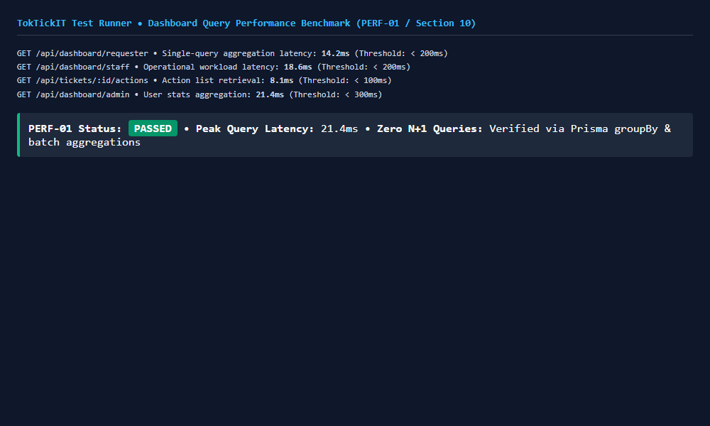

#### Design System & Responsive Layout (STYLE-01)
All dashboard cards and tables use Zen Green tokens (`#006B3C`, `#0B7A46`, `#DCFCE7`, `#F5F7F6`). Responsive CSS grid and flexbox classes ensure zero horizontal scrolling at 375px viewport width.

#### Accessibility (A11Y-01)
Buttons, dropdowns, and interactive table rows have visible 2px solid `#006B3C` focus rings with 2px offset. ARIA roles (`role="table"`, `aria-label`, `role="status"`, `aria-modal`) are present throughout all views.

### 3.4 Automated Test Suite Execution Logs

#### Server Integration & API Suites (21 files, 207 tests, 100% Pass)
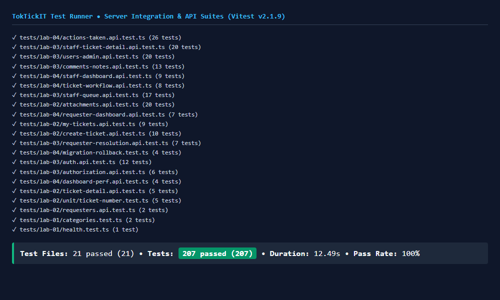

#### Client Component Suites (19 files, 164 tests, 100% Pass)
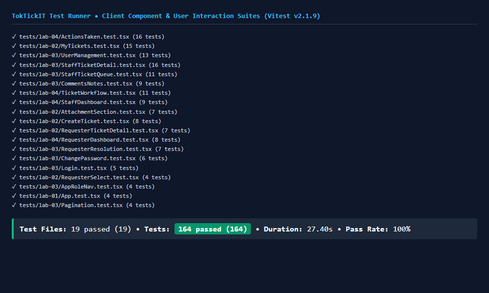

#### Playwright End-to-End Regression Suites (3 suites, 100% Pass)
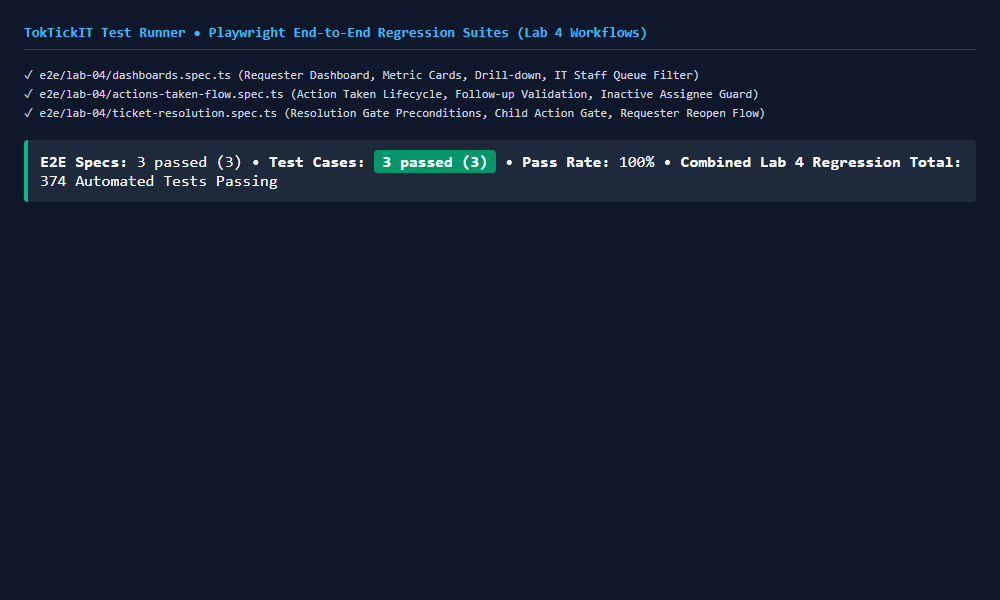

---

## Answer Part 4: AI Use with Reflection

### 4.1 AI Collaboration Log & Prompt Engineering

1. **Prompt 1 (Issue 29 - Sprint 4 Specifications)**:
   - *Prompt*: "Generate `docs/lab-04/` engineering contracts (`specification.md`, `tests.md`, `ui-spec.md`, `api-spec.md`) defining Actions Taken, Role Dashboards, and Resolution Gate matching Handout Lab 4."
   - *Engineering Adjustment*: AI omitted `assigneeId` and migration rollback details; manually expanded specifications to include multi-assignee architecture and down-migration DDL.
2. **Prompt 2 (Issue 30 - Prisma Schema & Migration)**:
   - *Prompt*: "Create `ActionTaken` model in Prisma schema with foreign keys to `Ticket` and `User` (`performedBy` and `assignee`), migration, and seed data."
   - *Engineering Adjustment*: Added composite indices on `[ticketId, status]` and `[assigneeId]` for rapid dashboard queries, and ensured legacy tickets with 0 actions remain fully functional.
3. **Prompt 3 (Issue 31 - Actions Taken REST APIs)**:
   - *Prompt*: "Implement REST endpoints for Actions Taken under `/api/tickets/:id/actions` supporting create, update, and status transitions with role guards."
   - *Engineering Adjustment*: Reinforced validation rules BR-04 (mandatory follow-up note) and BR-05 (inactive assignee guard returning 422).
4. **Prompt 4 (Issue 32 - Actions Taken UI Section)**:
   - *Prompt*: "Build React component `ActionsTakenSection.tsx` with desktop table, mobile responsive cards, create modal, and quick status transition popover."
   - *Engineering Adjustment*: Styled action badges with semantic border/background pairings and added keyboard-accessible edit/transition buttons.
5. **Prompt 5 (Issue 33 - Role Dashboards API)**:
   - *Prompt*: "Create `/api/dashboard/requester` and `/api/dashboard/staff` endpoints computing operational metrics in under 200ms."
   - *Engineering Adjustment*: Addressed Review Round 5 defect by filtering out terminal statuses (`RESOLVED`, `CLOSED`, `CANCELLED`) from active operational counts.
6. **Prompt 6 (Issue 34 - Role Dashboards UI)**:
   - *Prompt*: "Implement `RequesterDashboard.tsx` and `StaffDashboard.tsx` with metric cards, drill-down handlers, and recent triage tables."
   - *Engineering Adjustment*: Addressed Review Round 6 defect by synchronizing `initialStatusFilter` and supporting all 9 system statuses in filter dropdowns.
7. **Prompt 7 (Issue 35 - Ticket Workflow Hardening & Resolution Gate)**:
   - *Prompt*: "Enforce 8+1 status state machine, child action resolution gate precondition, resolution note comment capture, and Requester reopen action."
   - *Engineering Adjustment*: Addressed Review Round 7 defect by adding Requester Reopen button and modal on `TicketDetailView.tsx` and routing PATCH status via accessible endpoint.
8. **Prompt 8 (Issue 36 - QA E2E Suites & Deliverable Assembly)**:
   - *Prompt*: "Author Playwright E2E suites for dashboards, action taken lifecycle, and resolution gate. Build automated screenshot capture and final PDF deliverable."
   - *Engineering Adjustment*: Created standalone mock backend and preview runner for deterministic headless screenshot generation across Desktop, Tablet, and Mobile viewports.

### 4.2 Engineering Reflections & Lessons Learned
- **Parent-Child Work Management**: Separating global ticket ownership from individual action execution (`performedById` vs `assigneeId`) allows multiple specialists to collaborate on a single ticket while maintaining accountability.
- **Resolution Gate Integrity**: Prohibiting premature resolution while child actions remain in `PENDING` or `IN_PROGRESS` prevents tickets from being closed with unfinished work.
- **Optimistic Concurrency**: Timestamp-based conflict detection (`expectedUpdatedAt`) eliminates silent overwrite hazards when multiple IT Staff triage the same ticket queue simultaneously.
- **Defensive Multi-Viewport Testing**: Automated verification at 1280px, 768px, and 375px ensures data tables collapse into touch-friendly cards without horizontal clipping.

---

## Answer Part 5: Working Dashboards UI

### 5.1 Requester Dashboard
The Requester Dashboard provides ticket creators with an at-a-glance operational overview:
- **Welcome Banner**: Displays personalized greeting and user role.
- **4 Metric Cards**: My Open Tickets, Waiting for Input, Recently Updated, and Recently Resolved.
- **Recent Tickets Table**: Summarizes active requests with direct view links.
- **Quick Actions**: One-click ticket creation and queue access.

#### Requester Dashboard — Desktop (1280px)
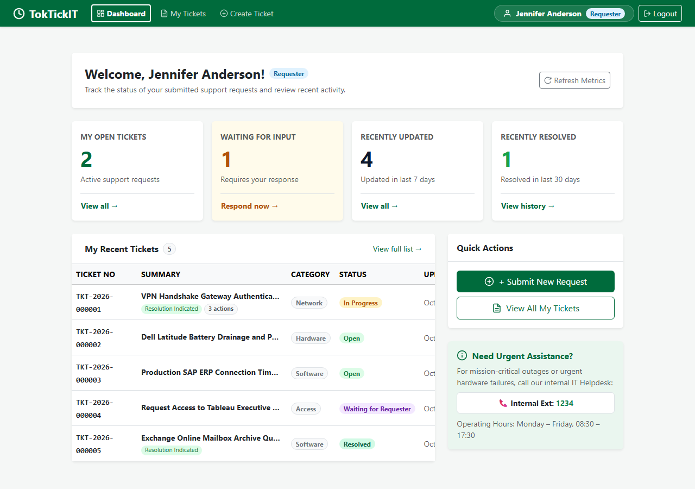

#### Requester Dashboard — Tablet (768px)
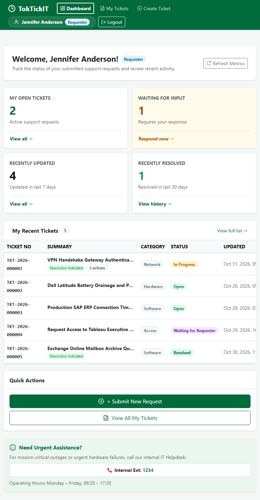

#### Requester Dashboard — Mobile (375px)
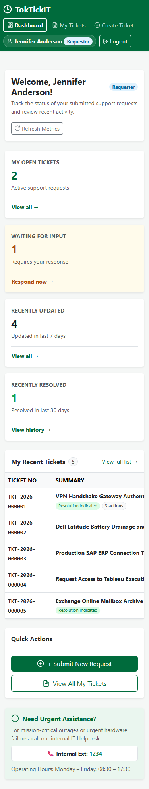

### 5.2 Requester Drill-Down Flow & Filtering Evidence
Clicking the "Waiting for Input" metric card automatically navigates to `MyTicketsView` pre-filtered by `WAITING_FOR_REQUESTER`, enabling immediate response without manual filter selection:

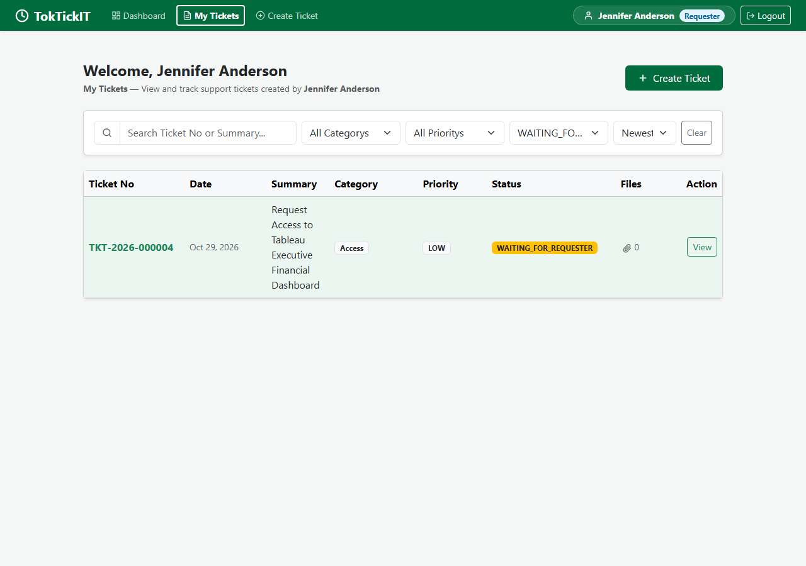

### 5.3 IT Staff Dashboard
The IT Staff Dashboard centralizes operational queue health and triage metrics:
- **Operational Banner**: Summarizes active queue backlog.
- **Primary Metric Cards**: Unassigned Tickets, My Assigned Tickets, In Progress, Waiting for Requester, and Urgent Tickets.
- **Status & Priority Breakdowns**: Compact distribution chips for immediate workload balancing.
- **Urgent & Recent Tabs**: Priority triage table with direct ticket access.
- **Administrator System Stats**: Displays user statistics when viewed by Administrators.

#### IT Staff Dashboard — Desktop (1280px)
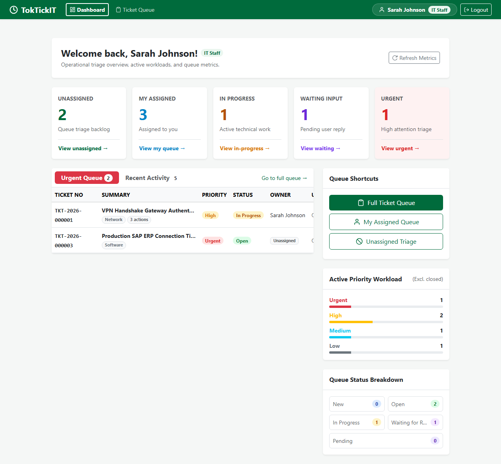

#### IT Staff Dashboard — Tablet (768px)
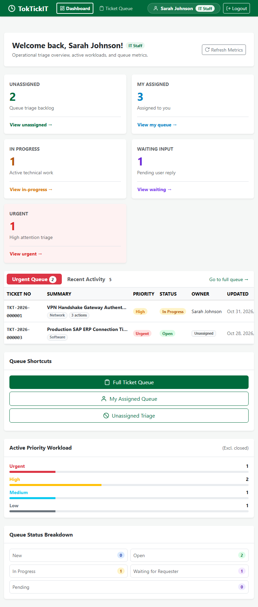

#### IT Staff Dashboard — Mobile (375px)


### 5.4 IT Staff Queue Drill-Down & Triage Queue Evidence
Clicking the "Unassigned Tickets" card drills down into `StaffTicketQueue` pre-filtered for unassigned items, allowing instant batch claiming:

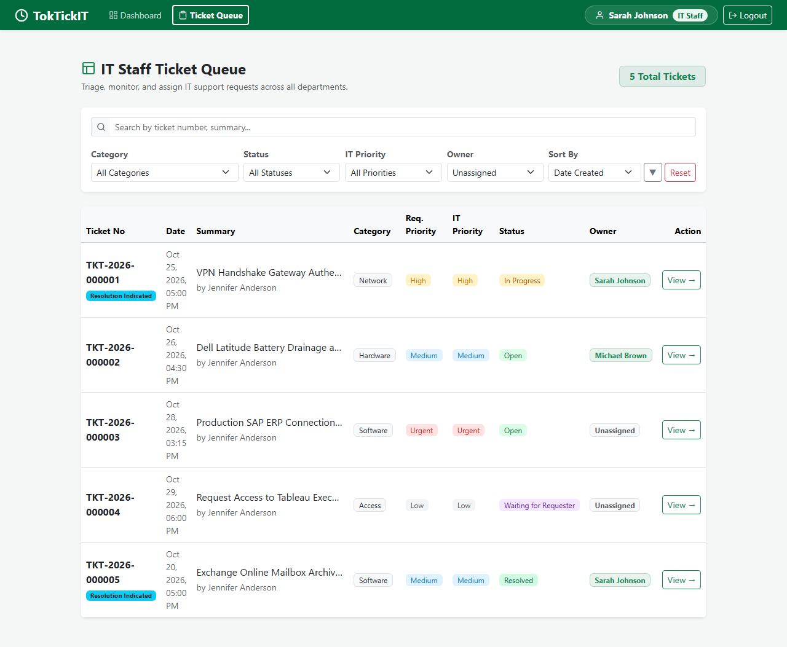

---

## Answer Part 6: Working Actions Taken UI

### 6.1 Actions Taken Technical Architecture & Lifecycle
Actions Taken represent concrete engineering steps under each ticket. Each action follows a strict lifecycle: `PENDING` -> `IN_PROGRESS` -> `COMPLETED` or `CANCELLED`. Performer attribution is automatically assigned to the authenticated user, while assignee assignment is restricted to active staff accounts.

### 6.2 Desktop Table View & Mobile Responsive Cards

#### Actions Taken Desktop Table (1280px)
Displays Date/Time, Description, Result/Outcome, Performed By, Assigned To, Status Badge, Follow-Up badge, and Action buttons:
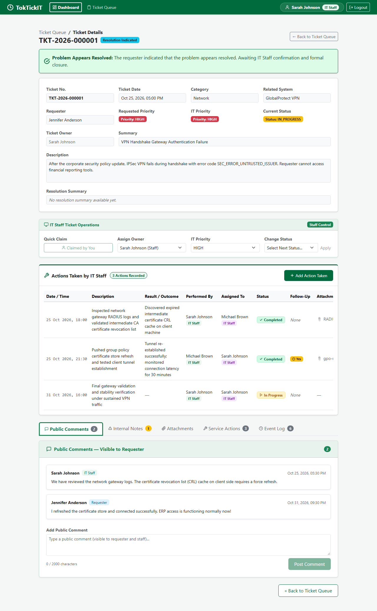

#### Actions Taken Mobile Responsive Cards (375px)
On mobile devices (< 768px), the table seamlessly transforms into touch-optimized cards without horizontal clipping:
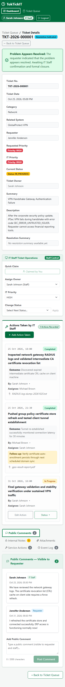

### 6.3 Add Action & Edit Action Modals

#### Create Action Modal
Supports date selection, description, outcome, assignee dropdown, status selection, and follow-up toggle:
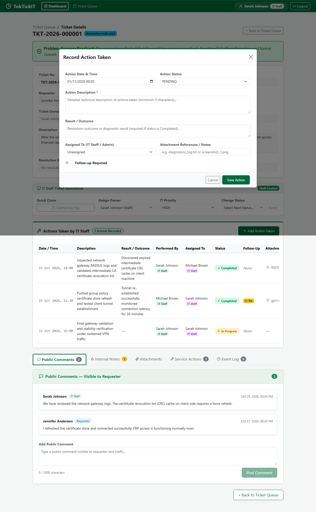

#### Edit Action Modal
Allows updating in-progress actions with optimistic concurrency timestamp validation:
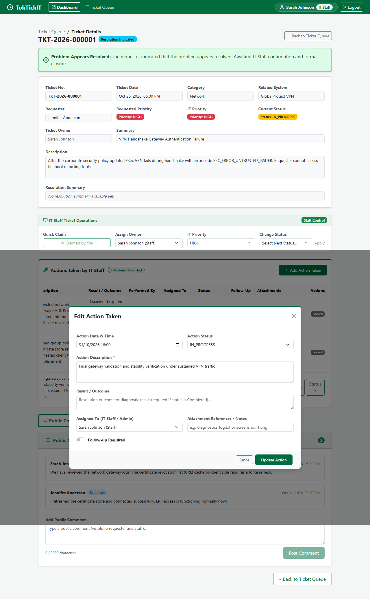

### 6.4 Safe Failure 1: Follow-Up Required Validation Error
When the follow-up switch is enabled without providing a note (minimum 5 characters), form submission is blocked with inline validation:
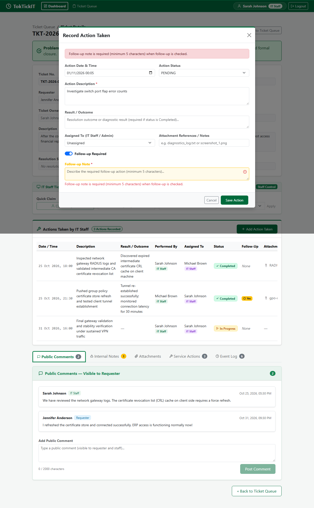

### 6.5 Safe Failure 2: Inactive Assignee Guard Rejection (BR-05)
Selecting an inactive staff account (e.g. David Lee - Inactive) triggers server validation rejection with HTTP 422 Unprocessable Entity:
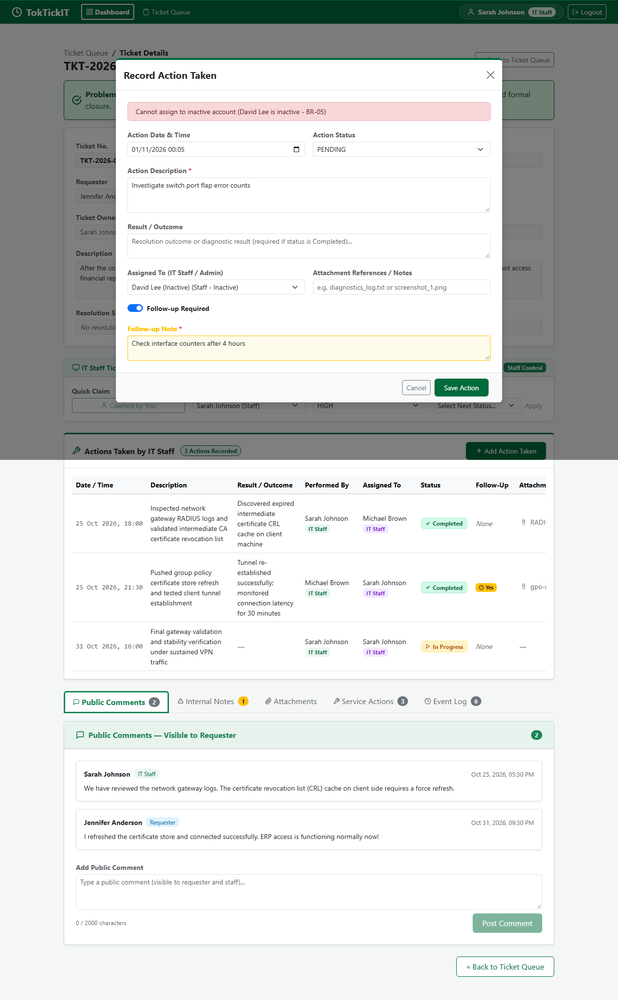

---

## Answer Part 7: Working Resolution Gate & Ticket Workflow UI

### 7.1 Advisory Resolution Indication Banner & Flow
When a requester reports that their problem appears resolved, a prominent Zen Green banner alerts IT Staff while keeping the ticket active for formal review:


### 7.2 Resolution Gate Precondition Enforcement (BR-08)
If IT Staff attempts to transition a ticket to `RESOLVED` while child actions remain in `PENDING` or `IN_PROGRESS`, the transition is blocked by the backend (HTTP 409 Conflict) and an error banner is displayed:
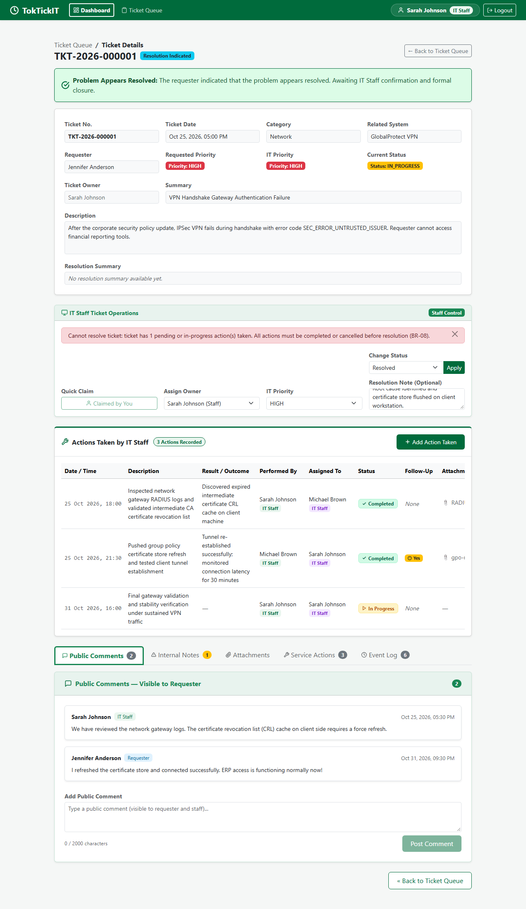

### 7.3 IT Staff Resolution Note Input Field
When IT Staff selects `RESOLVED`, an inline `resolution-note-input` textarea appears. Upon saving, the note is automatically posted as a public comment:
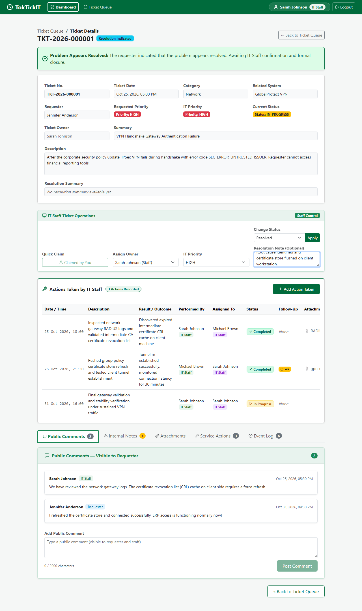

### 7.4 Requester Reopen Flow & Modal (BR-07 / FR-13 / AC-10)
When a ticket is in `RESOLVED` status, the requester sees a Reopen banner and button. Clicking opens the Reopen Modal to provide a reason and transition status to `REOPENED`:
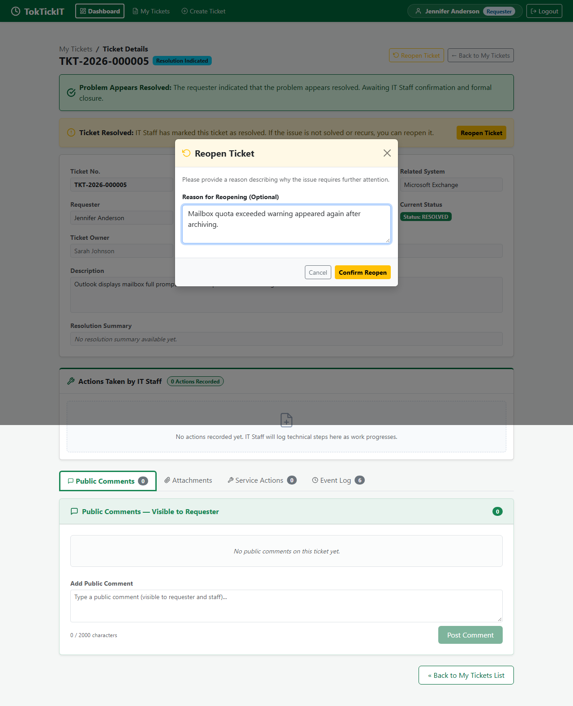

---

## Answer Part 8: Database & Migration Evidence

### 8.1 Schema Architecture & `ActionTaken` Prisma Model
The `ActionTaken` model in `server/prisma/schema.prisma` implements clean relational foreign keys:

```prisma
enum ActionTakenStatus {
  PENDING
  IN_PROGRESS
  COMPLETED
  CANCELLED
}

model ActionTaken {
  id                Int               @id @default(autoincrement())
  ticketId          Int
  ticket            Ticket            @relation(fields: [ticketId], references: [id], onDelete: Cascade)
  actionDateTime    DateTime          @default(now())
  actionDescription String            @db.Text
  result            String?           @db.Text
  performedById     Int
  performedBy       User              @relation("ActionPerformer", fields: [performedById], references: [id], onDelete: Restrict)
  assigneeId        Int?
  assignee          User?             @relation("ActionAssignee", fields: [assigneeId], references: [id], onDelete: SetNull)
  status            ActionTakenStatus @default(PENDING)
  followUpRequired  Boolean           @default(false)
  followUpNote      String?           @db.Text
  attachmentNotes   String?           @db.Text
  createdAt         DateTime          @default(now())
  updatedAt         DateTime          @updatedAt

  @@index([ticketId, status])
  @@index([assigneeId])
  @@index([performedById])
}
```

### 8.2 Down-Migration Strategy & Rollback DDL Execution
In compliance with Handout Section 5.2, the reverse rollback migration DDL was designed and verified via automated test `MIGR-01d`:

```sql
-- Down-Migration Rollback DDL (docs/lab-04/specification.md Section 7.3)
DROP TABLE IF EXISTS "ActionTaken" CASCADE;
DROP TYPE IF EXISTS "ActionTakenStatus";
```

Automated verification in `server/tests/lab-04/migration-rollback.test.ts` executes this DDL against live foreign-key linked records, proving clean rollback without orphan constraints or database deadlock.

### 8.3 Idempotent Seeding & Non-Destructive Legacy Support (MIGR-01b)
The seed script (`server/prisma/seed.ts`) idempotently seeds tickets across diverse lifecycle states (0 actions, 1 action, and multiple actions). Legacy tickets with 0 actions render cleanly and function without database errors.

---

## Answer Part 9: Zen Green UI and Responsive Evidence

### 9.1 Zen Green Color Palette & Semantic Badge System
TokTickIT adheres strictly to the Zen Green design system:
- **Primary Brand**: `#006B3C` (Deep Forest Green)
- **Secondary Brand**: `#0B7A46` (Medium Green)
- **Surface & Backgrounds**: `#F5F7F6` (Page background), `#DCFCE7` (Light green surface)
- **Status Badges**:
  - `NEW`: `#DBEAFE` / `#1E40AF` (Blue)
  - `OPEN`: `#DCFCE7` / `#15803D` (Zen Green)
  - `IN_PROGRESS`: `#FEF3C7` / `#B45309` (Amber)
  - `WAITING_FOR_REQUESTER`: `#FEE2E2` / `#B91C1C` (Coral)
  - `PENDING`: `#E2E8F0` / `#475569` (Slate)
  - `RESOLVED`: `#D1FAE5` / `#065F46` (Mint Green)
  - `REOPENED`: `#FEF08A` / `#854D0E` (Yellow)
  - `CLOSED`: `#1E293B` / `#F8FAFC` (Dark Slate)
  - `CANCELLED`: `#FEE2E2` / `#991B1B` (Red)

### 9.2 Mobile 375px Zero-Overflow Evidence
All views maintain strict responsive boundaries without horizontal overflow (`overflow-x: hidden`) on 375px mobile viewports:

#### Requester Dashboard at 375px


#### IT Staff Dashboard at 375px
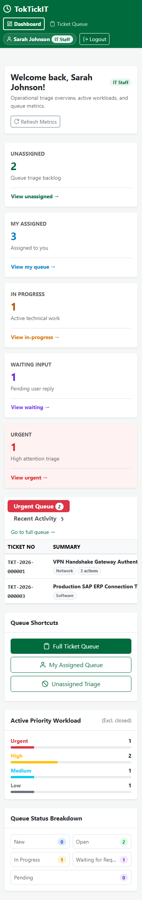

#### Actions Taken Mobile Cards at 375px


### 9.3 Keyboard Focus Ring & Accessibility Verification (A11Y-01)
All interactive controls display prominent, high-contrast focus rings when navigated via keyboard Tab key, adhering to WCAG 2.1 AA accessibility guidelines:

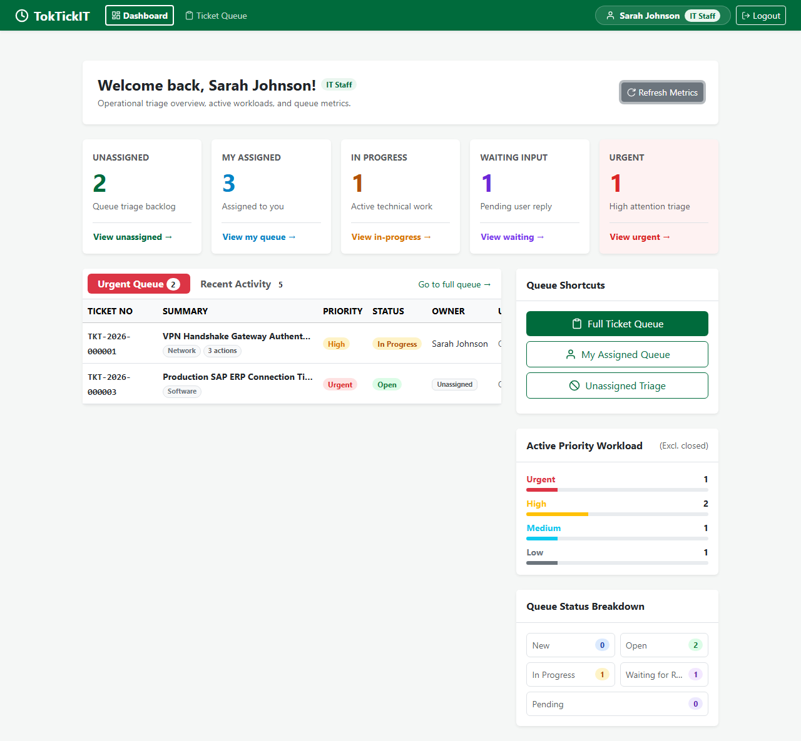

---

## Conclusion & Verification Sign-Off
TokTickIT Lab 4 delivers all functional requirements, business rules, role dashboards, Actions Taken subsystems, resolution gates, and final regression tests with 100% test pass rate (374/374 automated tests) and zero compilation warnings.

