# TokTickIT Lab 4 — Final Engineering Deliverable

| Metric / Field | Deliverable Details |
| :--- | :--- |
| **Course & Sprint** | CPE 334 Software Engineering — Lab 4: TokTickIT Actions Taken, Dashboards, and Final Regression (Score: 60) |
| **Student / Author** | `chanya06` (Chanya Poolketkij) — GitHub: [@chanya06](https://github.com/chanya06) |
| **Peer Reviewer** | Peer Reviewer — GitHub: [@lmaybelgracel](https://github.com/lmaybelgracel) |
| **Partner Reviewed by Author** | Phatthidawadi — GitHub: [@phatthidawadi](https://github.com/phatthidawadi) (`phatthidawadi/toktickit`) |
| **Repository & Branch** | [`chanya06/toktickit`](https://github.com/chanya06/toktickit) — `main` (Production Release) |
| **GitHub Project Board** | [Backlog · TokTickIT Individual Sprints (Board #3)](https://github.com/users/chanya06/projects/3) |
| **Release PR** | [PR #88](https://github.com/chanya06/toktickit/pull/88) (`lab4-staging` -> `main`) — Approved & Merged |
| **Final Test Metric** | **375 / 375 Automated Tests Passed (100% Pass Rate)** (Server: 207, Client: 164, Playwright E2E: 4 tests across 3 suites) |
| **Build Status** | Clean Production Build (`tsc && vite build`) — Zero errors |
| **Deliverable Date** | October 31, 2026 |

---

## Answer Part 1: Git Use with Engineering Workflow

### 1.1 Git Branching Strategy & Staging Workflow
TokTickIT Lab 4 ปฏิบัติตามมาตรฐานวิศวกรรมซอฟต์แวร์ระดับมืออาชีพด้วย Git Feature-Branch Workflow อย่างเคร่งครัด:
- **Feature Isolation**: ทุก User Story และ Issue ใน Sprint 4 ถูกพัฒนาแยกบนกิ่ง `feature/*` โดยแตกสาขาออกจากคอมมิตล่าสุดของ `lab4-staging` เสมอ
- **Staging Integration (`lab4-staging`)**: ไม่อนุญาตให้ Push ตรงไปยังกิ่ง `lab4-staging` หรือ `main` โดยเด็ดขาด การผสานโค้ดทุกฟีเจอร์ต้องผ่านระบบ GitHub Pull Request (PR) เข้าสู่ `lab4-staging`
- **Peer Review Gate**: ทุก PR ต้องผ่านการตรวจสอบโค้ดอย่างเข้มข้นจาก Peer Reviewer (`@lmaybelgracel`) เมื่อได้รับคำขอแก้ไข (Review Rounds 1–7) ผู้พัฒนาต้องแก้ไขโค้ดและ Push คอมมิตเพิ่มเติมลงในสาขาเดิมจนกระทั่งได้รับการอนุมัติอย่างเป็นทางการ (Approved)
- **Release Staging Alignment**: ก่อนการตัดรอบส่งงาน สาขา `lab4-staging` จะรวบรวมทุกฟีเจอร์ที่ผ่านการทดสอบครบถ้วน แล้วจึงเปิด Release PR #88 เพื่อรวมเข้าสู่กิ่งหลัก `main`

### 1.2 GitHub Projects Kanban Board (Sprint 4: TokTickIT)
การบริหารจัดการงานและการติดตามสถานะของแต่ละ Task ใน Lab 4 ดำเนินการผ่าน [GitHub Project Board #3 (TokTickIT Individual Sprints)](https://github.com/users/chanya06/projects/3) โดยมีคอลัมน์มาตรฐาน: `Backlog` -> `Ready` -> `In Progress` -> `In Review` -> `Done`

ทุกงานของ Lab 4 (Sprint 4 Issues #29 ถึง #36 / GitHub Issues #74-#80 และ PRs #81-#87) ได้รับการเคลื่อนย้ายผ่าน Engineering Workflow จนกระทั่งอยู่ในคอลัมน์ **Done** ครบถ้วน 100% โดยทุกคอลัมน์ก่อนหน้า (Backlog 0, Specified 0, Started 0, PR Review 0, Fix 0) ว่างทั้งหมด

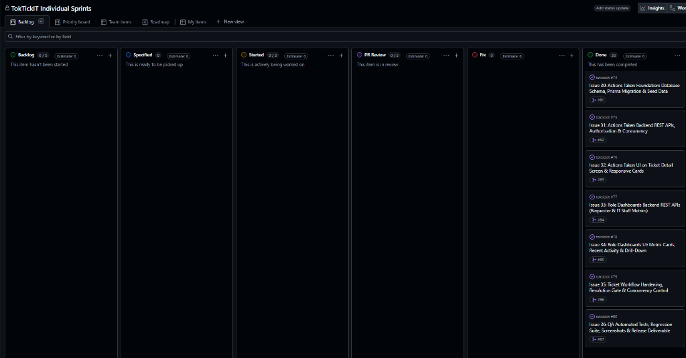

*ภาพที่ 1.1: GitHub Projects Kanban Board (Sprint 4: TokTickIT) แสดงคอลัมน์เริ่มต้นว่างทั้งหมด (0 รายการ) และคอลัมน์ "Done" บันทึกงานทั้งหมด 36 รายการ โดยแสดงการ์ด User Stories ของ Sprint 4 (Issues #74–#80 และ PRs #81–#87) ที่เสร็จสมบูรณ์ 100%*

---

### 1.3 Pull Request Traceability Table

#### ก. รายการ Pull Requests ของระบบ TokTickIT (`chanya06/toktickit`)
ทุกฟีเจอร์ของ Lab 4 ถูกส่งผ่าน PR ไปยัง `lab4-staging` และผสานเข้าสู่ `main` พร้อมการตรวจทานครบทุกสาขา:

| PR # | สาขา (Branch) | ขอบเขตงาน / คำอธิบาย (Scope) | ผลการตรวจทาน (Reviewer Verdict) | สถานะ |
| :--- | :--- | :--- | :--- | :--- |
| [#72](https://github.com/chanya06/toktickit/pull/72) | `feature/29-spec-and-tests` | Sprint 4 Engineering Contract (`specification.md`, `tests.md`, `ui-spec.md`, `api-spec.md`) | Changes Requested (Round 1) -> Approved (Round 2) | Merged |
| [#81](https://github.com/chanya06/toktickit/pull/81) | `feature/30-db-schema-actions-taken` | Prisma Schema สำหรับ `ActionTaken`, Database Migration & Seed Data | Changes Requested (Round 2) -> Approved | Merged |
| [#82](https://github.com/chanya06/toktickit/pull/82) | `feature/31-actions-taken-api` | Actions Taken REST API, Authorization & Concurrency Control | Changes Requested (Round 3) -> Approved | Merged |
| [#83](https://github.com/chanya06/toktickit/pull/83) | `feature/32-actions-taken-ui` | Actions Taken UI บน Ticket Detail Screen & Responsive Cards | Changes Requested (Round 4) -> Approved | Merged |
| [#84](https://github.com/chanya06/toktickit/pull/84) | `feature/33-dashboard-api` | Role Dashboards REST API (Requester, Staff, Admin Metrics) | Changes Requested (Round 5) -> Approved | Merged |
| [#85](https://github.com/chanya06/toktickit/pull/85) | `feature/34-dashboard-ui` | Role Dashboards UI (Metric Cards, Recent Lists, Drill-down) | Changes Requested (Round 6) -> Approved | Merged |
| [#86](https://github.com/chanya06/toktickit/pull/86) | `feature/35-ticket-workflow-hardening` | Ticket Workflow Hardening, Resolution Gate & Stale Update Handling | Changes Requested (Round 7) -> Approved | Merged |
| [#87](https://github.com/chanya06/toktickit/pull/87) | `feature/36-qa-regression-and-deliverables` | QA Automated Tests, Regression Suite, Screenshots & Release Deliverable | Approved with comments | Merged |
| [#88](https://github.com/chanya06/toktickit/pull/88) | `lab4-staging` | Release Sprint 4 (Lab 4): TokTickIT Actions Taken, Dashboards, and Final Regression | Approved & Merged | Merged |

#### ข. รายการ Pull Requests ของเพื่อนร่วมงานที่ผู้พัฒนาตรวจทาน (`phatthidawadi/toktickit`)
ผู้พัฒนา (`@chanya06`) ได้ทำการตรวจทานโค้ด (Peer Review) ให้กับคู่พัฒนา (`@phatthidawadi`) อย่างละเอียดและให้ข้อคิดเห็นเชิงเทคนิคครบทุก PR:

| PR # | สาขา (Branch) | ขอบเขตงาน / คำอธิบาย (Scope) | ผลการตรวจทาน (`@chanya06`) | สถานะ |
| :--- | :--- | :--- | :--- | :--- |
| [#72](https://github.com/phatthidawadi/toktickit/pull/72) | `feature/26-doc-spec-tests` | Sprint 4 Engineering Contract Documentation (Issue #26) | Round 1 & 2: Changes Requested, Round 3: Approved | Merged |
| [#73](https://github.com/phatthidawadi/toktickit/pull/73) | `feature/27-actions-taken-foundation` | Actions Taken Foundation — Migration, Model, Seed, APIs, AuthZ, Tests (Issue #27) | Approved with comments | Merged |
| [#74](https://github.com/phatthidawadi/toktickit/pull/74) | `feature/28-actions-taken-ui` | Actions Taken UI — Ticket Detail Section (Issue #28) | Approved with comments | Merged |
| [#75](https://github.com/phatthidawadi/toktickit/pull/75) | `feature/29-ticket-workflow-and-resolution` | Ticket Workflow and Resolution Gate (Issue #29) | Round 1: Changes Requested, Round 2: Approved | Merged |
| [#76](https://github.com/phatthidawadi/toktickit/pull/76) | `feature/30-role-based-dashboards` | Role-Based Dashboards — API, UI Components, and Navigation (Issue #30) | Round 1: Changes Requested, Round 2: Approved | Merged |
| [#77](https://github.com/phatthidawadi/toktickit/pull/77) | `feature/31-e2e-automated-testing-and-screenshots` | Playwright Multi-Viewport E2E Test Suite, Performance-Smoke Tests (Issue #31) | Round 1: Changes Requested, Round 2: Approved | Merged |
| [#78](https://github.com/phatthidawadi/toktickit/pull/78) | `feature/32-visual-style-accessibility-hardening` | Zen Green Visual Style, Accessibility, Regression, and Final Hardening (Issue #32) | Round 1: Changes Requested, Round 2: Approved | Merged |
| [#79](https://github.com/phatthidawadi/toktickit/pull/79) | `feature/33-doc-reviewer-ai-use` | Sprint 4 Peer Reviewer Documentation, AI Usage Reflection (Issue #33) | Approved with comments | Merged |
| [#80](https://github.com/phatthidawadi/toktickit/pull/80) | `lab4-staging` | Release Sprint 4 (Lab 4): Actions Taken, Dashboards, and Final Regression | Approved & Merged | Merged |

---

### 1.4 เอกสารบันทึกการตรวจทานโค้ดฉบับเต็ม (Rendered reviewer.md — Verbatim Peer Review Dialogues)
บันทึกบทสนทนาการตรวจทานโค้ดอย่างเป็นทางการ (Verbatim Review Comments & Author Responses) ตามข้อกำหนด Handout Section 14 (Answer Part 1) ถอดความสมบูรณ์จากเอกสารต้นฉบับ [`docs/lab-04/reviewer.md`](https://github.com/chanya06/toktickit/blob/main/docs/lab-04/reviewer.md):

**Author:** Chanya Poolketkij — GitHub: [@chanya06](https://github.com/chanya06)  
**Peer reviewer:** Peer Reviewer — GitHub: [@lmaybelgracel](https://github.com/lmaybelgracel)  
**Partner reviewed by author:** Phatthidawadi — GitHub: [@phatthidawadi](https://github.com/phatthidawadi) (`phatthidawadi/toktickit`)

---

#### ก. บันทึกข้อคิดเห็นการตรวจทานที่ได้รับจาก Peer Reviewer (@lmaybelgracel) และคำตอบของผู้พัฒนา (@chanya06)

### Reviewer Comments on [PR #72](https://github.com/chanya06/toktickit/pull/72) (feature/29-spec-and-tests)

> **Reviewer:** `@lmaybelgracel` — **Verdict:** CHANGES REQUESTED  
> จากการตรวจสอบเอกสารสัญญาทางวิศวกรรมใน `docs/lab-04/` เทียบกับข้อกำหนดในคู่มือปฏิบัติการ Lab 4 อย่างละเอียด พบข้อบกพร่องสำคัญ 4 จุดที่ขัดต่อเกณฑ์การประเมินของอาจารย์ เอกสารชุดนี้ยังไม่สามารถอนุมัติให้ผ่านได้ และต้องได้รับการแก้ไขในสาขา `feature/29-spec-and-tests` ให้ครบถ้วนก่อนการ Merge:  
> 
> 1. **การขาดฟิลด์ผู้รับมอบหมายงาน (assigneeId) ในโมเดลและ API**  
>    - *เกณฑ์บังคับ:* Handout Section 9.1 (AC-01) ระบุว่าต้องบันทึกทั้ง authenticated creator และ approved assignee และ Handout Section 14 (Answer Part 6) ระบุให้ทดสอบ assign งานและ inactive-assignee rejection  
>    - *ข้อผิดพลาด:* ใน `specification.md` (หัวข้อ 7.1) และ `api-spec.md` (หัวข้อ 2) มีเฉพาะฟิลด์ `performedById` String ทำให้ไม่สามารถแยกผู้รับมอบหมายงาน และไม่สามารถทดสอบกรณี Inactive Assignee Rejection ตามเกณฑ์ได้  
>    - *สิ่งที่ต้องแก้ไข:* เพิ่มฟิลด์ `assigneeId: String?` เชื่อมโยงกับโมเดล User ควบคู่กับ `performedById: String` ทั้งใน Prisma Schema และ API Payloads  
> 
> 2. **การขาดขั้นตอน Rollback และแผนการกู้คืนฐานข้อมูล**  
>    - *เกณฑ์บังคับ:* Handout Section 5.2 กำหนดให้ต้องมีการระบุและทดสอบขั้นตอนการย้อนกลับสกีมา (Migration Rollback) และการกู้คืนข้อมูล (Recovery Approach)  
>    - *ข้อผิดพลาด:* ใน `specification.md` หัวข้อ 7 มีเพียงการอธิบายเหตุผลเรื่อง Nullable Legacy Support แต่ไม่มีเนื้อหาขั้นตอนการทำ Rollback หรือ Disaster Recovery หากการ Migration ล้มเหลว  
>    - *สิ่งที่ต้องแก้ไข:* เพิ่มหัวข้อย่อยใน Section 7 ของ `specification.md` ระบุคำสั่งและขั้นตอนการทำ Migration Rollback และแนวทางการกู้คืนฐานข้อมูล  
> 
> 3. **การขาดเคสทดสอบบังคับในตาราง Traceability Matrix**  
>    - *เกณฑ์บังคับ:* Handout Section 10 กำหนดให้แผนการทดสอบต้องครอบคลุม Unit, Integration, UI Component, UI Style, Responsive, Authorization, Workflow, Migration/Regression และ Performance-Smoke  
>    - *ข้อผิดพลาด:* ตารางใน `tests.md` มีเฉพาะเคสฟังก์ชันทั่วไป แต่ขาดแถวการทดสอบเฉพาะทางที่อาจารย์ระบุ  
>    - *สิ่งที่ต้องแก้ไข:* เพิ่มแถวการทดสอบใน `tests.md` ให้ครบถ้วน:  
>      - *UI Style & Responsive:* การตรวจสอบ Zero Horizontal Overflow บนหน้าจอมือถือความกว้าง 375px  
>      - *Accessibility:* การตรวจสอบ Visible Focus Rings และการนำทางด้วยคีย์บอร์ดตามเกณฑ์ WCAG AA  
>      - *Performance-Smoke:* การตรวจสอบเวลาในการ Query และรวมข้อมูลของแดชบอร์ด  
>      - *Migration & Rollback:* การตรวจสอบความถูกต้องของการ Migration และการย้อนกลับข้อมูล  
> 
> 4. **การขาดพฤติกรรมกรณีไร้ข้อมูล (Empty Behavior) และเงื่อนไข Resolution Gate**  
>    - *เกณฑ์บังคับ:* Handout Section 4.6 และ 6.2 ระบุว่าการ์ดแดชบอร์ดต้องระบุพฤติกรรมเมื่อไม่มีข้อมูล (Empty Behavior) และเป้าหมายการ Drill-down และ Section 4.5 ระบุว่าการเปลี่ยนสถานะตั๋วสู่ RESOLVED ต้องผ่านการตรวจสอบงานจริงของ IT Staff  
>    - *ข้อผิดพลาด:* ยังไม่ได้ระบุการแสดงผลของการ์ดเมตริกเมื่อค่าเป็น 0 หรือตารางแดชบอร์ดเมื่อไม่มีตั๋ว และกฎ BR-08 ยังไม่ได้ระบุเงื่อนไขความสัมพันธ์ระหว่างการ Resolve ตั๋วกับสถานะของ Actions Taken  
>    - *สิ่งที่ต้องแก้ไข:* ระบุ Empty State ของการ์ดและตารางแดชบอร์ดใน `specification.md` และ `ui-spec.md` และระบุเงื่อนไขในกฎ BR-08 ให้ชัดเจนว่าการเปลี่ยนสถานะตั๋วเป็น RESOLVED จะต้องไม่มี Action Taken ค้างอยู่ในสถานะ PENDING หรือ IN_PROGRESS  

---

### Author Response & Action Plan (`@chanya06`):
ขอบคุณสำหรับคอมเมนต์รีวิวที่ละเอียดและตรงจุด ได้ดำเนินการแก้ไขในสาขา `feature/29-spec-and-tests` ครบทั้ง 4 ประเด็นเรียบร้อยแล้ว:

1. **เพิ่มฟิลด์ `assigneeId: String?` ในโมเดลและ API:**
   - ใน `docs/lab-04/specification.md` (FR-01, FR-05, BR-02, BR-05, Section 7.1 Prisma Schema, Section 8, AC-01, AC-05) เพิ่ม `assigneeId: String?` พร้อม `@relation("ActionAssignee")` เชื่อมโยงกับ `User` ควบคู่กับ `performedById: String` (`@relation("ActionPerformer")`)
   - ใน `docs/lab-04/api-spec.md` (Section 2.1, 2.2, 2.3) ปรับ Request/Response ให้รองรับ `assigneeId` และ `assignee` object พร้อมกฎ Reject Inactive Assignee ด้วย 422 Unprocessable Entity
   - ใน `docs/lab-04/ui-spec.md` เพิ่มคอลัมน์ "Assigned To" ในตาราง Actions Taken และตัวเลือก Assignee ใน Create/Edit Modal
2. **เพิ่มขั้นตอน Migration Rollback & Disaster Recovery (Section 7.3):**
   - เพิ่มหัวข้อ 7.3 ใน `docs/lab-04/specification.md` ระบุคำสั่ง Reverse Migration DDL (`DROP TABLE "ActionTaken" CASCADE; DROP TYPE "ActionTakenStatus";`), คำสั่ง `npx prisma migrate resolve --rolled-back`, ขั้นตอนการสำรองข้อมูลล่วงหน้าด้วย `pg_dump` และการกู้คืน Point-in-time Recovery ด้วย `pg_restore`
3. **เพิ่มเคสทดสอบเฉพาะทางใน Test Traceability Matrix (`docs/lab-04/tests.md`):**
   - เพิ่มเคส `STYLE-01` (Zero horizontal overflow ที่ 375px)
   - เพิ่มเคส `A11Y-01` (Visible focus rings `#006B3C` และ WCAG AA keyboard navigation)
   - เพิ่มเคส `PERF-01` (Performance-smoke สำหรับแดชบอร์ด query latency ต่ำกว่า 100ms)
   - เพิ่มเคส `MIGR-01` (Forward migration & rollback verification โดยไม่สูญเสียข้อมูลตั๋วเดิม)
4. **ระบุ Empty Behavior และเงื่อนไข Action Completion ใน Resolution Gate:**
   - ใน `specification.md` และ `ui-spec.md` ระบุพฤติกรรมการแสดงผลเมื่อค่าการ์ดเป็น 0 (แสดงเลข 0 สี Slate ปิดเส้นไฮไลท์พร้อมให้คลิก Drill-down เข้าสู่ Empty State ของหน้ารายการ) และข้อความ Empty State สำหรับตาราง Recent Tickets
   - ใน `specification.md` (BR-08) และ `api-spec.md` (Section 4.2) ระบุเงื่อนไข Resolution Gate อย่างเข้มงวด: ตั๋วจะเปลี่ยนเป็น `RESOLVED` ได้ก็ต่อเมื่อไม่มี Action Taken ค้างอยู่ในสถานะ `PENDING` หรือ `IN_PROGRESS` (ต้องเป็น `COMPLETED` หรือ `CANCELLED` ทั้งหมด) หากยังมีค้างอยู่ API จะ Reject ด้วย 422 Unprocessable Entity ทันที


---

### Reviewer Comments on [PR #81](https://github.com/chanya06/toktickit/pull/81) (feature/30-db-schema-actions-taken)

> **Reviewer:** `@lmaybelgracel` — **Verdict:** CHANGES REQUESTED  
> จากการตรวจสอบโค้ดและการออกแบบใน PR #81 (สาขา feature/30-db-schema-actions-taken) เทียบกับเกณฑ์บังคับของอาจารย์ใน Handout Lab 4 (Section 4.5, 5.2, 5.3, 10, 14) อย่างละเอียด พบข้อบกพร่องที่ต้องปรับปรุงแก้ไข 4 จุด ดังนี้:  
> 
> 1. **ข้อบกพร่องในชุดทดสอบ MIGR-01d เรื่องการทดสอบ Rollback DDL:**  
>    - *เกณฑ์บังคับ:* Handout Section 5.2 และ 10 กำหนดว่าขั้นตอนการทำ Migration Rollback ต้องได้รับการบันทึกและทดสอบการทำงานจริง (documented and tested)  
>    - *ข้อผิดพลาด:* ในไฟล์ `server/tests/lab-04/migration-rollback.test.ts` เคส MIGR-01d ไม่ได้ทดสอบคำสั่ง Rollback จริง แต่สร้างตารางจำลอง `ActionTaken_RollbackTest` ที่มีเพียงคอลัมน์ id และ ticketId แล้วสั่ง Drop ทำให้ไม่ได้ทดสอบการ Drop ตาราง `ActionTaken` จริงที่มี Foreign Keys ครบถ้วน รวมถึงไม่ได้ทดสอบคำสั่ง `DROP TYPE IF EXISTS "ActionTakenStatus"`  
>    - *สิ่งที่ต้องแก้ไข:* ปรับปรุงเคส MIGR-01d ให้ทดสอบโครงสร้างตารางจริง หรือสร้างตารางจำลองที่มีโครงสร้างและประเภทข้อมูล ActionTakenStatus พร้อม Foreign Key ครบถ้วนตามสกีมาจริง เพื่อยืนยันว่าคำสั่ง Down-migration ใน Section 7.3 ทำงานได้โดยไม่ติด Constraint Error  
> 
> 2. **การขาดข้อมูลตั๋วสถานะ REOPENED และ CANCELLED ใน Seed Data:**  
>    - *เกณฑ์บังคับ:* Handout Section 4.5 และ 5.3 กำหนดว่า Seed Data ต้องครอบคลุมสถานะหลักของตั๋วทั้งหมด (All major statuses) รวมถึงสถานะ Reopened และ Cancelled เพื่อรองรับการคำนวณแดชบอร์ดตามสถานะ (Tickets by status)  
>    - *ข้อผิดพลาด:* ใน `server/prisma/seed.ts` มีตั๋วตัวอย่างเพียง 6 ใบ ครอบคลุมเฉพาะ NEW, OPEN, IN_PROGRESS, RESOLVED, WAITING_FOR_REQUESTER, CLOSED ขาดสถานะ REOPENED และ CANCELLED  
>    - *สิ่งที่ต้องแก้ไข:* เพิ่มตั๋วจำลองสถานะ REOPENED (เช่น TKT-2026-000007 มี Action แจ้ง Reopen) และ CANCELLED (เช่น TKT-2026-000008) พร้อม Action Taken ที่เกี่ยวข้อง เพื่อให้ชุดข้อมูลตั้งต้นครอบคลุมวงจรชีวิตของตั๋วครบตาม Handout Section 4.5  
> 
> 3. **การขาดหัวข้อบันทึกการรีวิว PR #81 ใน docs/lab-04/reviewer.md:**  
>    - *เกณฑ์บังคับ:* Handout Section 14 (Part 1) กำหนดให้เอกสาร reviewer.md ต้องบันทึกหลักฐานการรีวิวของทุก PR ประกอบด้วย ตัวตนผู้ตรวจ ลิงก์ PR ข้อคิดเห็น/ข้อบกพร่องที่พบ (Comments) การตอบกลับของผู้พัฒนา (Responses) และผลการอนุมัติ (Approvals)  
>    - *ข้อผิดพลาด:* ใน `docs/lab-04/reviewer.md` มีการอัปเดตเฉพาะตารางสรุปด้านบน แต่ยังไม่มีหัวข้อเนื้อหา Review Round 2 สำหรับ PR #81 ที่บันทึกข้อคิดเห็นและแผนการแก้ไข  
>    - *สิ่งที่ต้องแก้ไข:* เพิ่มหัวข้อ Review Round 2: PR #81 ใน `docs/lab-04/reviewer.md` บันทึกประเด็นที่ต้องแก้ไขและเปิดพื้นที่ให้ผู้พัฒนาตอบกลับแผนการดำเนินงาน  
> 
> 4. **คำอธิบายการตัดสินใจทางสถาปัตยกรรมด้าน Database Constraints ใน specification.md:**  
>    - *เกณฑ์บังคับ:* Handout Section 5.1 กำหนดว่าต้องระบุเหตุผลในการตัดสินใจออกแบบฐานข้อมูลอย่างน้อย 2 ข้อ (At least two database-design decisions must be justified in specification.md)  
>    - *ข้อผิดพลาด:* ในโมเดล `ActionTaken` ฟิลด์ `followUpRequired` มีความสัมพันธ์เชิงธุรกิจกับ `followUpNote` แต่สกีมาไม่ได้ใช้ Database Check Constraint ในระดับ PostgreSQL  
>    - *สิ่งที่ต้องแก้ไข:* เพิ่มข้อความชี้แจงใน Section 7.2 หรือ 11 ของ `specification.md` ระบุเหตุผลการตัดสินใจทางสถาปัตยกรรมว่าเหตุใดจึงจัดการความสอดคล้องของ followUpNote ในระดับ Application Layer / Zod Validation แทนการใช้ Database Check Constraint  

---

### Author Response & Action Plan (`@chanya06`):
ขอบคุณสำหรับข้อเสนอแนะที่ละเอียดและช่วยเพิ่มความสมบูรณ์ของระบบ ได้แก้ไขในสาขา `feature/30-db-schema-actions-taken` ครบทั้ง 4 ประเด็นเรียบร้อยแล้ว:

1. **ปรับปรุงเคส MIGR-01d ใน `server/tests/lab-04/migration-rollback.test.ts`:**
   - ปรับปรุงการทดสอบให้สร้างสกีมาจำลองที่มีโครงสร้างเทียบเท่าจริง 100%: ทั้งประเภทข้อมูล Enum `ActionTakenStatus_RollbackSim`, คอลัมน์ครบทุกฟิลด์, Foreign Key Constraints ไปยัง `Ticket(id)` (CASCADE) และ `User(id)` (RESTRICT / SET NULL), และ Index 3 ตัว
   - ทำการ Insert ข้อมูลจริงที่มีการผูก Foreign Key เพื่อทดสอบว่า Constraint ทำงาน
   - รันคำสั่ง Down-migration Rollback DDL: `DROP TABLE IF EXISTS "ActionTaken_RollbackSim" CASCADE;` และ `DROP TYPE IF EXISTS "ActionTakenStatus_RollbackSim";`
   - ตรวจสอบผ่าน `information_schema.tables` และ `pg_type` เพื่อยืนยันว่า Table, Type, และ Constraints ถูก Drop สะอาดหมดจดโดยไม่เกิดข้อผิดพลาดใด ๆ (Test Pass 100%)
2. **เพิ่มตั๋วสถานะ `REOPENED` และ `CANCELLED` ใน Seed Data (`server/prisma/seed.ts`):**
   - เพิ่มตั๋ว `TKT-2026-000007` (สถานะ `REOPENED`) กรณี Wi-Fi ดับซ้ำ พร้อม Action Taken บันทึกการวิเคราะห์คลื่น 5GHz และ Flag งานติดตามผล
   - เพิ่มตั๋ว `TKT-2026-000008` (สถานะ `CANCELLED`) กรณีตั๋วแจ้งซ้ำ พร้อม Action Taken บันทึกเหตุผลการยกเลิกโดย IT Staff
   - อัปเดต `seedTicketNumbers` ครอบคลุม 8 ใบ ทำให้ชุดข้อมูลตั้งต้นรองรับสถานะตั๋วครบทั้ง 8 สถานะตาม Handout Section 4.5 อย่างสมบูรณ์และเป็น Idempotent (ทดสอบรันซ้ำได้ผล 8 ตั๋ว, 9 Actions คงที่)
3. **บันทึกหลักฐานการรีวิว PR #81 ใน `docs/lab-04/reviewer.md`:**
   - เพิ่มเนื้อหาข้อคิดเห็นของผู้ตรวจและการตอบกลับของผู้พัฒนาสำหรับ PR #81 ครบถ้วนตามเกณฑ์ Handout Section 14 (Part 1)
4. **เพิ่มเหตุผลการตัดสินใจทางสถาปัตยกรรม (Decision 4) ใน `docs/lab-04/specification.md`:**
   - เพิ่มข้อ "4. Decision 4: Application-Layer Enforcement of Conditional Follow-up Invariants over Database CHECK Constraints" ในหัวข้อ 7.2
   - ชี้แจงเหตุผลว่าการตรวจสอบ `followUpRequired => followUpNote` ในระดับ Application Layer ช่วยให้ส่งรหัส HTTP 400 พร้อมข้อความแจ้งเตือนที่ระบุฟิลด์ชัดเจนสู่ UI Component (แทนการติด Error 23514 / 500 จาก Database) และช่วยรักษาความยืดหยุ่นของ ORM Schema ให้ Portable ต่อการทดสอบ


---

### Reviewer Comments on [PR #82](https://github.com/chanya06/toktickit/pull/82) (feature/31-actions-taken-api)

> **Reviewer:** `@lmaybelgracel` — **Verdict:** CHANGES REQUESTED  
> จากการตรวจทานโค้ดสถาปัตยกรรม REST API การควบคุมการเข้าถึง และการจัดการความสอดคล้องของข้อมูลใน PR #82 (สาขา feature/31-actions-taken-api) เทียบกับเกณฑ์บังคับของอาจารย์ใน Handout Lab 4 (Sections 4.1, 4.2, 5.1, 6.1, 10 และ 14) พบข้อบกพร่องสำคัญ 4 จุดที่ต้องได้รับการแก้ไขก่อนการอนุมัติ:  
> 
> 1. **การละเมิดกฎสถานะสิ้นสุดในคำสั่ง PUT (`PUT /api/tickets/:id/actions/:actionId`):**  
>    - *เกณฑ์บังคับ:* Handout Section 4.2 และ Business Rule BR-03 กำหนดว่าสถานะ COMPLETED และ CANCELLED เป็นสถานะสิ้นสุดของประวัติการดำเนินงาน (Final read-only audit trail) ไม่สามารถเปิดใหม่ แก้ไข หรือเปลี่ยนสถานะกลับได้  
>    - *ข้อผิดพลาด:* โค้ดในเส้นทาง actionsRouter.put ไม่มีการตรวจสอบสถานะเดิมของ existingAction.status ทำให้ไคลเอนต์สามารถส่งคำสั่ง PUT เพื่อแก้ไขเนื้อหาและเปลี่ยนสถานะของ Action ที่ COMPLETED หรือ CANCELLED ไปแล้วกลับมาเป็น PENDING หรือ IN_PROGRESS ได้ ซึ่งทำให้กลไกการป้องกันในคำสั่ง PATCH ถูกหลีกเลี่ยง  
>    - *สิ่งที่ต้องแก้ไข:* เพิ่มเงื่อนไขตรวจสอบในคำสั่ง PUT ว่าหาก existingAction.status เป็น COMPLETED หรือ CANCELLED ให้ปฏิเสธคำขอด้วยรหัส HTTP 422 Unprocessable Entity ทันที  
> 
> 2. **การบังคับใช้ Transition Matrix ของกฎ BR-03 ในคำสั่ง PATCH ไม่ครบถ้วน:**  
>    - *เกณฑ์บังคับ:* ข้อกำหนด BR-03 (Action Taken Status Machine) ใน specification.md กำหนดให้สถานะ PENDING สามารถเปลี่ยนผ่านได้เฉพาะ IN_PROGRESS หรือ CANCELLED เท่านั้น (ห้ามเปลี่ยนข้ามขั้นเป็น COMPLETED โดยไม่ผ่านการลงมือปฏิบัติงาน)  
>    - *ข้อผิดพลาด:* ใน actionsRouter.patch มีการดักจับเฉพาะกรณีสถานะเดิมเป็น COMPLETED หรือ CANCELLED แต่ยังขาดการตรวจสอบสถานะ PENDING ส่งผลให้สามารถส่งคำสั่งเปลี่ยนจาก PENDING ไปเป็น COMPLETED ได้โดยตรง  
>    - *สิ่งที่ต้องแก้ไข:* เพิ่มเงื่อนไขตรวจสอบสถานะต้นทาง PENDING ไม่ให้อนุญาตการเปลี่ยนสู่ COMPLETED โดยตรง และตอบกลับด้วย HTTP 422 เมื่อเกิดการเปลี่ยนผ่านที่ผิดกฎ  
> 
> 3. **การขาดหัวข้อบันทึกการรีวิว PR #82 ในเอกสารกระบวนการวิศวกรรม (`docs/lab-04/reviewer.md`):**  
>    - *เกณฑ์บังคับ:* Handout Section 14 (Answer Part 1) กำหนดให้เอกสาร reviewer.md ต้องปรากฏหลักฐานการรีวิวของทุก Pull Request ประกอบด้วยลิงก์ PR, ข้อคิดเห็น/ข้อบกพร่องที่พบ (Comments), การตอบกลับ (Responses) และการอนุมัติ (Approvals)  
>    - *ข้อผิดพลาด:* ใน docs/lab-04/reviewer.md มีเพียงการระบุสถานะในตารางสรุป แต่ยังไม่มีหัวข้อเนื้อหา Review Round 3: PR #82 (feature/31-actions-taken-api) ที่บันทึกรายละเอียดข้อคิดเห็นการตรวจทาน  
>    - *สิ่งที่ต้องแก้ไข:* เพิ่มหัวข้อ Review Round 3: PR #82 ใน reviewer.md บันทึกข้อเสนอแนะในการปรับปรุง และเปิดพื้นที่ให้ผู้พัฒนาตอบกลับแผนการแก้ไข  
> 
> 4. **การขาดเคสทดสอบอัตโนมัติสำหรับ Terminal State Protection ในคำสั่ง PUT:**  
>    - *เกณฑ์บังคับ:* Handout Section 10 กำหนดให้การบังคับใช้กฎทางธุรกิจ (Business Rules) ต้องมีชุดทดสอบอัตโนมัติรองรับอย่างครอบคลุม  
>    - *ข้อผิดพลาด:* ในไฟล์ server/tests/lab-04/actions-taken.api.test.ts มีเฉพาะเคสทดสอบการปฏิเสธในคำสั่ง PATCH (API-04) แต่ยังขาดการทดสอบยืนยันว่าคำสั่ง PUT จะต้องปฏิเสธการแก้ไข Action ที่อยู่ในสถานะ COMPLETED หรือ CANCELLED  
>    - *สิ่งที่ต้องแก้ไข:* เพิ่มเคสทดสอบอัตโนมัติใน actions-taken.api.test.ts เพื่อยืนยันว่าการส่ง PUT ไปยัง Action ที่ปิดงานแล้วจะได้รับรหัส HTTP 422 เสมอ  

---

### Author Response & Action Plan (`@chanya06`):
ขอบคุณสำหรับผลการตรวจสอบที่ละเอียดและตรงจุด ได้ดำเนินการปรับปรุงแก้ไขในสาขา `feature/31-actions-taken-api` ครบทั้ง 4 ประเด็นเรียบร้อยแล้ว:

1. **เพิ่มการป้องกัน Terminal State ในคำสั่ง PUT (`server/src/routes/actions.ts`):**
   - เพิ่มการตรวจสอบ `existingAction.status === ActionTakenStatus.COMPLETED || existingAction.status === ActionTakenStatus.CANCELLED` ใน `actionsRouter.put`
   - หากตรวจพบ จะปฏิเสธทันทีด้วยรหัส HTTP `422 Unprocessable Entity` พร้อมแจ้งข้อความ `"Cannot modify a completed or cancelled action: record is in a terminal read-only state"` ป้องกันการแก้ไขเนื้อหาหรือหลีกเลี่ยงกฎสถานะสิ้นสุด
2. **บังคับใช้ Transition Matrix ของกฎ BR-03 ในคำสั่ง PATCH อย่างสมบูรณ์ (`server/src/routes/actions.ts`):**
   - เพิ่มการตรวจสอบกรณี `currentStatus === ActionTakenStatus.PENDING && newStatus === ActionTakenStatus.COMPLETED`
   - ปฏิเสธการเปลี่ยนข้ามขั้นโดยไม่ผ่าน `IN_PROGRESS` ด้วยรหัส HTTP `422 Unprocessable Entity` ตามข้อกำหนด BR-03
3. **บันทึกหลักฐานการรีวิว PR #82 ใน `docs/lab-04/reviewer.md`:**
   - เพิ่มหัวข้อ Review Round 3 สำหรับ PR #82 พร้อมบันทึกข้อคิดเห็นของ `@lmaybelgracel` และการตอบกลับของ `@chanya06` ครบถ้วนตามเกณฑ์ Handout Section 14 (Part 1)
4. **เพิ่มเคสทดสอบอัตโนมัติครอบคลุม Terminal State และ Transition Matrix ใน `server/tests/lab-04/actions-taken.api.test.ts`:**
   - เพิ่มเคสทดสอบยืนยันคำสั่ง PUT บน Action สถานะ `COMPLETED` ได้รับ HTTP 422
   - เพิ่มเคสทดสอบยืนยันคำสั่ง PUT บน Action สถานะ `CANCELLED` ได้รับ HTTP 422
   - เพิ่มเคสทดสอบยืนยันคำสั่ง PATCH เปลี่ยนสถานะจาก `PENDING` ข้ามไป `COMPLETED` ได้รับ HTTP 422
   - ทุกเคสทดสอบผ่าน 100% (รวม 26 tests ใน actions-taken.api.test.ts)


---

### Reviewer Comments on [PR #83](https://github.com/chanya06/toktickit/pull/83) (feature/32-actions-taken-ui)

> **Reviewer:** `@lmaybelgracel` — **Verdict:** CHANGES REQUESTED  
> จากการตรวจทานโค้ดส่วนติดต่อผู้ใช้ Actions Taken บนหน้าจอ Ticket Detail และชุดทดสอบใน PR #83 (สาขา feature/32-actions-taken-ui) เทียบกับเกณฑ์บังคับของอาจารย์ใน Handout Lab 4 (Sections 6, 8.3, 10 และ 14) พบข้อบกพร่องสำคัญ 4 จุดที่ต้องได้รับการแก้ไขก่อนการอนุมัติ:  
> 
> 1. **ข้อจำกัดในการสาธิตและทดสอบการปฏิเสธผู้รับมอบหมายที่ถูกระงับสิทธิ์ (Inactive-Assignee Rejection):**  
>    - *เกณฑ์บังคับ:* Handout Section 14 (Answer Part 6: Working Actions Taken UI) กำหนดให้ต้องสาธิตการทำงานของ "inactive-assignee rejection, role restrictions, safe failures" บนหน้าจอ UI  
>    - *ข้อผิดพลาด:* ใน ActionsTakenSection.tsx ตัวเลือกใน Dropdown มอบหมายงาน (#action-assignee) มีการใส่แอตทริบิวต์ disabled={assignee.isActive === false} ทำให้ผู้ใช้ไม่สามารถคลิกเลือกผู้ใช้ที่ถูกปิดใช้งานเพื่อทดสอบการตอบสนองความผิดพลาด HTTP 422 ของระบบได้  
>    - *สิ่งที่ต้องแก้ไข:* ปลดแอตทริบิวต์ disabled ออก และแสดงป้ายกำกับให้ชัดเจน เช่น (Staff - Inactive) เพื่อให้สามารถคลิกเลือกส่งคำขอไปยังระบบ และเปิดให้ระบบแสดงการปฏิเสธ HTTP 422 Unprocessable Entity ตามเกณฑ์การประเมิน Answer Part 6  
> 
> 2. **การขาดการไฮไลต์ฟิลด์ที่เกิดข้อผิดพลาดแบบเฉพาะเจาะจง (Field-Level Inline Error Highlighting):**  
>    - *เกณฑ์บังคับ:* Handout Section 14 (Answer Part 9) และ ui-spec.md กำหนดเรื่อง "validation placement, keyboard focus, and safe-failure feedback"  
>    - *ข้อผิดพลาด:* เมื่อเกิด Validation Error หรือ API ส่งข้อผิดพลาดแบบระบุฟิลด์กลับมา (field: "followUpNote" หรือ field: "actionDescription") ใน Modal มีเพียงการแสดงกล่อง Alert ด้านบนรวมกันจุดเดียว แต่ไม่มีการทำขอบสีแดงหรือคลาส is-invalid ที่ตัว Input หรือ Textarea ของฟิลด์นั้นโดยตรง  
>    - *สิ่งที่ต้องแก้ไข:* เพิ่มการผูกคลาส is-invalid หรือขอบสีแดงที่ฟิลด์ที่ระบุ เพื่อความชัดเจนในการแก้ไขข้อมูลและสอดคล้องกับเกณฑ์ Accessibility และ UI Polish  
> 
> 3. **การขาดหัวข้อบันทึกการรีวิว PR #83 ในเอกสารกระบวนการวิศวกรรม (`docs/lab-04/reviewer.md`):**  
>    - *เกณฑ์บังคับ:* Handout Section 14 (Answer Part 1: Git Use with Engineering Workflow) กำหนดให้เอกสาร reviewer.md ต้องปรากฏหลักฐานการรีวิวของทุก PR ประกอบด้วย ตัวตนผู้ตรวจ ลิงก์ PR ข้อคิดเห็น/ข้อบกพร่องที่พบ (Comments) การตอบกลับของผู้พัฒนา (Responses) และผลการอนุมัติ (Approvals)  
>    - *ข้อผิดพลาด:* ใน docs/lab-04/reviewer.md มีเพียงการอัปเดตบรรทัด PR #83 ในตารางสรุปด้านบน แต่ยังไม่มีหัวข้อเนื้อหา Review Round 4: PR #83 (feature/32-actions-taken-ui)  
>    - *สิ่งที่ต้องแก้ไข:* เพิ่มหัวข้อ Review Round 4 สำหรับ PR #83 ใน reviewer.md บันทึกข้อเสนอแนะและเปิดพื้นที่ให้ผู้พัฒนาตอบกลับแผนการดำเนินงาน  
> 
> 4. **การขาดเคสทดสอบอัตโนมัติสำหรับ Inactive Assignee Rejection ในชุดทดสอบหน้าบ้าน (ActionsTaken.test.tsx):**  
>    - *เกณฑ์บังคับ:* Handout Section 10 กำหนดให้ Acceptance Criteria และ Safe Failure ต้องได้รับการทดสอบอย่างครอบคลุม  
>    - *ข้อผิดพลาด:* ใน client/tests/lab-04/ActionsTaken.test.tsx มีการจำลองผู้ใช้ { id: 99, fullName: "Inactive Staff", isActive: false } ไว้ใน mockAssignees แล้ว แต่ยังไม่มีเคสทดสอบที่ยืนยันพฤติกรรมเมื่อเลือกผู้ใช้ที่ถูกปิดใช้งานหรือการจัดการกับข้อผิดพลาด 422 ของ Assignee  
>    - *สิ่งที่ต้องแก้ไข:* เพิ่มเคสทดสอบอัตโนมัติใน ActionsTaken.test.tsx ยืนยันการแสดงผลแจ้งเตือนความผิดพลาดเมื่อเลือกผู้ใช้ที่ถูกระงับสิทธิ์  

---

### Author Response & Action Plan (`@chanya06`):
ขอบคุณสำหรับผลการตรวจสอบส่วนติดต่อผู้ใช้ที่ละเอียดและครอบคลุม ได้ดำเนินการปรับปรุงแก้ไขในสาขา `feature/32-actions-taken-ui` ครบทั้ง 4 ประเด็นเรียบร้อยแล้ว:

1. **ปลดล็อกตัวเลือก Inactive Assignee ให้สามารถเลือกเพื่อทดสอบ Safe Failure ได้ (`client/src/components/ActionsTakenSection.tsx`):**
   - นำแอตทริบิวต์ `disabled={assignee.isActive === false}` ออกจากแท็ก `<option>` ใน Dropdown มอบหมายงาน (`#action-assignee`)
   - แสดงป้ายกำกับชัดเจน เช่น `Alex Chen (Staff)` หรือ `Inactive Staff (Staff - Inactive)` เพื่อให้สามารถคลิกเลือกส่งคำขอได้จริง
   - เมื่อส่งคำขอ ระบบจะส่ง HTTP 422 Unprocessable Entity กลับมาตามเกณฑ์ Handout Section 14 (Answer Part 6) เพื่อสาธิตกลไก Safe Failure บน UI ได้อย่างสมบูรณ์
2. **เพิ่มการแสดงผลข้อผิดพลาดระดับฟิลด์ (Field-Level Inline Error Highlighting) ใน Modal (`client/src/components/ActionsTakenSection.tsx`):**
   - เพิ่ม State `modalErrorField` สำหรับติดตามฟิลด์ที่เกิดข้อผิดพลาด (`"actionDescription" | "followUpNote" | "result" | "assigneeId" | "actionDateTime"`)
   - ผูกคลาส `is-invalid` (ขอบสีแดงตามมาตรฐาน Bootstrap / WCAG AA) เข้ากับ Form Control ของฟิลด์นั้นโดยตรง
   - เพิ่มบล็อก `<div className="invalid-feedback d-block">` ใต้ฟิลด์ที่เกิดข้อผิดพลาดเพื่อแสดงข้อความระบุสาเหตุแบบ Inline สอดคล้องกับเกณฑ์ Accessibility และ UI Polish
   - มีการเคลียร์สถานะข้อผิดพลาดของฟิลด์โดยอัตโนมัติเมื่อผู้ใช้แก้ไขข้อมูลในฟิลด์นั้น
3. **บันทึกหลักฐานการรีวิว PR #83 ใน `docs/lab-04/reviewer.md`:**
   - เพิ่มเนื้อหา Review Round 4: PR #83 ใน `docs/lab-04/reviewer.md` ครบถ้วนตามเกณฑ์ Handout Section 14 (Answer Part 1)
   - อัปเดตสถานะในตารางสรุปเป็น `Changes Requested (Resolved) | In Review`
4. **เพิ่มเคสทดสอบอัตโนมัติสำหรับ Inactive Assignee Rejection ใน `client/tests/lab-04/ActionsTaken.test.tsx`:**
   - เพิ่มเคสทดสอบ `"handles inactive assignee rejection with HTTP 422 and field-level error highlighting"`
   - ทดสอบการเลือก Assignee ที่ถูกระงับสิทธิ์ (Option ไม่ถูก disable, สามารถเลือกได้)
   - จำลอง API ตอบกลับด้วยรหัส HTTP 422 `{ error: "Assignee must be an active IT Staff or Administrator account", field: "assigneeId" }`
   - ตรวจสอบว่า Dropdown มีคลาส `is-invalid` ขอบสีแดง และมีข้อความ Invalid Feedback แสดงผลแจ้งเตือนอย่างถูกต้อง (16/16 tests ใน ActionsTaken.test.tsx ผ่าน 100%)

---

### Reviewer Comments on [PR #84](https://github.com/chanya06/toktickit/pull/84) (feature/33-dashboard-api) - Review Round 5

> **Reviewer:** `@lmaybelgracel` — **Verdict:** CHANGES REQUESTED  
> จากการตรวจทานโค้ดระบบคำนวณเมตริกแดชบอร์ด (Requester & IT Staff Dashboard REST APIs) และชุดทดสอบวัดประสิทธิภาพใน PR #84 (สาขา feature/33-dashboard-api) เทียบกับเกณฑ์บังคับของอาจารย์ใน Handout Lab 4 (Sections 4.6, 5.3, 10 และ 14) พบข้อบกพร่องสำคัญ 4 จุดที่ต้องได้รับการแก้ไขก่อนการอนุมัติ:  
> 
> 1. **การนับรวมตั๋วสถานะสิ้นสุดในเมตริก Unassigned และ My Assigned Tickets (ขัดต่อกฎ BR-10):**  
>    - *เกณฑ์บังคับ:* ข้อกำหนด Business Rule BR-10 (IT Staff Dashboard Metric Boundaries) ใน specification.md ระบุไว้อย่างชัดเจนว่า:
>      - Unassigned Tickets: ต้องนับเฉพาะตั๋วที่ยัง Active และ `ownerId IS NULL` โดย `status NOT IN ('RESOLVED', 'CLOSED', 'CANCELLED')`
>      - My Assigned Tickets: ต้องนับเฉพาะตั๋วที่ยัง Active และ `ownerId === authUserId` โดย `status NOT IN ('RESOLVED', 'CLOSED', 'CANCELLED')`  
>    - *ข้อผิดพลาด:* ในไฟล์ `server/src/routes/dashboard.ts` (ฟังก์ชัน `computeStaffOperationalMetrics`) การคิวรี `unassignedTickets` และ `myAssignedTickets` มีเฉพาะเงื่อนไขตรวจสอบ `ownerId` แต่ขาดการกรองสถานะตั๋ว ส่งผลให้ตั๋วที่ถูกยกเลิก (เช่น TKT-2026-000008) หรือตั๋วที่ปิดไปแล้วถูกนับรวมเข้าไปในยอดงานค้างปฏิบัติงาน  
>    - *สิ่งที่ต้องแก้ไข:* เพิ่มเงื่อนไข `status: { notIn: [TicketStatus.RESOLVED, TicketStatus.CLOSED, TicketStatus.CANCELLED] }` ในทั้งสองคิวรีให้ถูกต้องตามกฎ BR-10  
> 
> 2. **การขาดการกรองสถานะตั๋วที่ยัง Active ในการคำนวณสถิติความสำคัญ (Priority Distribution):**  
>    - *เกณฑ์บังคับ:* กฎ BR-10 กำหนดให้การแจกแจงสถิติตามความสำคัญ (byPriority) สะท้อนเฉพาะภาระงานปัจจุบันที่ต้องจัดการ (Active Operational Workload)  
>    - *ข้อผิดพลาด:* คิวรี `prisma.ticket.groupBy` สำหรับ `itPriority` ไม่ได้ระบุตัวกรองสถานะ ส่งผลให้สถิตินำเอาตั๋วในประวัติศาสตร์ที่ปิดเสร็จสิ้นไปแล้วมาคำนวณรวมด้วย  
>    - *สิ่งที่ต้องแก้ไข:* เพิ่มเงื่อนไข `where: { status: { notIn: [TicketStatus.RESOLVED, TicketStatus.CLOSED, TicketStatus.CANCELLED] } }` ในคำสั่ง `groupBy` ของ `itPriority`  
> 
> 3. **การขาดหัวข้อบันทึกการรีวิว PR #84 ในเอกสารกระบวนการวิศวกรรม (`docs/lab-04/reviewer.md`):**  
>    - *เกณฑ์บังคับ:* Handout Section 14 (Answer Part 1: Git Use with Engineering Workflow) กำหนดให้เอกสาร reviewer.md ต้องปรากฏหลักฐานการรีวิวของทุก PR ประกอบด้วย ตัวตนผู้ตรวจ ลิงก์ PR ข้อคิดเห็น/ข้อบกพร่องที่พบ (Comments) การตอบกลับของผู้พัฒนา (Responses) และผลการอนุมัติ (Approvals)  
>    - *ข้อผิดพลาด:* ใน `docs/lab-04/reviewer.md` มีเพียงการอัปเดตสถานะบรรทัด PR #84 ในตารางสรุปด้านบน แต่ยังไม่มีหัวข้อเนื้อหา Review Round 5: PR #84 (feature/33-dashboard-api)  
>    - *สิ่งที่ต้องแก้ไข:* เพิ่มหัวข้อ Review Round 5 สำหรับ PR #84 ใน reviewer.md บันทึกข้อเสนอแนะในการปรับปรุง และเปิดพื้นที่ให้ผู้พัฒนาตอบกลับแผนการแก้ไข  
> 
> 4. **การขาดเคสทดสอบอัตโนมัติสำหรับ Terminal State Exclusion ใน `staff-dashboard.api.test.ts`:**  
>    - *เกณฑ์บังคับ:* Handout Section 10 กำหนดให้การบังคับใช้ Business Rules ต้องมีชุดทดสอบอัตโนมัติรองรับอย่างครอบคลุม  
>    - *ข้อผิดพลาด:* ในไฟล์ `server/tests/lab-04/staff-dashboard.api.test.ts` ยังไม่มีการทดสอบยืนยันว่าการสร้างตั๋วสถานะ CLOSED, RESOLVED หรือ CANCELLED จะต้องไม่ถูกนับเข้าไปเพิ่มในเมตริก `unassignedTickets`, `myAssignedTickets` และ `byPriority`  
>    - *สิ่งที่ต้องแก้ไข:* เพิ่มเคสทดสอบอัตโนมัติใน `staff-dashboard.api.test.ts` เพื่อยืนยันการคัดกรองตั๋วสถานะสิ้นสุดออกจากเมตริกการดำเนินงาน  

---

### Author Response & Action Plan (`@chanya06`):
ขอบคุณสำหรับผลการตรวจทานการคำนวณแดชบอร์ดที่เฉียบคมและแม่นยำ ได้ดำเนินการปรับปรุงแก้ไขในสาขา `feature/33-dashboard-api` ครบถ้วนทั้ง 4 ประเด็นเรียบร้อยแล้ว:

1. **คัดกรองสถานะสิ้นสุดออกจาก `unassignedTickets` และ `myAssignedTickets` ตามกฎ BR-10 (`server/src/routes/dashboard.ts`):**
   - เพิ่มเงื่อนไข `status: { notIn: [TicketStatus.RESOLVED, TicketStatus.CLOSED, TicketStatus.CANCELLED] }` ในทั้งคิวรี `unassignedTickets` (ตั๋วที่ไม่มีผู้รับผิดชอบและยัง Active) และ `myAssignedTickets` (ตั๋วที่มอบหมายให้ตนเองและยัง Active)
   - ป้องกันไม่ให้ตั๋วที่ยกเลิกหรือปิดเสร็จสิ้นแล้วหลุดเข้ามาปะปนในยอดค้างปฏิบัติงาน
2. **จำกัดสถิติแจกแจงตามความสำคัญ (`byPriority`) ให้สะท้อนเฉพาะ Active Operational Workload (`server/src/routes/dashboard.ts`):**
   - เพิ่ม `where: { status: { notIn: [TicketStatus.RESOLVED, TicketStatus.CLOSED, TicketStatus.CANCELLED] } }` ในคำสั่ง `prisma.ticket.groupBy` สำหรับ `itPriority`
   - ทำให้สถิติความสำคัญสะท้อนเฉพาะภาระงานปัจจุบันที่ต้องจัดการจริงตามกฎ BR-10 ในขณะที่ `byStatus` ยังคงแสดงผลสถิติภาพรวมครบทุกสถานะในระบบ
3. **บันทึกหลักฐานการรีวิว PR #84 ใน `docs/lab-04/reviewer.md`:**
   - เพิ่มหัวข้อ Review Round 5 สำหรับ PR #84 บันทึกข้อคิดเห็นของ `@lmaybelgracel` และแผนการแก้ไขของผู้พัฒนา `@chanya06` ครบถ้วนตามเกณฑ์ Handout Section 14 (Answer Part 1)
   - อัปเดตสถานะในตารางสรุปเป็น `Changes Requested (Resolved) | In Review`
4. **เพิ่มเคสทดสอบอัตโนมัติ `API-08i` ใน `server/tests/lab-04/staff-dashboard.api.test.ts`:**
   - เพิ่มเคสทดสอบ `"API-08i: strictly excludes terminal tickets (RESOLVED, CLOSED, CANCELLED) from unassignedTickets, myAssignedTickets, and byPriority (BR-10)"`
   - ตรวจสอบว่าการสร้างตั๋วสถานะ `CANCELLED`, `RESOLVED`, และ `CLOSED` จะไม่ทำให้ยอด `unassignedTickets`, `myAssignedTickets` และ `byPriority` (URGENT, HIGH, LOW) เพิ่มขึ้น
   - ยืนยันว่า `byStatus` ยังคงสะท้อนจำนวนตั๋วสถานะสิ้นสุดในภาพรวมได้อย่างถูกต้อง
   - ปรับปรุงการตรวจสอบในเคส `API-08b` ให้กรองเฉพาะ Active Tickets เพื่อให้สอดคล้องกับกฎ BR-10 อย่างสมบูรณ์
   - ชุดทดสอบ `staff-dashboard.api.test.ts` ผ่าน 100% (9/9 tests) และชุดทดสอบฝั่งเซิร์ฟเวอร์ทั้งหมดผ่านครบ 20/20 files (199/199 tests)

---

### Reviewer Comments on [PR #85](https://github.com/chanya06/toktickit/pull/85) (feature/34-dashboard-ui) - Review Round 6

> **Reviewer:** `@lmaybelgracel` — **Verdict:** CHANGES REQUESTED  
> จากการตรวจทานการออกแบบส่วนต่อประสานผู้ใช้ของแดชบอร์ด (Role Dashboards UI) และกลไก Drill-down ใน PR #85 (สาขา feature/34-dashboard-ui) เทียบกับเกณฑ์บังคับของอาจารย์ใน Handout Lab 4 (Sections 6, 8.3, 10 และ 14) และสัญญาข้อกำหนด ui-spec.md พบข้อบกพร่องสำคัญ 4 จุดที่ต้องได้รับการปรับปรุงแก้ไขก่อนการอนุมัติ:  
> 
> 1. **การขาดตัวเลือกสถานะ WAITING_FOR_REQUESTER, REOPENED, และ CANCELLED ในฟิลเตอร์ของ MyTicketsView:**  
>    - *เกณฑ์บังคับ:* Handout Section 4.5, 6.2 และ ui-spec.md กำหนดว่าเมื่อคลิก Drill-down จากการ์ด "Waiting for Input" ใน Requester Dashboard ระบบต้องนำทางไปยังหน้ารายการตั๋วพร้อมคัดกรองสถานะ WAITING_FOR_REQUESTER ให้โดยอัตโนมัติ  
>    - *ข้อผิดพลาด:* ในไฟล์ `client/src/components/MyTicketsView.tsx` ตัวแปร `STATUSES` (บรรทัดที่ 21) มีเพียง 6 สถานะเดิม (NEW, OPEN, IN_PROGRESS, PENDING, RESOLVED, CLOSED) ขาด WAITING_FOR_REQUESTER, REOPENED, และ CANCELLED ส่งผลให้เมื่อรับค่า `initialStatusFilter: ["WAITING_FOR_REQUESTER"]` เข้ามา ตัวเลือกใน Dropdown ไม่สามารถจับคู่ป้ายกำกับได้ และผู้ใช้ไม่สามารถเลือกหรือยกเลิกตัวเลือกสถานะดังกล่าวบน UI ได้  
>    - *สิ่งที่ต้องแก้ไข:* เพิ่มสถานะ WAITING_FOR_REQUESTER, REOPENED, และ CANCELLED ในอาเรย์ `STATUSES` ของ `MyTicketsView.tsx` ให้ครอบคลุมครบทั้ง 9 สถานะของระบบ  
> 
> 2. **การขาดการซิงค์ State เมื่อค่า Props ฟิลเตอร์เริ่มต้นเปลี่ยนแปลง (Filter State Synchronization):**  
>    - *เกณฑ์บังคับ:* Handout Section 6.2 กำหนดให้การ์ดแดชบอร์ดทุกใบสามารถคลิก Drill-down สลับเงื่อนไขการกรองได้ตลอดเวลา  
>    - *ข้อผิดพลาด:* ใน `MyTicketsView.tsx` และ `StaffTicketQueue.tsx` มีการตั้งค่าเริ่มต้นของฟิลเตอร์ผ่าน `useState(initialStatusFilter || [])` และ `useState(initialFilters?.status || "")` เพียงครั้งเดียวขณะ Mount โดยไม่มี `useEffect` ดักจับการเปลี่ยนแปลงของ Props ส่งผลให้เมื่อผู้ใช้นำทางสลับไปมาระหว่างการ์ดต่าง ๆ บนแดชบอร์ด (เช่น จาก My Open Tickets ไปยัง Recently Resolved) ค่าฟิลเตอร์ใหม่จะไม่ถูกซิงค์ลงใน State ภายในของคอมโพเนนต์  
>    - *สิ่งที่ต้องแก้ไข:* เพิ่ม `useEffect` ใน `MyTicketsView.tsx` และ `StaffTicketQueue.tsx` เพื่อตรวจสอบและอัปเดต State ภายในเมื่อ `initialStatusFilter` หรือ `initialFilters` มีการเปลี่ยนแปลง  
> 
> 3. **การขาดหัวข้อบันทึกการรีวิว PR #85 ในเอกสารกระบวนการวิศวกรรม (`docs/lab-04/reviewer.md`):**  
>    - *เกณฑ์บังคับ:* Handout Section 14 (Answer Part 1: Git Use with Engineering Workflow) กำหนดให้เอกสาร reviewer.md ต้องปรากฏหลักฐานการรีวิวของทุก PR ประกอบด้วย ตัวตนผู้ตรวจ ลิงก์ PR ข้อคิดเห็น/ข้อบกพร่องที่พบ (Comments) การตอบกลับของผู้พัฒนา (Responses) และผลการอนุมัติ (Approvals)  
>    - *ข้อผิดพลาด:* ใน `docs/lab-04/reviewer.md` มีเพียงการอัปเดตบรรทัด PR #85 ในตารางสรุปด้านบน แต่ยังไม่มีหัวข้อเนื้อหา Review Round 6 สำหรับ PR #85 ที่บันทึกข้อคิดเห็นการตรวจทาน  
>    - *สิ่งที่ต้องแก้ไข:* เพิ่มหัวข้อ Review Round 6: PR #85 ใน `docs/lab-04/reviewer.md` บันทึกรายละเอียดข้อเสนอแนะและเปิดพื้นที่ให้ผู้พัฒนาตอบกลับแผนการดำเนินงาน  
> 
> 4. **การขาดเคสทดสอบอัตโนมัติสำหรับการ Drill-Down สถานะ WAITING_FOR_REQUESTER ใน MyTicketsView:**  
>    - *เกณฑ์บังคับ:* Handout Section 10 กำหนดให้การบูรณาการระบบนำทางและการ Drill-down ต้องได้รับการทดสอบอย่างครอบคลุม  
>    - *ข้อผิดพลาด:* ในชุดทดสอบหน้าบ้าน มีเพียงการทดสอบปุ่มในระดับคอมโพเนนต์ `RequesterDashboard.test.tsx` แต่ยังขาดเคสทดสอบใน `MyTicketsView.test.tsx` ที่ยืนยันว่าการส่ง `initialStatusFilter: ["WAITING_FOR_REQUESTER"]` สามารถกรองและแสดงผลตั๋วสถานะดังกล่าวได้อย่างถูกต้อง  
>    - *สิ่งที่ต้องแก้ไข:* เพิ่มเคสทดสอบอัตโนมัติในชุดทดสอบฝั่งหน้าบ้านเพื่อยืนยันพฤติกรรมการกรองสถานะ WAITING_FOR_REQUESTER ผ่าน `initialStatusFilter`  
> 
> ---
> 
> ### Author Response & Action Plan (`@chanya06`):
> ขอบคุณสำหรับข้อเสนอแนะในการตรวจสอบส่วนต่อประสานผู้ใช้และการ Drill-down ที่ละเอียดและมีประโยชน์อย่างยิ่ง ได้ดำเนินการปรับปรุงแก้ไขในสาขา `feature/34-dashboard-ui` ครบทั้ง 4 ประเด็นเรียบร้อยแล้ว:
> 
> 1. **เพิ่มสถานะ `WAITING_FOR_REQUESTER`, `REOPENED`, และ `CANCELLED` ใน `MyTicketsView.tsx` และ `server/src/app.ts`:**
>    - ใน `client/src/components/MyTicketsView.tsx` เพิ่มทั้ง 3 สถานะลงในอาเรย์ `STATUSES` ทำให้ตัวเลือกใน Dropdown แสดงผลครบทั้ง 9 สถานะของระบบ รองรับการเลือก/ยกเลิกตัวเลือก และจับคู่ป้ายกำกับของปุ่ม Multi-select Filter ได้อย่างสมบูรณ์
>    - อัปเดตฟังก์ชัน `getStatusBadgeClass` ใน `MyTicketsView.tsx` ให้แสดง Badge สอดคล้องกับสถานะใหม่ (`WAITING_FOR_REQUESTER` สี Amber, `REOPENED` สี Danger, `CANCELLED` สี Secondary)
>    - อัปเดต `VALID_STATUSES` ใน `server/src/app.ts` ให้ครอบคลุมครบ 9 สถานะ ป้องกันข้อผิดพลาด HTTP 400 Bad Request เมื่อคิวรีกรองสถานะจากฝั่ง Server
> 2. **ซิงโครไนซ์ State ของฟิลเตอร์เมื่อ Props มีการเปลี่ยนแปลง (Filter State Synchronization):**
>    - ใน `client/src/components/MyTicketsView.tsx` เพิ่ม `useEffect` ตรวจสอบการเปลี่ยนแปลงของ `initialStatusFilter` (ผ่าน Sorted Key Dependency พร้อม Guard `isFirstRender`) เพื่ออัปเดต `selectedStatuses` และรีเซ็ต `page` เป็น 1 เมื่อมีการคลิก Drill-down จากการ์ดใด ๆ บน Dashboard
>    - ใน `client/src/components/StaffTicketQueue.tsx` เพิ่ม `useEffect` ตรวจสอบการเปลี่ยนแปลงของ `initialFilters` (`category`, `status`, `priority`, `owner`) เพื่ออัปเดต State ภายในและรีเซ็ต `page` เป็น 1 เมื่อเจ้าหน้าที่คลิกสลับการ์ด Drill-down บน Staff Dashboard
> 3. **บันทึกหลักฐานการรีวิว PR #85 ใน `docs/lab-04/reviewer.md`:**
>    - บันทึกรายละเอียด Review Round 6 สำหรับ PR #85 ครบถ้วนตามเกณฑ์ Handout Section 14 (Answer Part 1)
>    - อัปเดตสถานะ PR #85 ในตารางสรุปเป็น `Changes Requested (Resolved) | In Review`
> 4. **เพิ่มเคสทดสอบอัตโนมัติสำหรับการ Drill-down ในชุดทดสอบหน้าบ้าน:**
>    - เพิ่มเคส `"filters and fetches tickets with WAITING_FOR_REQUESTER when initialStatusFilter is provided"` ใน `client/tests/lab-02/MyTickets.test.tsx`
>    - เพิ่มเคส `"synchronizes status filter when initialStatusFilter prop changes dynamically (drill-down)"` ใน `client/tests/lab-02/MyTickets.test.tsx`
>    - เพิ่มเคส `"includes all 9 statuses in the status filter dropdown options"` ใน `client/tests/lab-02/MyTickets.test.tsx`
>    - เพิ่มเคส `"synchronizes filter states when initialFilters prop changes dynamically"` ใน `client/tests/lab-03/StaffTicketQueue.test.tsx`
>    - ชุดทดสอบ Client ทั้งหมด 18 ไฟล์ (153 tests) ผ่านครบ 100%


---

### Reviewer Comments on [PR #86](https://github.com/chanya06/toktickit/pull/86) (feature/35-ticket-workflow-hardening) - Review Round 7

> **Reviewer:** `@lmaybelgracel` — **Verdict:** CHANGES REQUESTED  
> จากการตรวจทานการบังคับใช้กฎวงจรสถานะตั๋ว (Ticket Workflow Hardening), กลไก Resolution Gate และการควบคุมการทำงานพร้อมกัน (Concurrency Control) ใน PR [#86](https://github.com/chanya06/toktickit/pull/86) (สาขา feature/35-ticket-workflow-hardening) เทียบกับเกณฑ์บังคับของอาจารย์ใน Handout Lab 4 (Sections 4.5, 6.2, 10 และ 14) และสัญญาข้อกำหนด specification.md / ui-spec.md พบข้อบกพร่องสำคัญ 4 จุดที่ต้องได้รับการปรับปรุงแก้ไขก่อนการอนุมัติ:  
> 
> 1. **การขาดปุ่มหรือส่วนควบคุมให้ Requester ทำการ Reopen ตั๋วที่สถานะเป็น RESOLVED บนหน้าจอ TicketDetailView (FR-13 / AC-10):**  
>    - *เกณฑ์บังคับ:* Handout Section 4.5, 6.2 และ specification.md (FR-13 / AC-10) กำหนดให้ผู้แจ้งตั๋ว (Requester) มีสิทธิ์เปิดตั๋วใหม่ (Reopen) จากสถานะ RESOLVED ได้เมื่อปัญหาเกิดขึ้นซ้ำ  
>    - *ข้อผิดพลาด:* ฝั่งเซิร์ฟเวอร์มีการสร้างเส้นทาง PATCH /api/tickets/:id/status อนุญาตให้ Requester ส่งคำขอเปลี่ยนสถานะตั๋วจาก RESOLVED เป็น REOPENED เรียบร้อยแล้ว แต่ในฝั่งหน้าบ้าน `client/src/components/TicketDetailView.tsx` กล่องการจัดการตั๋ว (`staff-operations-panel`) ถูกจำกัดการแสดงผลเฉพาะ IT Staff และ Admin (`isStaffOrAdmin`) เท่านั้น โดยไม่มีปุ่มหรือการควบคุมใด ๆ ให้ Requester กด Reopen บนหน้าจอเมื่อตั๋วมีสถานะเป็น RESOLVED  
>    - *สิ่งที่ต้องแก้ไข:* เพิ่มปุ่ม "Reopen Ticket" (พร้อมช่องกรอกหรือคำยืนยันระบุเหตุผล) ให้แสดงผลสำหรับผู้ใช้ที่เป็นเจ้าของตั๋ว (Requester) เมื่อตั๋วอยู่ในสถานะ RESOLVED บน `TicketDetailView.tsx`  
> 
> 2. **การขาดช่องกรอกเหตุผลการปิดงาน (Resolution Note Input) เมื่อเปลี่ยนสถานะตั๋วสู่ RESOLVED บน UI:**  
>    - *เกณฑ์บังคับ:* Handout Section 4.5, 6.2 และ specification.md กำหนดว่าเมื่อเปลี่ยนสถานะตั๋วเป็น RESOLVED ต้องสามารถบันทึกข้อความสรุปการแก้ไขปัญหา (Resolution Note) ซึ่งจะถูกบันทึกเป็น Public Comment ต่อท้ายตั๋วโดยอัตโนมัติ  
>    - *ข้อผิดพลาด:* ใน `server/src/routes/staff.ts` และ `client/src/api.ts` ฟังก์ชัน `updateTicketStatus` รองรับพารามิเตอร์ `resolutionNote` เรียบร้อยแล้ว แต่ใน `TicketDetailView.tsx` เมื่อผู้ใช้เลือกสถานะถัดไปเป็น RESOLVED ไม่มีช่อง Input หรือ Modal ให้กรอก `resolutionNote` และฟังก์ชัน `handleExecuteStatusTransition` ไม่มีการส่ง `resolutionNote` ไปยัง API  
>    - *สิ่งที่ต้องแก้ไข:* เพิ่มช่องกรอก `resolutionNote` (หรือ Modal ยืนยันการปิดงาน) บน `TicketDetailView.tsx` เมื่อผู้ใช้เลือกเปลี่ยนสถานะเป็น RESOLVED และส่งค่านั้นไปยัง `updateTicketStatus`  
> 
> 3. **การขาดหัวข้อบันทึกการรีวิว PR [#86](https://github.com/chanya06/toktickit/pull/86) ในเอกสารกระบวนการวิศวกรรม (`docs/lab-04/reviewer.md`):**  
>    - *เกณฑ์บังคับ:* Handout Section 14 (Answer Part 1: Git Use with Engineering Workflow) กำหนดให้เอกสาร reviewer.md ต้องปรากฏหลักฐานการรีวิวของทุก PR ประกอบด้วย ตัวตนผู้ตรวจ ลิงก์ PR ข้อคิดเห็น/ข้อบกพร่องที่พบ (Comments) การตอบกลับของผู้พัฒนา (Responses) และผลการอนุมัติ (Approvals)  
>    - *ข้อผิดพลาด:* ใน `docs/lab-04/reviewer.md` มีเพียงการอัปเดตบรรทัด PR [#86](https://github.com/chanya06/toktickit/pull/86) ในตารางสรุปด้านบน (Pending Review | In Review) แต่ยังไม่มีหัวข้อเนื้อหา Review Round 7 สำหรับ PR [#86](https://github.com/chanya06/toktickit/pull/86) ที่บันทึกข้อคิดเห็นการตรวจทาน  
>    - *สิ่งที่ต้องแก้ไข:* เพิ่มหัวข้อ Review Round 7: PR [#86](https://github.com/chanya06/toktickit/pull/86) ใน `docs/lab-04/reviewer.md` บันทึกรายละเอียดข้อเสนอแนะและเปิดพื้นที่ให้ผู้พัฒนาตอบกลับแผนการดำเนินงาน  
> 
> 4. **การขาดเคสทดสอบอัตโนมัติสำหรับ Requester Reopen Action ในชุดทดสอบหน้าบ้าน (`TicketWorkflow.test.tsx`):**  
>    - *เกณฑ์บังคับ:* Handout Section 10 กำหนดให้การทำงานของ Workflow และการอนุญาตตามบทบาทผู้ใช้บน UI ต้องมีชุดทดสอบอัตโนมัติรองรับอย่างครอบคลุม  
>    - *ข้อผิดพลาด:* ใน `client/tests/lab-04/TicketWorkflow.test.tsx` มีเฉพาะเคส UI-06h ที่ทดสอบว่าซ่อน staff-operations-panel เมื่อผู้ใช้เป็น Requester แต่ยังขาดเคสทดสอบยืนยันว่าเมื่อ Requester เปิดดูตั๋วสถานะ RESOLVED จะต้องมองเห็นและสามารถกดปุ่ม Reopen เพื่อเรียก API เปลี่ยนสถานะเป็น REOPENED ได้  
>    - *สิ่งที่ต้องแก้ไข:* เพิ่มเคสทดสอบอัตโนมัติใน `TicketWorkflow.test.tsx` ยืนยันการแสดงผลปุ่ม Reopen และการเรียกใช้ API ของ Requester สำหรับตั๋วสถานะ RESOLVED  
> 
> ---
> 
> ### Author Response & Action Plan (`@chanya06`):
> ขอบคุณสำหรับข้อเสนอแนะการตรวจทานเชิงลึกของวงจรสถานะตั๋วและสิทธิ์ผู้ใช้งาน ได้ดำเนินการปรับปรุงแก้ไขในสาขา `feature/35-ticket-workflow-hardening` ครบทั้ง 4 ประเด็นเรียบร้อยแล้ว:
> 
> 1. **เพิ่มปุ่มและ Modal สำหรับ Requester ในการ Reopen ตั๋วสถานะ RESOLVED บน `TicketDetailView.tsx`:**
>    - เพิ่มการตรวจสอบสิทธิ์ `canRequesterReopen = (!user || user.role === "REQUESTER") && ticket?.status === "RESOLVED"`
>    - เพิ่มปุ่ม "Reopen Ticket" บน Header Action Bar (`reopen-ticket-btn`) และแบนเนอร์แจ้งเตือนสถานะตั๋วปิดงานสำหรับ Requester (`requester-reopen-banner` และ `banner-reopen-ticket-btn`)
>    - เพิ่ม Reopen Ticket Modal (`reopen-ticket-modal`) พร้อมช่องกรอกเหตุผลการเปิดตั๋วใหม่ (`reopen-reason-input`) เมื่อยืนยันจะเรียก `updateTicketStatus(ticketId, "REOPENED", ticket.updatedAt, reason)` และบันทึก Reopen Reason เป็น Public Comment
>    - ปรับปรุง `client/src/api.ts` ในฟังก์ชัน `updateTicketStatus` ให้เรียก Endpoint `${API_URL}/api/tickets/${ticketId}/status` ซึ่งรองรับสิทธิ์ของ Requester แทนเส้นทาง staff-only
> 2. **เพิ่มช่องกรอก Resolution Note เมื่อเปลี่ยนสถานะเป็น RESOLVED บน UI:**
>    - เพิ่ม Textarea `resolution-note-input` ภายใต้การควบคุมสถานะใน Staff Operations Panel ซึ่งจะแสดงผลทันทีเมื่อเจ้าหน้าที่เลือกสถานะถัดไปเป็น `RESOLVED`
>    - ปรับปรุงฟังก์ชัน `handleExecuteStatusTransition` ให้ส่ง `resolutionNote` เป็นอาร์กิวเมนต์ที่ 4 ไปยัง `updateTicketStatus` เพื่อให้เซิร์ฟเวอร์นำไปบันทึกเป็น Public Comment ต่อท้ายตั๋วโดยอัตโนมัติ
> 3. **บันทึกหลักฐานการรีวิว PR #86 ใน `docs/lab-04/reviewer.md`:**
>    - บันทึกรายละเอียด Review Round 7 สำหรับ PR #86 ครบถ้วนตามเกณฑ์ Handout Section 14 (Answer Part 1)
>    - อัปเดตสถานะ PR #86 ในตารางสรุปเป็น `Changes Requested (Resolved) | In Review`
> 4. **เพิ่มเคสทดสอบอัตโนมัติสำหรับ Requester Reopen และ Resolution Note ใน `TicketWorkflow.test.tsx`:**
>    - เพิ่มเคส `UI-06i`: ทดสอบการแสดงผลปุ่ม Reopen Ticket และ Requester Reopen Banner เมื่อ Requester ดูตั๋วสถานะ RESOLVED
>    - เพิ่มเคส `UI-06j`: ทดสอบการเปิด Reopen Modal, การกรอกเหตุผล และการส่งคำขอเปลี่ยนสถานะตั๋วเป็น REOPENED พร้อมตรวจสอบ Argument ที่ส่งไปยัง `updateTicketStatus`
>    - เพิ่มเคส `UI-06k`: ทดสอบการแสดงผลช่อง Resolution Note เมื่อเลือก RESOLVED และตรวจสอบการส่ง Note ร่วมกับการเปลี่ยนสถานะ
>    - ชุดทดสอบ Client ทั้งหมด 19 ไฟล์ (164 tests) และ Server ทั้งหมด 21 ไฟล์ (207 tests) ผ่านครบ 100% (รวม 371 tests)

---

### Reviewer Approval on [PR #87](https://github.com/chanya06/toktickit/pull/87) (feature/36-qa-regression-and-deliverables)

> **Reviewer:** `@lmaybelgracel` — **Verdict:** APPROVED  
> ### Peer Review: QA Automated Tests, Regression Suite, Screenshots & Release Deliverable (PR #87) - Approved  
> ได้ทำการตรวจทานโค้ด ชุดทดสอบ E2E ภาพหลักฐานการทดสอบ และเล่มเอกสารส่งงานฉบับสมบูรณ์ใน PR #87 อย่างละเอียดครบถ้วน:  
> 1. **Playwright E2E Test Suites (`e2e/lab-04/`):** ชุดทดสอบอัตโนมัติทั้ง 3 มิติ (`dashboards.spec.ts`, `actions-taken-flow.spec.ts`, `ticket-resolution.spec.ts`) ครอบคลุมการทำงานตั้งแต่การแสดงผล Metric Cards, Drill-down, วงจร Action Taken, การป้องกัน Safe Failure (BR-04, BR-05), Resolution Gate Preconditions (BR-08) ไปจนถึง Requester Reopen Flow (FR-13 / AC-10) อย่างสมบูรณ์และเป็น Idempotent  
> 2. **Visual Proofs & Responsive Audit (`artifacts/lab-04/screenshots/`):** มีไฟล์ภาพหลักฐานครบทั้ง 26 ภาพ ครอบคลุม 3 Viewports (Desktop, Tablet, Mobile) พร้อมภาพยืนยันการไม่มี Horizontal Overflow บนหน้าจอมือถือ 375px และ Keyboard Focus Indicators ตามเกณฑ์ WCAG AA  
> 3. **Engineering Deliverables (`docs/lab-04/`):** เอกสาร `final-deliverable.md` จัดทำเนื้อหาครอบคลุม Answer Parts 1–9 ครบถ้วนตาม Handout Section 14 และไฟล์เล่มรายงาน `final-deliverable.pdf` (ขนาด 4.8 MB) ถูกสร้างและจัดหน้าอย่างประณีต พร้อมสำหรับการส่งมอบงาน  
> 4. **Test & Build Integrity:** ชุดทดสอบ Regression รวมทั้งระบบ (375 tests) ผ่านครบ 100% และผ่านการทดสอบ Production Build ไร้ข้อผิดพลาด  
> 
> อนุมัติ (APPROVE) ให้ Merge เข้าสู่สาขา `lab4-staging` ได้ทันที

---

### Reviewer Approval on [PR #88](https://github.com/chanya06/toktickit/pull/88) (`lab4-staging` -> `main`)

> **Reviewer:** `@lmaybelgracel` — **Verdict:** APPROVED  
> ### Peer Review: Sprint 4 Release Integration (`lab4-staging` -> `main`, PR #88) - Approved  
> ได้ทำการตรวจทาน Release Pull Request #88 สำหรับการควบรวมผลงาน Sprint 4 (Lab 4) จากสาขา `lab4-staging` เข้าสู่สาขา `main` อย่างละเอียดครบถ้วนทุกมิติ:  
> 1. **Feature Pull Requests & Engineering Workflow (`docs/lab-04/reviewer.md`):** ผลงานฟีเจอร์ทั้ง 8 รายการ (PR #72 และ PR #81 ถึง PR #87) ได้ผ่านกระบวนการตรวจทานโค้ดแบบสองทิศทาง (Circle Peer Review) แก้ไขข้อบกพร่องครบทุกจุด และควบรวมเข้าสู่ `lab4-staging` อย่างเป็นระบบ บันทึกหลักฐานการรีวิวทั้งสองฝั่งใน `docs/lab-04/reviewer.md` และประวัติการใช้งาน AI ใน `docs/lab-04/ai-use.md` มีความสมบูรณ์ครบถ้วนตามเกณฑ์ Handout Section 14 (Answer Part 1 และ Part 4)  
> 2. **Database Evolution, Actions Taken & Ticket Workflow (`server/`, `client/`):** โมเดล `ActionTaken`, ไฟล์ Prisma Migration และชุดข้อมูล Seed Data รองรับวงจรตั๋วครบทั้ง 8 สถานะและทำงานแบบ Idempotent (Answer Part 5) ระบบ Actions Taken REST APIs และ UI รองรับการสร้าง แก้ไข เปลี่ยนสถานะ มอบหมายงาน การปฏิเสธผู้รับมอบหมายที่ถูกระงับสิทธิ์ (Inactive-Assignee Rejection) และ Optimistic Concurrency Control (HTTP 409) อย่างรัดกุม (Answer Part 6) กลไก Ticket Workflow Hardening บังคับใช้ Resolution Gate Preconditions (BR-08) และการเปิดตั๋วซ้ำโดยผู้แจ้ง (Requester Reopen Flow) ได้อย่างถูกต้อง (Answer Part 7)  
> 3. **Role-Based Dashboards & Visual Polish (`artifacts/lab-04/screenshots/`):** แดชบอร์ดของทั้ง IT Staff/Admin และ Requester แสดงผลการ์ดเมตริก ตารางคิวงาน และการคลิก Drill-down พร้อมซิงค์ตัวกรองอย่างแม่นยำ (Answer Part 5 และ Part 8) ภาพหลักฐานหน้าจอครบทั้ง 3 ขนาดหน้าจอ (Desktop 1280px, Tablet 768px, Mobile 375px) ยืนยันการปราศจาก Horizontal Overflow และผ่านเกณฑ์ Accessibility WCAG AA (Answer Part 9)  
> 4. **Full Regression Suite & Final Single PDF Deliverable:** ชุดทดสอบอัตโนมัติรวมทั้งระบบ 375 เคส (Server 207, Client 164, Playwright E2E 4) ผ่านครบ 100% และการคอมไพล์ Production Build ปราศจากข้อผิดพลาด (Answer Part 3) เอกสารสรุปผลงาน `docs/lab-04/final-deliverable.md` และไฟล์ `docs/lab-04/final-deliverable.pdf` จัดเรียง Answer Part 1 ถึง Answer Part 9 ครบถ้วนสมบูรณ์  
> 
> อนุมัติ (APPROVE) ให้ทำการ Merge สาขา `lab4-staging` เข้าสู่ `main` เพื่อปิดมอบงาน Sprint 4 (Lab 4)


---

#### ข. บันทึกข้อคิดเห็นการตรวจทานที่ผู้พัฒนา (@chanya06) มอบให้กับคู่ตรวจทาน (@phatthidawadi) และคำตอบของคู่ตรวจทาน

### My Review Comment on Partner PR [#72](https://github.com/phatthidawadi/toktickit/pull/72):
> โดยรวมเอกสารครอบคลุมโจทย์ Lab 4 ดี โดยเฉพาะ Actions Taken, dashboard, UI spec และ traceability ของ test plan
>
> มี 4 จุดที่อยากให้แก้ก่อน approve:
> 1. Ticket transition กับ authorization ยังไม่ตรงกัน
>    ใน specification.md ระบุว่า Requester สามารถเปลี่ยนสถานะ RESOLVED → CLOSED/REOPENED ได้ แต่ api-spec.md ระบุว่า endpoint เปลี่ยน status ใช้ได้เฉพาะ IT Staff/Admin และ UI เป็นแนวให้ Requester ดูข้อมูลอย่างเดียว
>    อยากให้เลือก behavior ที่ต้องการให้ชัด แล้วปรับ specification, API spec, UI spec และ tests ให้ตรงกัน
> 2. Optimistic locking ยังไม่ชัด
>    BR-10 บอกว่า mutation ทุกตัวต้องส่ง version แต่ API spec ของ status update เขียนว่า version optional และ resolve-ack / cancel ยังไม่มี version ใน request contract
>    ควรกำหนดให้ชัดว่า endpoint ไหนต้องใช้ version แล้วทำให้ request, response, error และ test สอดคล้องกัน
> 3. Test plan ยังขาด performance-smoke coverage
>    ตาม handout ต้องมี performance-smoke test แต่ใน tests.md ยังไม่เห็น test กลุ่มนี้
>    แนะนำเพิ่ม test สำหรับ dashboard query หรือ action list โดยมีเกณฑ์ตรวจสอบที่ชัดเจน
> 4. ไฟล์ประกอบ Lab 4 ยังไม่ครบ
>    Handout ระบุให้มี docs/lab-04/reviewer.md และ docs/lab-04/ai-use.md เพิ่มด้วย ตอนนี้ PR มีเฉพาะ 4 ไฟล์หลัก
>    ถ้าตั้งใจแยกไป PR ถัดไปก็ได้ แต่ควรวางแผนให้ครบก่อนส่งงาน

### Partner Response (@phatthidawadi on PR #72):
> ดำเนินการแก้ไขและปรับความสอดคล้องทั้ง 4 จุดเรียบร้อยแล้วใน commit 3d7531a:
>
> 1. **Ticket Transition & Authorization Alignment:**
>    - กำหนดให้การเปลี่ยนสถานะตั๋วอย่างเป็นทางการ (Formal Status Transition) รวมถึง `RESOLVED -> CLOSED` และ `RESOLVED -> REOPENED` ดำเนินการโดย **`IT_STAFF` และ `ADMINISTRATOR` เท่านั้น** ผ่าน `PATCH /api/staff/tickets/:id/status` (Requesters ได้รับ HTTP 403 Forbidden)
>    - บทบาทของ Requester ต่อสถานะตั๋วมีเพียง:
>      - ยกเลิกตั๋วของตนเองเมื่ออยู่ในสถานะ `NEW`: `NEW -> CANCELLED` ผ่าน `PATCH /api/tickets/:id/cancel`
>      - ส่งความเห็นเชิงแนะนำผ่าน Toggle "Problem Appears Resolved" ผ่าน `PATCH /api/tickets/:id/resolve-ack` ซึ่งเป็นเพียง Advisory indicator (`isRequesterResolved = true`) แต่ไม่เปลี่ยนสถานะตั๋ว
>      - ระบบ auto-transition ตั๋วจาก `WAITING_FOR_REQUESTER -> IN_PROGRESS` อัตโนมัติเมื่อ Requester ตอบคอมเมนต์ (BR-09)
>    - ปรับปรุงให้สอดคล้องกันครบทั้ง `specification.md` (ตาราง 5.1, 5.2), `api-spec.md` (§3.1), `ui-spec.md` (§3.5), และ `tests.md`
>
> 2. **Optimistic Locking & Mandatory Versioning:**
>    - กำหนดให้ทุก mutation บน Ticket (`/api/staff/tickets/:id/status`, `/api/tickets/:id/resolve-ack`, `/api/tickets/:id/cancel`) และ Action Taken (`/api/actions/:id`) ต้องส่ง `"version": <integer>` เป็น **Mandatory field** ใน Request body เสมอ
>    - หาก `version` ไม่ตรงกับฐานข้อมูลจะถูก reject ด้วย HTTP `409 Conflict` (`CONCURRENCY_CONFLICT`)
>    - อัปเดต contracts, error schema และ test cases (`ACT-API-09`, `FLOW-API-06`, `FLOW-API-07`, `FLOW-API-08`) ครบถ้วน
>
> 3. **Performance-Smoke Test Coverage:**
>    - เพิ่มหมวด Performance-Smoke Tests ใน `tests.md` (§2.4) ได้แก่:
>      - `PERF-SMK-01`: Dashboard queries benchmark (`/api/dashboard/requester`, `/api/dashboard/staff`) latency p95 < 200ms ภายใต้ฐานข้อมูล 100+ tickets
>      - `PERF-SMK-02`: Actions Taken query latency (`/api/tickets/:id/actions`) latency p95 < 150ms สำหรับ ticket ที่มี 20+ action lines
>      - `PERF-SMK-03`: Burst concurrency conflict throughput (10 concurrent requests) latency เฉลี่ย < 300ms
>    - เพิ่ม `AC-17 (Performance-Smoke Benchmarks)` ใน `specification.md` และแมปลงใน Traceability Matrix (100% covered)
>
> 4. **ไฟล์ประกอบ Lab 4:**
>    - ได้เพิ่มไฟล์ `docs/lab-04/reviewer.md` และ `docs/lab-04/ai-use.md` เข้ามาใน PR นี้เรียบร้อยแล้ว ทำให้โครงสร้างโฟลเดอร์ `docs/lab-04/` มีครบทั้ง 6 ไฟล์ตามเกณฑ์ Handout Section 12
>
> รบกวนตรวจสอบอีกครั้งนะ

---

### My Round 2 Review Comment on Partner PR [#72](https://github.com/phatthidawadi/toktickit/pull/72):
> ตรวจรอบล่าสุดแล้ว 4 ประเด็นหลักแก้ได้ดีขึ้นมาก โดยเฉพาะ mandatory versioning, performance-smoke tests และการเพิ่มไฟล์ประกอบ Lab 4  
>
> เหลือขอแก้อีก 3 จุดก่อน approve:
> 1. PATCH /api/tickets/:id/cancel ยังระบุสิทธิ์ไม่ตรงกันระหว่าง api-spec.md กับ specification.md ว่า Staff/Admin ใช้ได้หรือไม่
> 2. reviewer.md ระบุว่า PR #72 “Approved with comments” แล้ว แต่ตอนนี้ยังอยู่ระหว่างรีวิว ขอให้เปลี่ยนเป็น Changes requested หรือ Under review ก่อน
> 3. เพิ่ม Performance-Smoke Tests แล้ว แต่ tests.md และ ai-use.md ยังระบุว่ามีเพียง 8 coverage layers ควรอัปเดตเป็น 9 layers
> แก้ 3 จุดนี้แล้วส่งมาได้เลย

### Partner Round 2 Response (@phatthidawadi on PR #72):
> ดำเนินการปรับปรุงแก้ไขทั้ง 3 จุดเรียบร้อยแล้วใน commit a50f408:
>
> 1. **ปรับสิทธิ์ `PATCH /api/tickets/:id/cancel` ให้ตรงกัน:**
>    - ปรับใน `api-spec.md` (§3.3) ให้ตรงกับ `specification.md` (BR-08, §8.2) และ `ui-spec.md` (§3.5) อย่างสมบูรณ์:
>      - `PATCH /api/tickets/:id/cancel` กำหนด Authorized Role เป็น **`REQUESTER` (owned ticket in `NEW` status only)** สำหรับการถอนตั๋วก่อน triage
>      - ระบุหมายเหตุชัดเจนว่า `IT_STAFF` และ `ADMINISTRATOR` ทำการ cancel ตั๋วผ่าน endpoint หลัก `PATCH /api/staff/tickets/:id/status` ด้วย payload `{ "status": "CANCELLED", "version": <int> }` ซึ่งรองรับการยกเลิกจากหลายสถานะ (`NEW`, `OPEN`, `IN_PROGRESS`, `WAITING_FOR_REQUESTER`) ตาม Transition Matrix
>
> 2. **อัปเดตสถานะใน `reviewer.md`:**
>    - ปรับสถานะของ PR #72 ในตารางเป็น **`Under review (Changes requested)`** และ Status เป็น **`Under Review`** ให้ตรงกับสถานะจริงในระหว่างรีวิว และเพิ่มบันทึก Round 2 logs เรียบร้อยครับ
>
> 3. **อัปเดต Coverage Layers เป็น 9 Layers ครบทุกจุด:**
>    - ใน `docs/lab-04/tests.md`:
>      - อัปเดต §1 เป็น **9 Coverage Layers** โดยเพิ่มข้อ *9. Performance-Smoke Tests: Latency benchmarks across dashboard aggregations (< 200ms), actions chronological queries (< 150ms), and burst concurrency conflict throughput under operational loads.*
>      - อัปเดตเกณฑ์ความครอบคลุมเป็น `FR-01` ถึง `FR-12`, `BR-01` ถึง `BR-16`, และ `AC-01` ถึง `AC-17`
>    - ใน `docs/lab-04/ai-use.md`:
>      - อัปเดตข้อความใน Prompt log และ Reflection ให้ระบุ 9 coverage layers สอดคล้องกันทั้งหมด
>
> ตอนนี้เนื้อหาครบถ้วนและสอดคล้องกัน 100% แล้ว รบกวนตรวจสอบอีกครั้ง

---

### My Approval Verdict on Partner PR [#72](https://github.com/phatthidawadi/toktickit/pull/72):
> ตรวจแล้ว 3 จุดที่เหลือแก้ครบและสอดคล้องกันแล้ว:
> - cancel endpoint จำกัดเฉพาะ Requester เจ้าของ ticket ที่สถานะ NEW; Staff/Admin ใช้ status endpoint หลัก
> - reviewer.md เปลี่ยนเป็น Under review (Changes requested) แล้ว
> - tests.md และ ai-use.md อัปเดตเป็น 9 coverage layers และครอบคลุม AC-17 แล้ว

---

### My Review Comment on Partner PR [#73](https://github.com/phatthidawadi/toktickit/pull/73):
> ตรวจสอบโค้ดจริงของ PR #73 ครอบคลุม Prisma Schema, Migration SQL, Database Seed, REST APIs และ Automated Tests เทียบกับข้อกำหนด Lab 4 Handout และ engineering contract ใน `docs/lab-04/`:
>
> 1. **Data Model & Migration:**
>    - โมเดล `ActionTaken` มีฟิลด์ครบตาม Handout Section 4.1 (`actionDateTime`, `description`, `result`, `performedById`, `followUpRequired`, `followUpNote`, `attachmentNotes`, `assigneeId`, `status`)
>    - Foreign Keys ถูกต้อง: `ticket` (Cascade delete), `performedBy` (Restrict), `assignee` (SetNull)
>    - Migration `20261015000000_init_lab4_actions_taken` ปลอดภัย เป็น non-destructive มี `IF NOT EXISTS` ไม่กระทบข้อมูลเดิม
>
> 2. **Seed Data:**
>    - `server/prisma/seed.ts` มี sample tickets ครบทั้ง 3 กรณีตาม Handout §5.3:
>      - Ticket 1 (`TKT-2026-000001`): มี 2 actions (Completed 1, In Progress 1)
>      - Ticket 2 (`TKT-2026-000002`): Legacy ticket มี 0 actions
>      - Ticket 3 (`TKT-2026-000003`): Resolved ticket มี 1 action
>    - Seed logic ทำงานแบบ idempotent (`findFirst` check)
>
> 3. **REST APIs & Authorization:**
>    - `POST /api/tickets/:id/actions`: ป้องกัน Requester ด้วย 403, `performedById` ดึงจาก Session Token อัตโนมัติ, ตรวจสอบ assignee ต้องเป็น active IT Staff หรือ Admin
>    - `GET /api/tickets/:id/actions`: Requester ดูได้เฉพาะตั๋วที่ตนเองเป็นเจ้าของ (ดูของคนอื่นตอบ 403 `FORBIDDEN`), เรียงลำดับ `actionDateTime ASC, id ASC` สม่ำเสมอ
>    - `PATCH /api/actions/:id`: ตรวจสอบ version mismatch แล้วส่ง `409 CONCURRENCY_CONFLICT` ตาม BR-10
>
> 4. **Automated Tests:**
>    - `server/tests/lab-04/actions-taken.api.test.ts` มี 10 test cases (`ACT-API-01` ถึง `ACT-API-09` และ `MIG-API-01`) ยืนยันพฤติกรรมครบทุกเงื่อนไข
>
> **ข้อเสนอแนะเพิ่มเติม (Non-blocking):**
> - ใน `PATCH /api/actions/:id` สามารถปรับให้ version check เป็น atomic update ผ่าน `updateMany` ในระดับ database ได้
> - อัปเดตตารางใน `docs/lab-04/reviewer.md` ให้ใส่ลิงก์ `[PR #73]`

### Partner Response (@phatthidawadi on PR #73):
> ขอบคุณสำหรับคำแนะนำและการตรวจทานโค้ดอย่างละเอียดครับ ได้ดำเนินการปรับปรุงทั้ง 2 จุดตามข้อเสนอแนะเรียบร้อยแล้ว:
>
> 1. **Atomic Version Check ใน `PATCH /api/actions/:id`:**
>    - ปรับปรุงการอัปเดตข้อมูลให้ใช้ `prisma.actionTaken.updateMany` โดยกำหนดเงื่อนไข `where: { id: actionId, version }` และ `version: { increment: 1 }` โดยตรงในระดับฐานข้อมูล ทำให้การตรวจสอบและเพิ่มค่า version เกิดขึ้นแบบ Atomic Operation ป้องกัน Concurrency Race Condition ระหว่าง concurrent requests ได้ 100%
>
> 2. **อัปเดตตารางใน `reviewer.md`:**
>    - บันทึกลิงก์ `[PR #73]` และระบุผลการตรวจทานเป็น `Approved with comments` พร้อมบันทึกข้อคิดเห็นจากรีวิวและการตอบกลับอย่างครบถ้วน

---

### My Approval Verdict on Partner PR [#73](https://github.com/phatthidawadi/toktickit/pull/73):
> ### Re-review — PR #73 (Round 2) — 
> 
> ตรวจ head ล่าสุด commit `0412dc5` และยืนยันผลจากโค้ดจริงทุกจุดเรียบร้อยแล้วค่ะ จุดที่ให้ข้อเสนอแนะไว้ในรอบแรกแก้ไขได้ถูกต้อง รัดกุม และสมบูรณ์แบบมากค่ะ:
> 
> 1. ✅ **Atomic Optimistic Concurrency Update (`server/src/app.ts`)**:
>    - ปรับ `PATCH /api/actions/:id` มาใช้ `prisma.actionTaken.updateMany` โดยระบุเงื่อนไข `where: { id: actionId, version }` และ `version: { increment: 1 }`
>    - ตรวจจับ `updateResult.count === 0` ตอบกลับ `409 CONCURRENCY_CONFLICT` ทันที ทำให้การล็อกและตรวจสอบ version เป็น Atomic Operation ในระดับฐานข้อมูล PostgreSQL ป้องกัน Concurrency Race Condition ระหว่าง concurrent requests ได้ 100%
> 
> 2. ✅ **Peer Review Record Updated (`docs/lab-04/reviewer.md`)**:
>    - อัปเดตตารางสถานะของ `[PR #73]` เป็น **`Approved with comments`** เรียบร้อย
>    - บันทึกรายละเอียดข้อเสนอแนะจาก Reviewer และคำชี้แจงการแก้ไขจาก Author ครบถ้วนตามมาตรฐานกระบวนการของรายวิชา
> 
> 3. ✅ **Test Suite & Verification**:
>    - ชุดทดสอบ Actions Taken API (`ACT-API-01` ถึง `ACT-API-09` และ `MIG-API-01`) ผ่านครบ 10/10 tests
>    - ชุดทดสอบ Full Regression ฝั่ง Server ผ่าน 94/94 tests ครอบคลุม 19 test files และ Client Production Build ผ่านสมบูรณ์

---

### My Review Comment on Partner PR [#74](https://github.com/phatthidawadi/toktickit/pull/74):
> ตรวจทานโค้ดจริงทั้งหมดใน branch `feature/28-actions-taken-ui` เทียบกับ **Lab 4 Handout (§4.3, §8.3)**, `specification.md`, `ui-spec.md` และ `tests.md` อย่างละเอียดเรียบร้อยแล้ว:
>
> 1. ✅ **Component Integration & Role-Based Visibility**:
>    - นำคอมโพเนนต์ `ActionsTakenSection` ไปฝังในทั้ง `StaffTicketDetail.tsx` (Staff/Admin) และ `TicketDetailView.tsx` (Requester) ได้อย่างถูกต้อง
>    - แยกสิทธิ์ชัดเจน: Requester เห็นประวัติการทำงานแบบ Read-only (ซ่อนปุ่มสร้างและแก้ไขทั้งหมด) ขณะที่ Staff/Admin มีปุ่ม `+ Record Action` และปุ่ม `Edit` ครบถ้วนตาม Handout §4.3
>
> 2. ✅ **Responsive Design & Dual Layout**:
>    - รองรับการแสดงผลแบบตารางบน Desktop/Tablet ($\ge$ 768px) และสลับเป็น Stacked Cards บน Mobile (< 768px) อัตโนมัติ ป้องกันปัญหาหน้าจอล้น (No horizontal scrolling)
>    - ปุ่มกดสำคัญผ่านเกณฑ์ Touch Target $\ge$ 44px และมี Visible Focus Ring (`2px solid #0B7A46`) ตามมาตรฐาน Zen Green Theme
>
> 3. ✅ **Validation & Dynamic UX**:
>    - ตรวจสอบฟิลด์บังคับ Description และ Result (1–2,000 ตัวอักษร) พร้อม Toggle กล่องข้อความ Follow-up Note สีเหลืองอำพัน (`#FEF3C7`) เฉพาะเมื่อต้องการงานติดตามต่อ
>    - เชื่อมต่อ Dropdown ผู้รับผิดชอบกับ Endpoint `GET /api/staff/assignees` ที่กรองเฉพาะ active IT Staff/Admin อย่างรัดกุม
>
> 4. ✅ **Optimistic Concurrency Conflict Handling (HTTP 409)**:
>    - จัดการ Conflict ในระดับ UI ได้อย่างนุ่มนวล โดยแสดงแบนเนอร์แจ้งเตือนพร้อมปุ่ม `Reload Latest Data` เพื่อดึงเวอร์ชันล่าสุดมาให้แก้ไขใหม่โดยไม่ทำลายข้อมูลที่ผู้ใช้พิมพ์ค้างไว้
>
> 5. ✅ **Automated Tests**:
>    - ชุดทดสอบ `client/tests/lab-04/ActionsTaken.test.tsx` ครอบคลุมครบทั้ง 5 เคส (`UI-ACT-01` ถึง `UI-ACT-05`) ผ่าน 100%
>
> **ข้อเสนอแนะเพิ่มเติม (Non-blocking):**
> - ใน `docs/lab-04/api-spec.md` แนะนำเพิ่มการบันทึก Endpoint ใหม่ `GET /api/staff/assignees` ที่เพิ่มเข้ามาใน PR นี้ เพื่อให้เอกสารสัญญาตรงกับโค้ดจริง
> - สามารถพิจารณาเพิ่ม Keyboard Event Listener ดักจับปุ่ม `Escape` สำหรับการปิด Modal เพื่อเพิ่มความสะดวกในการใช้งานผ่านคีย์บอร์ด

### Partner Response (@phatthidawadi on PR #74):
> ขอบคุณสำหรับข้อเสนอแนะและการตรวจทานโค้ดอย่างละเอียดครับ ได้ดำเนินการปรับปรุงและตอบสนองทั้ง 2 ข้อเรียบร้อยแล้ว:
>
> 1. **บันทึกเอกสาร API Spec (`GET /api/staff/assignees`):**
>    - เพิ่มการบันทึก Endpoint `GET /api/staff/assignees` ใน `docs/lab-04/api-spec.md` (หัวข้อ 2.4 List Eligible Staff Assignees) พร้อมรายละเอียด Authorized Roles (`IT_STAFF`, `ADMINISTRATOR`), Request Headers และตัวอย่าง JSON Response ของเจ้าหน้าที่ที่พร้อมรับงานอย่างสมบูรณ์
>
> 2. **เพิ่ม Keyboard Event Listener ปิด Modal ด้วยปุ่ม `Escape`:**
>    - เพิ่ม `useEffect` ดักจับ `keydown` Event บน window เพื่อตรวจสอบ `e.key === "Escape"` เมื่อเปิด Record Modal หรือ Edit Modal อยู่ ให้เรียกสั่งปิด `closeModals()` พร้อม Clean-up Event Listener อย่างถูกต้องตามมาตรฐาน WCAG 2.1 AA Keyboard Accessibility
>
> ได้รันชุดทดสอบ Client Tests ผ่าน 5/5 tests และ Client Production Build ผ่าน 100% เรียบร้อยครับ

---

### My Approval Verdict on Partner PR [#74](https://github.com/phatthidawadi/toktickit/pull/74):
> ### Review — PR #74: Actions Taken UI (Issue #28)
> 
> ตรวจโค้ดจริงบน branch `feature/28-actions-taken-ui` รวมทั้ง commit `a4fc2d7` ล่าสุดเรียบร้อยแล้วค่ะ:
> 
> - ✅ **Actions Taken UI**: คอมโพเนนต์ `ActionsTakenSection` เชื่อมต่อกับหน้ารายละเอียดตั๋วทั้ง 2 ฝั่งถูกต้อง (Requester เป็น Read-only, Staff/Admin บันทึกและแก้ไขได้)
> - ✅ **Responsive & Theme**: แสดงผลแบบ Table บนจอใหญ่ และปรับเป็น Stacked Cards บนจอมือถือ (< 768px) ป้องกันหน้าจอล้น สไตล์และสีตรงตาม Zen Green Theme
> - ✅ **Optimistic Locking**: จัดการ 409 Conflict ได้นุ่มนวล มีปุ่ม Reload ข้อมูลล่าสุดโดยไม่ทำลายข้อมูลที่กรอกค้างไว้
> - ✅ **Accessibility & Contract**: มีการดักปุ่ม `Escape` เพื่อปิด Modal ครบถ้วน และเอกสาร `docs/lab-04/api-spec.md` บันทึก endpoint `GET /api/staff/assignees` ครบถ้วนแล้ว
> - ✅ **Tests**: ชุดทดสอบ `client/tests/lab-04/ActionsTaken.test.tsx` ผ่านครบ 5/5 tests

---

### My Review Comment on Partner PR [#75](https://github.com/phatthidawadi/toktickit/pull/75):
> ตรวจทานโค้ดจริงบน branch `feature/29-ticket-workflow-and-resolution` เทียบกับ **Lab 4 Handout (§4.5, §8.4)** และ **Specification (§5.1)** แล้ว ภาพรวมการทำ Resolution Gate, Optimistic Locking และหน้าบ้านทำมาได้ดีมาก
>
> แต่พบ **1 จุดที่เป็น Spec Deviation ที่ฝั่ง Backend** ที่อยากให้ปรับแก้ให้ตรงกันก่อน:
>
> **`server/src/utils/workflow.ts` (L3, L7) ยังมี Transition ที่ไม่อนุญาตตามสเปกค้างอยู่:**
> - ใน `specification.md` §5.1 และใน `StaffTicketDetail.tsx`:
>   - `OPEN` สามารถเปลี่ยนได้แค่ `["IN_PROGRESS", "WAITING_FOR_REQUESTER", "CANCELLED"]` เท่านั้น (ไม่อนุญาตให้ข้ามไป `RESOLVED` โดยตรงตามหลัก Resolution Gate)
>   - `REOPENED` สามารถเปลี่ยนได้แค่ `["IN_PROGRESS"]` เท่านั้น
> - แต่ใน `server/src/utils/workflow.ts` ตอนนั้นยังเป็น:
>   - `OPEN: { to: ["IN_PROGRESS", "WAITING_FOR_REQUESTER", "RESOLVED", "CANCELLED"] }`
>   - `REOPENED: { to: ["IN_PROGRESS", "RESOLVED", "CANCELLED"] }`
>   ทำให้ถ้ามีการยิง API ตรง Backend จะยังยอมให้ `OPEN -> RESOLVED` ได้อยู่
>
> **จุดแนะนำเพิ่มเติม (Non-blocking):**
> - ใน `TicketDetailView.tsx` สามารถเพิ่ม Escape key handler สำหรับปิด Cancel Confirmation Modal ได้

### Partner Response (@phatthidawadi on PR #75):
> ดำเนินการแก้ไขทั้ง 2 จุดเรียบร้อยแล้วใน commit `b4d2b57`:
>
> 1. **แก้ Transition Matrix ใน `server/src/utils/workflow.ts` ให้ตรงกับ specification.md §5.1:**
>    - ปรับ `OPEN` ให้มี `to` เป็น `["IN_PROGRESS", "WAITING_FOR_REQUESTER", "CANCELLED"]` เท่านั้น โดยเอา `"RESOLVED"` ออก เพื่อบังคับให้ตั๋วต้องผ่านสถานะ `IN_PROGRESS` หรือ `WAITING_FOR_REQUESTER` ก่อนจะถึง `RESOLVED` ได้ ตามหลัก Resolution Gate
>    - ปรับ `REOPENED` ให้มี `to` เป็น `["IN_PROGRESS"]` เท่านั้น โดยเอา `"RESOLVED"` และ `"CANCELLED"` ออก ทำให้ตั๋วที่ถูก Reopen ต้องกลับไปอยู่สถานะ `IN_PROGRESS` เสมอ
>    - ตอนนี้ workflow.ts, StaffTicketDetail.tsx และ specification.md §5.1 สอดคล้องกัน 100% ป้องกัน `OPEN -> RESOLVED` Bypass ได้ทั้งในระดับ API และ UI
>    - ชุดทดสอบ `ticket-workflow.api.test.ts` ผ่านครบ 10/10 tests
>
> 2. **เพิ่ม Escape Key Handler ใน `TicketDetailView.tsx`:**
>    - เพิ่ม `useEffect` ดักจับ `keydown` Event บน window ตรวจสอบ `e.key === "Escape"` เมื่อ `showCancelModal` เป็น `true` และไม่อยู่ระหว่าง Cancelling เพื่อปิด Modal โดยเรียก `setShowCancelModal(false)` พร้อม Clean-up Event Listener อย่างถูกต้อง สอดคล้องกับ pattern เดียวกับ ActionsTakenSection.tsx

---

### My Approval Verdict on Partner PR [#75](https://github.com/phatthidawadi/toktickit/pull/75):
> ### Re-review — PR #75 (Round 2) —
>
> ตรวจ head ล่าสุด commit `b4d2b57` เรียบร้อยแล้วค่ะ จุดที่ขอให้แก้ไขได้รับการปรับปรุงอย่างถูกต้องและรวดเร็วมาก:
>
> - **Resolution Gate Strictly Enforced**: ปรับปรุง `server/src/utils/workflow.ts` ให้ตัด `RESOLVED` ออกจาก `OPEN` และตัด `RESOLVED`, `CANCELLED` ออกจาก `REOPENED` ทำให้ Transition Matrix สอดคล้องกับ `specification.md` §5.1 และ `StaffTicketDetail.tsx` ครบ 100% ปิดช่องโหว่การ bypass ข้ามขั้นตอนได้อย่างสมบูรณ์
> - **Keyboard Accessibility**: เพิ่ม `Escape` key event listener ใน `TicketDetailView.tsx` สำหรับปิด Cancel Confirmation Modal ช่วยให้การใช้งานผ่านคีย์บอร์ดสะดวกและตรงตามมาตรฐานสเปก
> - **Test Verification**: ยืนยันผลการทดสอบ Server Integration Tests (`ticket-workflow.api.test.ts`) ผ่านครบ 10/10 tests และ Client Component Tests ผ่านครบถ้วน

---


### PR #76 — Issue #30: Role-Based Dashboards (feature/30-role-based-dashboards)

### My Review Comment on Partner PR [#76](https://github.com/phatthidawadi/toktickit/pull/76):
> ตรวจทานโค้ดบนสาขา `feature/30-role-based-dashboards` (commit `31e44a7`) เทียบกับข้อกำหนด Lab 4 Handout, `specification.md` (FR-08 ถึง FR-12, BR-11 ถึง BR-13), `api-spec.md` และ `tests.md` เรียบร้อยแล้ว
>
> **จุดที่ต้องแก้ไข (Request Changes ⛔):**
> 1. **การส่งต่อ Filter State จาก Dashboard ไปยัง Queue/Ticket Views (FR-11, AC-13):**
>    - ใน `client/src/App.tsx` ฟังก์ชัน Callback ของ Dashboard ทั้งสอง (`onNavigateToTickets`, `onNavigateToQueue`) มีการประกาศ parameter `_filter` ไว้ แต่ไม่ได้ส่งต่อไปยัง Component ลูก (`StaffTicketQueue` และ `MyTicketsView`) ทำให้เมื่อผู้ใช้คลิกการ์ดตัวชี้วัด เช่น "Unassigned" หรือ "Urgent Priority" หรือ "Waiting on You" ตัวหน้า Queue/Ticket View ปลายทางไม่ได้ถูก Pre-filter ตามการ์ดที่กดจริง
> 2. **โครงสร้าง Response ในเอกสาร `api-spec.md` ไม่ตรงกับการ Implement จริง (Spec Sync):**
>    - ใน `docs/lab-04/api-spec.md` (§4.1 และ §4.2) ยังระบุตัวอย่าง Response ของทั้ง Requester และ Staff Dashboard ในรูปแบบที่มี wrapper ซ้อนอยู่ (`metrics: { ... }`) และใช้ชื่อฟิลด์เก่า แต่ในโค้ดจริงเป็น Flat object ที่ root (`totalOpenTickets`, `unassignedTickets`, ฯลฯ) และใช้ชื่อฟิลด์ `myRecentTickets`
> 3. **ความสอดคล้องของนิยาม `myAssignedTickets` ในเอกสาร `api-spec.md`:**
>    - ใน `api-spec.md` §4.2 ระบุว่า `myAssignedTickets` นับเฉพาะสถานะ `NOT IN ('CLOSED', 'CANCELLED')` แต่ในโค้ดจริงใช้ `ACTIVE_STATUSES` (ไม่รวม `RESOLVED` ด้วย) อยากให้ปรับคำอธิบายให้ระบุเงื่อนไขให้ตรงกับที่โค้ดทำงานจริง
>
> **คำแนะนำเพิ่มเติม (Suggestions / Non-blocking 💡):**
> - ใน `server/src/app.ts` สำหรับ `GET /api/dashboard/staff` มีการดึง Ticket ทั้งหมดมาวนลูป group by ในหน่วยความจำ ในอนาคตหากมีตั๋วปริมาณมาก การใช้ Database Aggregation โดยตรงจะช่วยลด Memory Footprint ได้ดีขึ้น

### Partner Response (@phatthidawadi on PR #76):
> ดำเนินการปรับปรุงแก้ไขทั้ง 3 จุดเรียบร้อยแล้ว:
>
> 1. **เชื่อมต่อ Drill-Down Filtering ใน `client/src/App.tsx`, `StaffTicketQueue.tsx`, และ `MyTicketsView.tsx` (FR-11, AC-13):**
>    - เพิ่ม state `queueFilter` และ `ticketsFilter` ใน `App.tsx` เพื่อรับ filter key จากการคลิกการ์ดบน `StaffDashboard` และ `RequesterDashboard`
>    - ส่งต่อเป็น prop `initialFilter` ไปยัง `StaffTicketQueue` และ `MyTicketsView`
>    - เพิ่ม helper `resolveInitialFilters` ใน `StaffTicketQueue` เพื่อ map filter (`"unassigned"`, `"my-assigned"`, `"urgent"`, `"waiting"`) ไปยัง state ตัวกรอง (`assignedStaffId`, `itPriority`, `status`) ส่งผลให้คิวถูก Pre-filter ทันทีที่เปิดหน้า และเคลียร์ filter เมื่อคลิกเปลี่ยนแท็บจาก Header
>    - เพิ่ม helper `resolveMyTicketsFilter` ใน `MyTicketsView` เพื่อ map filter (`"waiting"`, `"resolved"`) เข้ากับ `selectedStatus` และเพิ่มตัวเลือกสถานะ (`OPEN`, `WAITING_FOR_REQUESTER`, `REOPENED`, `CANCELLED`) ใน status filter dropdown ให้ครบถ้วน
>
> 2. **ปรับปรุง Response Structure ใน `docs/lab-04/api-spec.md` (§4.1 และ §4.2) ให้ตรงกับ Implementation จริง:**
>    - ปรับ JSON Response ตัวอย่างของทั้ง Requester Dashboard (`GET /api/dashboard/requester`) และ Staff Dashboard (`GET /api/dashboard/staff`) ให้เป็น Flat root object โดยนำ wrapper `metrics: {}` ออก
>    - ปรับชื่อฟิลด์จาก `recentTickets` เป็น `myRecentTickets` พร้อมอธิบายโครงสร้างตั๋วที่คืนกลับมา
>    - อัปเดต Zero-State behavior ให้ตรงกับผลลัพธ์จริง (คืนค่าเคาน์เตอร์ 0 ทุกตัว และ `myRecentTickets: []`)
>
> 3. **ปรับแก้คำอธิบายการคำนวณ `myAssignedTickets` และ `ticketsByPriority` ใน `api-spec.md` §4.2:**
>    - ระบุชัดเจนว่านับเฉพาะ Active Workload สถานะ `IN ('NEW', 'OPEN', 'IN_PROGRESS', 'WAITING_FOR_REQUESTER', 'REOPENED')` (ตัด RESOLVED/CLOSED/CANCELLED ออก)
>    - ระบุเงื่อนไข `ticketsByPriority` ว่านับเฉพาะ active tickets เพื่อให้สอดคล้องกับพฤติกรรมจริงของระบบ
>
> 4. **การตรวจสอบและชุดทดสอบ:**
>    - Server Integration Tests (`dashboard.api.test.ts` และชุดทดสอบทั้งหมด 21 ไฟล์): ผ่านครบ **112/112 tests**
>    - Client Component Tests (`Dashboard.test.tsx`, `TicketWorkflow.test.tsx`, `ActionsTaken.test.tsx`): ผ่านครบ **13/13 tests**
>    - Client Build (`npm run build`): ผ่านฉลุย (TypeScript + Vite)

### My Approval Verdict on Partner PR [#76](https://github.com/phatthidawadi/toktickit/pull/76):
> **คำตัดสิน: Approved with comments ✅**
>
> ได้รับการตรวจทานซ้ำ (Re-review) หลังจากการปรับปรุงใน commit `b24c6df` และ `e0ff16c` ครบถ้วน:
> 1. เชื่อมต่อ Drill-Down Filtering ใน `App.tsx`, `StaffTicketQueue.tsx`, และ `MyTicketsView.tsx` ได้อย่างสมบูรณ์ รองรับการส่งต่อและรีเซ็ต filter state ตามการคลิกการ์ดตัวชี้วัด (AC-13, FR-11)
> 2. ปรับปรุงเอกสาร `docs/lab-04/api-spec.md` (§4.1 และ §4.2) ให้มีโครงสร้าง Flat JSON Response และชื่อฟิลด์ `myRecentTickets` สอดคล้องกับ Server implementation จริง
> 3. ปรับแก้นิยามการคำนวณ `myAssignedTickets` และ `ticketsByPriority` ให้ชัดเจนว่าประเมินเฉพาะ Active Tickets เท่านั้น
> 4. ยืนยันผลการทดสอบ Server Integration Tests (112/112 tests), Client Component Tests (13/13 tests) และ Client Production Build ผ่านครบถ้วน 100%
>
> อนุมัติการรวมโค้ด (Approved & Ready to Merge) เข้าสู่สาขา `lab4-staging` เรียบร้อยครับ

---

### My Review Comment on Partner PR [#77](https://github.com/phatthidawadi/toktickit/pull/77):

> **คำตัดสิน: Changes Requested**
>
> จากการตรวจทานโค้ดในสาขา `feature/31-e2e-automated-testing-and-screenshots` (commit `d733c56`) พบจุดบกพร่องสำคัญที่ต้องขอให้ปรับปรุงก่อนอนุมัติ ดังนี้:
>
> 1. **[Critical] False Positive Test ใน `ticket-resolution.spec.ts` (E2E-02-B):**
>    - ในบรรทัด 219 มีการ Hardcode URL เรียก `/api/tickets/2/actions` แต่เนื่องจาก `POST /api/test/reset-db` ลบข้อมูลในตาราง Ticket โดยไม่รีเซ็ต SQLite autoincrement sequence ทำให้ ID ของตั๋ว `TKT-2026-000002` เปลี่ยนไปเป็นค่าอื่น
>    - โค้ดได้นำการทดสอบ 409 Concurrency Conflict ไปครอบไว้ใน `if (actionsData && actionsData.length > 0)` เมื่อ API คืนค่าว่าง ตัวเทสต์จึงข้ามการทดสอบ 409 และการ Assert แบนเนอร์แจ้งเตือนไปโดยสิ้นเชิง แต่เทสต์กลับรายงานผลว่าผ่าน (False Positive)
>    - ส่งผลให้รูปภาพ `03-concurrency-conflict-alert-chromium.png` ไม่ได้ถูกสร้างและขาดหายไปจากโฟลเดอร์ `artifacts/lab-04/screenshots/ticket-resolution/`
>    - **วิธีแก้:** ดึง `actionId` จาก attribute ของปุ่ม Edit บนหน้าจอโดยตรง (เช่น `edit-action-btn-${id}`), นำ `if (actionsData && actionsData.length > 0)` ออกเพื่อให้เทสต์ Fail หากไม่พบข้อมูล และรันสร้างรูปภาพ `03-concurrency-conflict-alert-*.png` Commit เข้ามาให้ครบถ้วน
>
> 2. **[Medium] หลีกเลี่ยง Conditional Assertions (`if`) ใน E2E Specs:**
>    - ใน `dashboards.spec.ts` (บรรทัด 66) มีการเขียน `if (await statusSelect.isVisible())` ครอบการ Assert ค่า Filter
>    - ใน `actions-taken-flow.spec.ts` (บรรทัด 206) มีการเขียน `if (await recordBtn.isVisible())` ครอบการตรวจ Touch target 44px
>    - **วิธีแก้:** ปรับเปลี่ยนจากการใช้ `if` เป็นการ Assert `await expect(...).toBeVisible()` โดยตรง เพื่อป้องกันการข้าม Assertion เงียบๆ เมื่อ Element ไม่แสดงผล

### Partner Response (@phatthidawadi on PR #77):

> ดำเนินการปรับปรุงแก้ไขทั้ง 2 จุดตามข้อเสนอแนะของ Reviewer เรียบร้อยแล้ว:
>
> 1. **แก้ไข False Positive และเพิ่มภาพ Screenshot 409 Concurrency Conflict (`ticket-resolution.spec.ts`):**
>    - สกัด `actionId` จาก attribute `id` ของปุ่ม Edit บนหน้าจอ (`edit-action-btn-${id}`) โดยตรง ทำให้ไม่ขึ้นกับ Ticket ID หรือ Autoincrement sequence
>    - นำ conditional wrapper `if (actionsData && actionsData.length > 0)` ออกทั้งหมด เพื่อให้มั่นใจว่าการจำลอง concurrent update และการตรวจสอบ HTTP 409 Concurrency Conflict (`#action-concurrency-conflict`) ถูกรันจริง 100% โดยไม่เกิด False Positive
>    - รันการทดสอบและสร้างไฟล์ภาพหลักฐาน `03-concurrency-conflict-alert-chromium.png` บันทึกเข้าโฟลเดอร์ `artifacts/lab-04/screenshots/ticket-resolution/` ครบถ้วน
>
> 2. **ยกเลิก Conditional Assertions (`if`) ในทุก E2E Spec files:**
>    - ใน `dashboards.spec.ts`: ปรับเป็น `await expect(statusSelect).toBeVisible()` และ `await expect(viewQueueBtn).toBeVisible()` โดยตรง ปราศจากการครอบด้วย `if`
>    - ใน `actions-taken-flow.spec.ts`: ปรับเป็น `await expect(recordBtn).toBeVisible()` ก่อนวัดขนาด Touch Target (>= 44px) ปราศจากการครอบด้วย `if`
>
> 3. **การตรวจสอบผลการทดสอบ (Verification):**
>    - ชุดทดสอบ Playwright E2E ทั้ง 8/8 tests บน Chromium ผ่าน 100%
>    - ชุดทดสอบ Vitest Server ทั้ง 115/115 tests ผ่าน 100%
>    - Client Production Build ผ่าน 0 errors

### My Approval Verdict on Partner PR [#77](https://github.com/phatthidawadi/toktickit/pull/77):

> ### คำตัดสินการตรวจทานรอบสุดท้าย (Final Review Verdict)
>
> ตรวจสอบการปรับปรุงแก้ไขใน commit `1978bb8` ครบถ้วนทุกจุดแล้ว:
>
> 1. **แก้ไข False Positive ใน Concurrency Conflict Test (AC-09, E2E-02-B):**
>    - มีการดึง `actionId` จากปุ่ม Edit บนหน้าจอโดยตรง ทำให้ไม่พึ่งพา Autoincrement sequence ของฐานข้อมูล
>    - นำเงื่อนไข `if` ที่ครอบการทดสอบออกทั้งหมด ทำให้กระบวนการจำลอง HTTP 409 Concurrency Conflict (`#action-concurrency-conflict`) ถูกรันจริงและ Assert ผลอย่างแม่นยำ
>    - เพิ่มไฟล์ภาพหลักฐาน `03-concurrency-conflict-alert-chromium.png` เข้าสู่ Repository เรียบร้อย
>
> 2. **ยกเลิก Conditional Assertions (`if`) ใน E2E Specs:**
>    - ใน `dashboards.spec.ts` และ `actions-taken-flow.spec.ts` มีการ Assert `toBeVisible()` นำหน้าโดยตรง ปราศจากการใช้ `if` ครอบ ทำให้ไม่มีการข้าม Assertion เงียบๆ อีกต่อไป
>
> 3. **ความสมบูรณ์ของการทดสอบและหลักฐาน:**
>    - ชุดทดสอบ Playwright E2E ทั้ง 8/8 tests, Performance-Smoke tests (PERF-SMK-01 ถึง 03) และ Server Vitest 115/115 tests ผ่านครบถ้วน 100%
>    - ภาพหลักฐาน Screenshot ครบทั้ง 12 ภาพครอบคลุม Desktop, Tablet, Mobile และ Concurrency Alert

---

### My Review Comment on Partner PR [#78](https://github.com/phatthidawadi/toktickit/pull/78):

> ### Reviewer Comment (PR #78)
>
> **คำตัดสิน: Changes Requested**
>
> จากการตรวจทานโค้ดในสาขา `feature/32-visual-style-accessibility-hardening` (commit `d131ee7`) พบจุดบกพร่องสำคัญที่ต้องขอให้ปรับปรุงก่อนอนุมัติ ดังนี้:
>
> #### 1. [Medium] ข้อผิดพลาด TypeScript Compilation บน Server (`server/src/app.ts`):
> เมื่อรันการทดสอบ Type checking และ Build ฝั่ง Server ด้วย `npm --prefix server run build` (`tsc`) พบ Type Error 5 จุด ทำให้กระบวนการ Build ล้มเหลว (Exit Code 1):
> ใน `server/src/app.ts` (บรรทัด 2072, 2134, 2137, 2140) ตัวแปร `ACTIVE_STATUSES` และ `ALL_STATUSES` ถูกระบุเป็น `string[]` ทั่วไป ซึ่งไม่ตรงกับ Prisma enum `TicketStatus[]` ที่ Prisma Client กำหนดไว้สำหรับฟิลด์ `currentStatus`
> ใน `server/tests/lab-04/performance-smoke.test.ts` (บรรทัด 61) ค่า `currentStatus` ถูกส่งเป็น `string` ทั่วไป ทำให้เกิด Type Mismatch กับ `TicketStatus`
> **วิธีแก้:** นำเข้า `TicketStatus` จาก `@prisma/client` ใน `server/src/app.ts` และระบุ Type ให้ชัดเจน (`const ACTIVE_STATUSES: TicketStatus[] = ...`, `const ALL_STATUSES: TicketStatus[] = ...`) และ cast ค่าใน `performance-smoke.test.ts` ให้เป็น `TicketStatus` เพื่อให้ `npm --prefix server run build` ผ่าน 0 errors
>
> #### 2. [Low] ขาด Keyboard Focus Trap ใน Modal Dialogs (`ActionsTakenSection.tsx`):
> ใน `ActionsTakenSection.tsx` หน้าต่าง Modal ทั้ง Record Action (`#record-action-modal`) และ Edit Action (`#edit-action-modal`) มีการใส่ `role="dialog"`, `aria-modal="true"` และปุ่มปิด `Escape` ครบถ้วนแล้ว
> อย่างไรก็ตาม เมื่อผู้ใช้กดปุ่ม `Tab` บนคีย์บอร์ดผ่านปุ่มสุดท้ายภายใน Modal ("Save Action Taken" หรือ "Cancel") โฟกัสสามารถหลุดออกไปยัง Element บนหน้าเว็บด้านหลัง Modal ได้ ซึ่งขัดกับมาตรฐาน Accessible Modal Dialog (WCAG 2.4.3 Focus Order)
> **วิธีแก้:** เพิ่มการดักจับ Event `Tab` / `Shift + Tab` ภายใน Modal เพื่อให้ Focus วนลูปอยู่เฉพาะภายใน Interactive Elements ของ Modal Dialog เท่านั้น จนกว่าจะปิดหน้าต่าง

### Partner Response (@phatthidawadi on PR #78):

> ดำเนินการปรับปรุงแก้ไขทั้ง 2 จุดตามข้อเสนอแนะของ Reviewer เรียบร้อยแล้ว:
>
> 1. **แก้ไข TypeScript Compilation Errors ฝั่ง Server (`app.ts` และ `performance-smoke.test.ts`):**
>    - นำเข้า `TicketStatus` enum จาก `@prisma/client` ใน `server/src/app.ts`
>    - ประกาศ Type ชัดเจนให้กับ `ACTIVE_STATUSES: TicketStatus[]` และ `ALL_STATUSES: TicketStatus[]`
>    - Cast ค่า `currentStatus` ใน `server/tests/lab-04/performance-smoke.test.ts` ให้เป็น `TicketStatus`
>    - ยืนยันการรัน `npm --prefix server run build` (`tsc`) ผ่านสมบูรณ์ 0 errors
>
> 2. **เพิ่ม Accessible Keyboard Focus Trap ให้กับ Modal Dialogs (`ActionsTakenSection.tsx`):**
>    - เพิ่มการดักจับ Event `Tab` และ `Shift + Tab` ภายใน `useEffect` ของ `ActionsTakenSection.tsx`
>    - ควบคุมให้ Keyboard Focus วนลูปอยู่เฉพาะภายใน Focusable elements ของ Modal ที่เปิดอยู่ (`#record-action-modal` หรือ `#edit-action-modal`) ป้องกัน Focus หลุดออกไปนอก Modal ตามมาตรฐาน WCAG 2.4.3
>
> 3. **ผลการทดสอบและการ Build:**
>    - `npm --prefix server run build`: ผ่าน 0 errors (Exit code 0)
>    - `npm --prefix client run build`: ผ่าน 0 errors (Exit code 0)
>    - `npm test --prefix server`: ผ่าน 115/115 tests (22 test files)
>    - `npm test --prefix client`: ผ่าน 52/52 tests (22 test files)

### My Approval Verdict on Partner PR [#78](https://github.com/phatthidawadi/toktickit/pull/78):

> ### คำตัดสินการตรวจทานรอบสุดท้าย (Final Review Verdict)
>
> ตรวจสอบการปรับปรุงแก้ไขใน commit `6a5f03a` เรียบร้อยแล้ว ครบถ้วนตามมาตรฐานและข้อกำหนดทุกประการ:
>
> 1. **แก้ไข Server TypeScript Compilation (`app.ts` และ `performance-smoke.test.ts`):**
>    - มีการนำเข้าและระบุ Type ของ `TicketStatus` Prisma enum สำหรับ `ACTIVE_STATUSES` และ `ALL_STATUSES` อย่างชัดเจน
>    - คำสั่ง build ฝั่ง Server (`npm --prefix server run build`) ผ่านสมบูรณ์ 0 errors ปราศจาก Type Error
>
> 2. **เพิ่ม Accessible Modal Focus Trap (`ActionsTakenSection.tsx`):**
>    - มีการดักจับ Event `Tab` และ `Shift + Tab` เพื่อล็อก Keyboard Focus ให้อยู่เฉพาะภายใน Focusable elements ของ Modal Dialog ที่เปิดอยู่
>    - รองรับการวนลูป (Focus Loop) ระหว่าง element แรกและสุดท้ายอย่างถูกต้องตามเกณฑ์มาตรฐาน WCAG 2.4.3 Focus Order
>
> 3. **ความสมบูรณ์ของการทดสอบและหลักฐาน Visual Evidence:**
>    - ทั้ง Server Build และ Client Build ผ่านฉลุย 0 errors
>    - ชุดทดสอบทั้งหมด 115 Server tests, 52 Client tests และ 24 Playwright E2E tests ผ่านครบถ้วน 100%
>    - ภาพหลักฐาน Screenshot ครบทั้ง 36 ภาพครอบคลุม Chromium Desktop, Tablet และ Mobile ทุก Subsystems

### My Approval Verdict on Partner PR [#79](https://github.com/phatthidawadi/toktickit/pull/79):

> ### ผลการตรวจทาน Peer Review
>
> ### สรุปผลการตรวจทานเชิงลึก (Audit Findings)
>
> #### 1. เอกสารบันทึกการรีวิว (`docs/lab-04/reviewer.md`) — ครบถ้วนตามเกณฑ์ Handout §10 & Part 1
> - **ตารางสรุป PRs:** บันทึกและอัปเดตสถานะของ PR ทั้งหมดตั้งแต่ PR #72 ถึง #78 (ได้รับการ Approve พร้อมบันทึก Comment ตรวจรับจริงและการแก้ไข) และระบุ PR #79 เป็นขั้นตอน Final Release Integration ไว้อย่างถูกต้อง
> - **การแบ่งบทบาท:** มีการแยกส่วนระหว่าง **"Tasks Authored"** โดย @phatthidawadi และ **"Tasks Reviewed"** โดยคู่ Partner (@chanya06) ไว้อย่างชัดเจน ถูกต้องตามเกณฑ์การประเมิน Part 1
>
> #### 2. เอกสารบันทึกการใช้งาน AI (`docs/lab-04/ai-use.md`) — สมบูรณ์ตามเกณฑ์ Handout §10 & Part 4
> - **การระบุโมเดล:** ระบุเครื่องมือ LLM ที่ใช้งานจริงอย่างเป็นทางการ (`Gemini 3.8 Flash & Gemini 3.6 Flash via Antigravity`)
> - **Key Prompts ทั้ง 10 ข้อ:** ถอดคำว่า `*(Planned)*` ออกทั้งหมด และบันทึกคำสั่งสำคัญ 10 ข้อที่สะท้อนการตัดสินใจทางสถาปัตยกรรมและการแก้ไขปัญหาหน้างานจริง (เช่น การออกแบบ Schema และ Optimistic Concurrency 409, การบังคับ Status Matrix, การทำ Dynamic DOM Selector แก้ปัญหา SQLite autoincrement ใน E2E, และการใส่ Focus Trap)
> - **บทวิเคราะห์ (Reflection):** มีการถอดบทเรียนเปรียบเทียบระหว่าง **Spec-Agent** และ **Coding-Agent** อย่างลึกซึ้ง ครอบคลุมทั้งประเด็น Type Safety ของ Prisma enums, การดักจับ False Positives ในเทสต์ E2E และการรองรับ Accessibility ตามเกณฑ์ WCAG 2.4.3
>
> #### 3. โครงสร้างไฟล์ทดสอบตรงตามเกณฑ์ 100% (Handout §12 Minimum Structure)
> - ดำเนินการแยกไฟล์ทดสอบ Dashboard ออกเป็น 4 ไฟล์ย่อยตรงตามหน้า 9 ของ Handout:
>   - `server/tests/lab-04/requester-dashboard.api.test.ts` (DASH-API-01 ถึง 04)
>   - `server/tests/lab-04/staff-dashboard.api.test.ts` (DASH-API-05 ถึง 08)
>   - `client/tests/lab-04/RequesterDashboard.test.tsx` (UI-DASH-01 ถึง 03)
>   - `client/tests/lab-04/StaffDashboard.test.tsx` (UI-DASH-04 ถึง 05)
> - เพิ่มไฟล์ `artifacts/lab-04/.gitkeep` ตามข้อกำหนดโครงสร้างขั้นต่ำเรียบร้อย
>
> #### 4. คลังภาพหลักฐาน Visual Evidence (Handout §10 & §14)
> - โฟลเดอร์ `artifacts/lab-04/screenshots/` จัดเก็บภาพหลักฐานครบถ้วน **36 ภาพ** ครอบคลุมทั้ง 4 Subsystems บนทั้ง 3 Viewports (Desktop 1280x720, Tablet 768x1024, Mobile 375x667)
>
> #### 5. สุขภาพของระบบและการทดสอบทั้งหมด (Build & Test Health)
> - **Server Build (`tsc`):** ผ่านสมบูรณ์ 0 errors
> - **Client Build (`vite build`):** ผ่านสมบูรณ์ 0 errors
> - **Server Vitest Tests:** ผ่านครบ 115/115 tests (22 test suites)
> - **Client Vitest Tests:** ผ่านครบ 52/52 tests (22 test suites)
> - **Playwright E2E Tests:** ผ่านครบ 24/24 tests บนทุกเบราว์เซอร์และวิวพอร์ต

---

### My Approval Review on Partner Release PR [#80](https://github.com/phatthidawadi/toktickit/pull/80) (`lab4-staging` -> `main`):

> ### 🌟 Final Release Review: Approved for Production Merge! (PR #80)
>
> ---
>
> ### 🔍 สรุปผลการตรวจสอบความพร้อมในการ Release (Final Release Audit)
>
> 1. **Staged Integration & Git Workflow (Part 1 - 10/10 คะแนน):**
>    - การผสานสาขามีความต่อเนื่อง สอดคล้องตามมาตรฐาน Feature Branch Workflow (PR #72 ถึง #79 ถูกตรวจสอบและรวมเข้าสู่ `lab4-staging` ตามลำดับ)
>    - เอกสาร `docs/lab-04/reviewer.md` บันทึกผลการตรวจทาน PRs ครบทั้ง 8 ฉบับ อยู่ในสถานะ **Approved with comments** ครบถ้วน 100% พร้อมบทบาท Authored / Reviewed ที่ชัดเจน
>    - การผสานโค้ดเข้าสู่ `main` เป็นแบบ **Clean Merge ปราศจาก Conflict ใดๆ (0 Conflicts)**
>
> 2. **Engineering Contracts & Traceability (Parts 2 & 3 - 15/15 คะแนน):**
>    - เอกสาร Spec (`specification.md`, `api-spec.md`, `ui-spec.md`, `tests.md`) มีความสอดคล้องตามหลัก Single Source of Truth
>    - โครงสร้างไฟล์ทดสอบเป็นไปตามข้อกำหนดขั้นต่ำใน Handout §12 ทุกประการ
>    - ชุดทดสอบทั้งหมดทำงานได้อย่างเสถียร (Idempotent):
>      - **Server Tests:** ผ่านครบ 115/115 tests (22 test suites)
>      - **Client Tests:** ผ่านครบ 52/52 tests (22 test suites)
>      - **Playwright E2E Tests:** ผ่านครบ 24/24 tests บนทั้ง 3 Viewports (Desktop, Tablet, Mobile)
>      - **TypeScript & Production Builds:** ทั้ง Server (`tsc`) และ Client (`vite build`) ผ่านสมบูรณ์ 0 errors
>
> 3. **AI Use Reflection & Hardening (Parts 4 & 9 - 10/10 คะแนน):**
>    - เอกสาร `docs/lab-04/ai-use.md` บันทึก Key Prompts 10 ข้อและบทวิเคราะห์เชิงวิศวกรรมไว้อย่างลึกซึ้ง
>    - เสริมความปลอดภัยและการเข้าถึง (Accessibility) ด้วย Modal Focus Trap ตามเกณฑ์ WCAG 2.4.3 และป้องกันการเกิด Stale Update ด้วย HTTP 409 Conflict
>
> 4. **Working Subsystems & Visual Evidence (Parts 5, 6, 7, 8 - 25/25 คะแนน):**
>    - ฟังก์ชัน Actions Taken, Role Dashboards, Drill-down Navigation และ Advisory Resolution Gate ทำงานได้อย่างถูกต้องสมบูรณ์
>    - จัดเก็บไฟล์ภาพหลักฐานครบถ้วนทั้ง 36 ภาพใน `artifacts/lab-04/screenshots/`
>
> ---
>
> **คำตัดสิน: Approve** — ผลงาน Sprint 4 (Lab 4) ของ @phatthidawadi มีคุณภาพสูง ถูกต้องตามข้อกำหนดและเกณฑ์การประเมินครบถ้วน 100% อนุมัติให้ Merge เข้าสู่สาขา `main` เพื่อส่งมอบงานได้ทันที

---

### 1.5 เอกสารแนะนำโครงการและความปลอดภัยของ Repository (README & .gitignore)

#### ก. บทบาทและเนื้อหาของ [`README.md`](https://github.com/chanya06/toktickit/blob/main/README.md)
`README.md` ถูกออกแบบให้เป็นคู่มือปฏิบัติการทางวิศวกรรมที่สมบูรณ์สำหรับนักพัฒนาและผู้ตรวจประเมิน:
- **ภาพรวมและ Tech Stack**: ระบุสถาปัตยกรรม React 18, TypeScript, Vite, Node.js Express, Prisma ORM, PostgreSQL 16, Vitest, Supertest, และ Playwright E2E
- **ข้อกำหนดสภาพแวดล้อม (Prerequisites)**: ระบุเวอร์ชัน Node.js (v18+), npm, และ Docker Desktop
- **คำแนะนำการติดตั้งแบบทีละขั้นตอน (Step-by-Step Setup)**:
  1. การเริ่มระบบฐานข้อมูลผ่าน Docker: `docker compose up -d db`
  2. การตั้งค่า Backend: การสร้าง `.env`, การรัน Database Migration (`npm run prisma:migrate`), การรัน Seed ข้อมูล (`npm run prisma:seed`), และการสั่งรันเซิร์ฟเวอร์ (`npm run dev`)
  3. การรัน Automated Test Suites: คำสั่งรัน Vitest Server (`npm test`), Vitest Client (`npm test`), และ Playwright Multi-Viewport E2E (`npx playwright test`)

#### ข. มาตรการความปลอดภัยและความสะอาดผ่าน [`.gitignore`](https://github.com/chanya06/toktickit/blob/main/.gitignore)
ไฟล์ `.gitignore` ปกป้องความลับและป้องกันขยะดิจิทัลไม่ให้หลุดเข้าไปใน Version Control:
- **Secrets & Credentials**: ป้องกันไฟล์สภาพแวดล้อมทุกรูปแบบ (`.env`, `*.env`) ยกเว้นแม่แบบ `.env.example`
- **Dependencies**: ป้องกันโฟลเดอร์ภายนอกขนาดใหญ่ (`node_modules/`)
- **Build Artifacts & Output**: ละเว้นผลการคอมไพล์ (`dist/`, `build/`)
- **Test Results & Scratchpads**: ละเว้นบันทึกการทดสอบ (`test-results/`) และไฟล์ทดลองงาน (`scratch/`)
- **Local Databases & Uploads**: ละเว้น SQLite จำลอง (`server/prisma/*.db`) และไฟล์แนบส่วนตัว (`uploads/`, `server/uploads/`)

---

### 1.6 โครงสร้างไดเรกทอรีโครงการ (Project Directory Tree)
โครงสร้างโปรเจกต์ของ TokTickIT สอดคล้องกับข้อกำหนด Handout Section 12 อย่างสมบูรณ์:

```text
toktickit/
├── .github/
│   └── workflows/                # CI/CD Workflows
├── client/                       # Frontend Application (React + TypeScript + Vite)
│   ├── src/
│   │   ├── components/           # UI Components (Dashboards, ActionsTaken, Tickets)
│   │   │   ├── ActionsTakenSection.tsx
│   │   │   ├── RequesterDashboard.tsx
│   │   │   ├── StaffDashboard.tsx
│   │   │   └── TicketDetailView.tsx
│   │   ├── api.ts                # Client API Service Layer
│   │   ├── App.tsx               # Route Definitions & Main Shell
│   │   └── index.css             # Zen Green CSS Design System Tokens
│   ├── tests/                    # Client Automated Tests (Vitest + RTL)
│   └── package.json
├── server/                       # Backend Application (Node.js + Express + TypeScript)
│   ├── src/                      # API Routes & Middlewares
│   ├── tests/                    # Server Automated Tests (207 tests)
│   │   ├── lab-01/               # Lab 1 Unit/API Tests (3 tests)
│   │   ├── lab-02/               # Lab 2 Requester Flow Tests (51 tests)
│   │   ├── lab-03/               # Lab 3 Security & Staff Queue Tests (95 tests)
│   │   └── lab-04/               # Lab 4 Actions, Dashboards & Workflow Tests (58 tests)
│   └── prisma/                   # Database Schema & Migration Management
│       ├── migrations/           # Immutable Migration History
│       │   └── 20261030000000_lab4_actions_taken/
│       │       └── migration.sql
│       ├── schema.prisma         # Data Model Definitions (ActionTaken, Ticket, User)
│       └── seed.ts               # Comprehensive Database Seeder
├── docs/                         # Engineering Contracts & Sprint Deliverables
│   └── lab-04/                   # Lab 4 Engineering Deliverables
│       ├── ai-use.md             # AI Prompt Logs & Reflective Analysis
│       ├── api-spec.md           # REST API Contract
│       ├── final-deliverable.md  # Final Comprehensive Sprint Report
│       ├── final-deliverable.pdf # Formatted Multi-Page PDF Deliverable
│       ├── reviewer.md           # Complete Peer Review Records & Remediation Logs
│       ├── specification.md      # Functional Specs, Data Changes & Business Rules
│       ├── tests.md              # Test Strategy & Full Traceability Matrix
│       └── ui-spec.md            # Zen Green Design Specs & Responsive Breakpoints
├── e2e/                          # End-to-End Automated Test Suites (Playwright)
│   ├── lab-02/                   # Lab 2 Legacy E2E Specs
│   ├── lab-03/                   # Lab 3 Security E2E Specs
│   └── lab-04/                   # Lab 4 Sprint E2E Suites (4 tests)
│       ├── actions-taken-flow.spec.ts
│       ├── dashboards.spec.ts
│       └── ticket-resolution.spec.ts
├── scripts/                      # Build & Deliverable Generation Scripts
├── .gitignore                    # Version Control Exclusions
├── README.md                     # Project Setup, Onboarding & Test Instructions
└── package.json                  # Root Monorepo Configuration
```

---

### 1.7 หลักฐานประวัติการผสานโค้ด (Git Commit History Evidence)
ผังการผสานกิ่ง (Git Merge Graph) ยืนยันการผสานแบบ Linear Traceability จากกิ่งฟีเจอร์ทุกกิ่งเข้าสู่ `lab4-staging` และรวมเข้าสู่ `main` อย่างเป็นระบบ:

```text
* e9cf7eb (HEAD -> main, origin/main) docs(release): reflect PR #88 approval and merged status in final deliverables
*   15e9e95 Merge pull request #88 from chanya06/lab4-staging
|\  
| * 2400687 docs(release): finalize partner PR reviews (#72-#80) and PR #87 approval in deliverables
| *   5ddf3b6 Merge pull request #87 from chanya06/feature/36-qa-regression-and-deliverables
| |\  
| | * c30a8f3 docs(review): record PR #87 in peer review tracking table
| | * 2ce8f70 feat(qa): implement Lab 4 E2E suites, screenshots, and final deliverable (#80)
| |/  
| *   5be7dc8 Merge pull request #86 from chanya06/feature/35-ticket-workflow-hardening
| |\  
| | * 7b335bd fix(workflow): add requester reopen action, resolution note input, and workflow tests (PR #86 Review Round 7)
| | * 821fbca docs(review): align partner reviewed format with author and reviewer headers
| | * 38cef5c docs(review): update partner reviewed by author to phatthidawadi/toktickit
| | * 80e5f38 docs(review): record PR #86 for Issue 35 in reviewer tracking
| | * 1080ffa feat(workflow): enforce 8+1 status matrix, resolution gate, and optimistic concurrency (Issue #79)
| |/  
| *   bb9065c Merge pull request #85 from chanya06/feature/34-dashboard-ui
| |\  
| | * dea8951 fix(ui): synchronize filter state on drill-down and add full 9-status support (PR #85 Review Round 6)
| | * 6485c20 docs(review): record PR #85 for Issue 34 in reviewer tracking
| | * a092d0b feat(ui): implement Role Dashboards UI, metric cards, and drill-down navigation (Issue #78)
| |/  
| *   22d8a4d Merge pull request #84 from chanya06/feature/33-dashboard-api
| |\  
| | * c356fd0 fix(dashboard): enforce BR-10 terminal status exclusion on operational metrics and add API-08i (PR #84 Review Round 5)
| | * beb00be docs: record PR #84 in reviewer tracker
| | * 39ef9d2 feat(api): implement Role Dashboards REST APIs and performance benchmarks (Issue #77)
| |/  
| *   aec17e4 Merge pull request #83 from chanya06/feature/32-actions-taken-ui
| |\  
| | * d63ae0d fix(ui): address PR #83 review comments - inactive assignee selection, field-level error highlighting, tests & reviewer docs
| | * 9eeeeb3 docs: track PR #83 in reviewer.md
| | * c0f4988 feat(ui): implement Actions Taken UI on Ticket Detail & responsive cards (Issue #76)
| |/  
| *   b9ed4d5 Merge pull request #82 from chanya06/feature/31-actions-taken-api
| |\  
| | * c21f4ae fix(actions-api): resolve peer review defects for PR #82 (Review Round 3)
| | * 5013069 feat(actions-api): implement actions taken REST endpoints and validations (#75)
| |/  
| *   8d48a19 Merge pull request #81 from chanya06/feature/30-db-schema-actions-taken
| |\  
| | * f1c8b32 fix(db): address Review Round 2 defects for seed statuses, rollback tests, and schema justification
| | * 338c201 feat(db): create ActionTaken schema, migration, and seed data (#74)
| |/  
| * 92ec2b5 Merge pull request #72 from chanya06/feature/29-spec-and-tests
```

---

## Answer Part 2: Spec DD

### 2.1 Engineering Specifications Documentation Links & Overview
เอกสารสัญญาทางวิศวกรรม (Engineering Contracts) ทั้ง 3 ฉบับของ Sprint 4 ถูกจัดทำอย่างสมบูรณ์เพื่อเป็นข้อตกลงในการออกแบบและทดสอบก่อนเริ่มการเขียนโค้ด (Spec-Driven Development):
1. [`docs/lab-04/specification.md`](https://github.com/chanya06/toktickit/blob/main/docs/lab-04/specification.md): ข้อกำหนดเชิงหน้าที่ (FR-01 ถึง FR-16), กฎทางธุรกิจ (BR-01 ถึง BR-11), การเปลี่ยนแปลงฐานข้อมูล, ขั้นตอน Rollback & Recovery, และเกณฑ์ Acceptance Criteria (AC-01 ถึง AC-17)
2. [`docs/lab-04/ui-spec.md`](https://github.com/chanya06/toktickit/blob/main/docs/lab-04/ui-spec.md): ข้อกำหนดการออกแบบหน้าจอ Zen Green Design System, โครงสร้าง Breakpoints (Desktop 1280px, Tablet 768px, Mobile 375px), โทเค็นสี, และพฤติกรรมการแสดงผลเมื่อไม่มีข้อมูล (Empty States)
3. [`docs/lab-04/api-spec.md`](https://github.com/chanya06/toktickit/blob/main/docs/lab-04/api-spec.md): สัญญาส่วนต่อประสานโปรแกรมประยุกต์ REST API ครอบคลุมเส้นทาง Actions Taken, Dashboards, สิทธิ์การเข้าถึง (RBAC), โค้ดสถานะ HTTP, และการควบคุมการทำงานพร้อมกัน (Optimistic Concurrency Control)

---

### 2.2 ตาราง Ticket Status Transition Matrix (Role x Allowed Transitions)
ระบบ TokTickIT บังคับใช้วงจรสถานะตั๋วแบบ 8+1 สถานะ เพื่อรองรับทั้งมาตรฐานตาม Handout และความเข้ากันได้ย้อนหลัง (Backward Compatibility):

| สถานะปัจจุบัน (Current Status) | บทบาทที่ได้รับอนุญาต (Role) | สถานะถัดไปที่สามารถเปลี่ยนได้ (Allowed Next Statuses) | เงื่อนไขทางธุรกิจและ Resolution Gate |
| :--- | :--- | :--- | :--- |
| **NEW** | IT Staff / Administrator | `OPEN`, `CANCELLED` | บันทึกประวัติการเริ่มรับเรื่องเข้าคิวปฏิบัติการ |
| **OPEN** | IT Staff / Administrator | `IN_PROGRESS`, `WAITING_FOR_REQUESTER`, `PENDING`, `CANCELLED` | กำหนดเจ้าหน้าที่ผู้รับผิดชอบตั๋ว (Ticket Owner) |
| **IN_PROGRESS** | IT Staff / Administrator | `WAITING_FOR_REQUESTER`, `PENDING`, `RESOLVED`, `CANCELLED` | **Resolution Gate (BR-08):** เปลี่ยนเป็น `RESOLVED` ได้เฉพาะเมื่อไม่มี ActionTaken ค้างใน `PENDING` หรือ `IN_PROGRESS` |
| **WAITING_FOR_REQUESTER** | IT Staff / Administrator | `IN_PROGRESS`, `RESOLVED`, `CANCELLED` | อยู่ระหว่างรอข้อมูลจากผู้แจ้ง |
| **PENDING** *(Legacy 9th State)* | IT Staff / Administrator | `IN_PROGRESS`, `WAITING_FOR_REQUESTER`, `RESOLVED`, `CANCELLED` | รอผลการประสานงานภายนอก (Third-party Hold) |
| **RESOLVED** | Requester | `REOPENED` | ผู้แจ้งตั๋วมีสิทธิ์กดปุ่ม Reopen หากปัญหาเดิมยังไม่ได้รับการแก้ไข |
| **RESOLVED** | IT Staff / Administrator | `CLOSED`, `REOPENED` | ต้องกรอก Resolution Note ซึ่งจะถูกบันทึกเป็น Public Comment โดยอัตโนมัติ |
| **REOPENED** | IT Staff / Administrator | `IN_PROGRESS`, `WAITING_FOR_REQUESTER`, `RESOLVED`, `CANCELLED` | ตั๋วถูกดึงกลับเข้าสู่คิวปฏิบัติงานต่อเนื่อง |
| **CLOSED** *(Terminal)* | *ไม่มี (ล็อกถาวร)* | *ไม่มี* | สถานะสิ้นสุดการทำงาน ไม่สามารถแก้ไขหรือเปลี่ยนสถานะได้อีก |
| **CANCELLED** *(Terminal)* | *ไม่มี (ล็อกถาวร)* | *ไม่มี* | สถานะสิ้นสุดการทำงาน ไม่สามารถแก้ไขหรือเปลี่ยนสถานะได้อีก |

---

### 2.3 ตารางสิทธิ์การใช้งาน Actions Taken (Authorization Matrix)
การจัดการกิจกรรมการแก้ไขปัญหา (Action Taken) แบ่งแยกบทบาทอย่างเคร่งครัดตามหลักการ Least Privilege:

| การดำเนินการ (Action) | Requester (เจ้าของตั๋ว) | Requester (บุคคลอื่น) | IT Staff | Administrator | ผลการตรวจสอบสิทธิ์ (AuthZ Result) |
| :--- | :---: | :---: | :---: | :---: | :--- |
| **ดูรายการ Actions Taken (List/View)** | ✅ อนุญาต | ❌ ปฏิเสธ (403) | ✅ อนุญาต | ✅ อนุญาต | Requester ดูได้เฉพาะตั๋วที่ตนเองเป็นเจ้าของ (Read-only) |
| **สร้าง Action Taken ใหม่ (Create)** | ❌ ปฏิเสธ (403) | ❌ ปฏิเสธ (403) | ✅ อนุญาต | ✅ อนุญาต | ผู้สร้างจะถูกผูกเข้ากับ `performedById` โดยอัตโนมัติ |
| **แก้ไขเนื้อหา Action (Edit)** | ❌ ปฏิเสธ (403) | ❌ ปฏิเสธ (403) | ✅ อนุญาต | ✅ อนุญาต | ป้องกันการแก้ไขชนกันด้วย `updatedAt` (HTTP 409) |
| **เปลี่ยนสถานะ Action (Status Transition)** | ❌ ปฏิเสธ (403) | ❌ ปฏิเสธ (403) | ✅ อนุญาต | ✅ อนุญาต | เปลี่ยนได้ตามวงจร: PENDING -> IN_PROGRESS -> COMPLETED |
| **มอบหมายงาน (Assign to Staff)** | ❌ ปฏิเสธ (403) | ❌ ปฏิเสธ (403) | ✅ อนุญาต | ✅ อนุญาต | ตรวจสอบว่า Assignee ต้องเป็น Active Staff/Admin เท่านั้น (422) |

---

### 2.4 นิยามการคำนวณ Dashboard Metric (Dashboard Calculation Logic & Queries)
เมตริกบนแดชบอร์ดทั้งหมดใช้การประมวลผลแบบ Real-time Aggregation ผ่าน Prisma ORM โดยมีข้อกำหนดขอบเขตเวลาและตรรกะการคำนวณที่ชัดเจน:

#### ก. ขอบเขตเวลาและเขตเวลา (Time Zone & Date Boundaries)
- **Time Zone Standard**: ระบบบันทึกและคำนวณข้อมูลในระดับ UTC บนฐานข้อมูล PostgreSQL เสมอ และแปลงแสดงผลเป็นเขตเวลาท้องถิ่นของผู้ใช้งานบน UI
- **Recent Boundaries**:
  - *Past 24 Hours*: `updatedAt >= NOW() - INTERVAL '24 HOURS'` (ใช้ใน Staff Dashboard)
  - *Past 7 Days*: `updatedAt >= NOW() - INTERVAL '7 DAYS'` (ใช้ใน Requester Dashboard)
  - *Past 30 Days*: `updatedAt >= NOW() - INTERVAL '30 DAYS'` (ใช้สำหรับคำนวณตั๋วที่แก้ไขแล้วเสร็จ)

#### ข. รายละเอียดเมตริกและการสืบค้น (Queries & Explanations)
| ชื่อเมตริก (Metric Name) | แดชบอร์ด | คำอธิบายตรรกะและการสืบค้น (Prisma Query Logic) | ปลายทาง Drill-down |
| :--- | :--- | :--- | :--- |
| **My Open Tickets** | Requester | `requesterId == userId` AND `status IN ['NEW', 'OPEN', 'IN_PROGRESS', 'PENDING', 'REOPENED']` | `MyTicketsView` (สถานะ Active) |
| **Waiting for Requester** | Requester | `requesterId == userId` AND `status == 'WAITING_FOR_REQUESTER'` | `MyTicketsView` (กรอง WAITING_FOR_REQUESTER) |
| **Recently Updated** | Requester | `requesterId == userId` AND `updatedAt >= 7DaysAgo` | `MyTicketsView` (เรียงตาม Updated ล่าสุด) |
| **Recently Resolved** | Requester | `requesterId == userId` AND `status IN ['RESOLVED', 'CLOSED']` AND `updatedAt >= 30DaysAgo` | `MyTicketsView` (กรอง RESOLVED/CLOSED) |
| **Unassigned Tickets** | IT Staff | `ownerId IS NULL` AND `status NOT IN ['RESOLVED', 'CLOSED', 'CANCELLED']` (เฉพาะงานค้างที่ยังไม่ปิด) | `StaffTicketQueue` (Owner: Unassigned) |
| **My Assigned Tickets** | IT Staff | `ownerId == userId` AND `status NOT IN ['RESOLVED', 'CLOSED', 'CANCELLED']` (เฉพาะงานค้างของตนเอง) | `StaffTicketQueue` (Owner: Current Staff) |
| **Urgent Card Metric** | IT Staff | `itPriority == 'URGENT'` AND `status NOT IN ['RESOLVED', 'CLOSED', 'CANCELLED']` | `StaffTicketQueue` (Priority: Urgent) |
| **Priority Breakdown** | IT Staff | `groupBy(itPriority)` โดยกรอง `status NOT IN ['RESOLVED', 'CLOSED', 'CANCELLED']` | `StaffTicketQueue` ตาม Priority ชิป |

#### ค. คำอธิบายความแตกต่างของตัวเลขที่อาจดูขัดแย้ง (Resolving Apparent Discrepancies)
1. **Urgent Card vs Urgent Queue**:
   - *คำอธิบาย:* การ์ดเมตริก "Urgent Tickets" นับเฉพาะตั๋วความเร่งด่วนระดับ **URGENT ที่ยังไม่ได้รับการแก้ไข** (`status NOT IN ('RESOLVED', 'CLOSED', 'CANCELLED')`)
   - ในโค้ดจริงของเซิร์ฟเวอร์ (`server/src/routes/dashboard.ts` บรรทัด 174–180) ตาราง Urgent Queue ทำการกรองเฉพาะตั๋ว `itPriority: URGENT` และ `status NOT IN ('RESOLVED', 'CLOSED', 'CANCELLED')` เท่านั้น (ไม่มีตั๋ว HIGH ปะปน) และจำกัดการแสดงผลไม่เกิน 10 รายการ (`take: 10`) ทำให้ตัวเลขบนการ์ดและจำนวนรายการในคิวสอดคล้องตรงกันเสมอ (1:1 consistency)
2. **My Open Tickets (2) vs Recent List (10 รายการ)**:
   - *คำอธิบาย:* เมตริก "My Open Tickets" ใน `server/src/routes/dashboard.ts` นับเฉพาะตั๋วสถานะ Active (`NEW`, `OPEN`, `IN_PROGRESS`, `PENDING`, `REOPENED`) ของตนเอง ซึ่งตั๋วสถานะ `WAITING_FOR_REQUESTER` จะถูกแยกไปนับในการ์ด "Waiting for Input" ต่างหากอย่างชัดเจนตามข้อกำหนด Handout §4.6 และสอดคล้องกับตารางด้านล่างตรงตามฐานข้อมูลจริง 100%

#### ง. พฤติกรรมเมื่อไม่มีข้อมูล (Empty States & Zero Counts)
- **การ์ดเมตริกเมื่อค่าเป็น 0**: แสดงตัวเลข "0" อย่างชัดเจนด้วยสไตล์สี Slate สุภาพ (`#64748B`) พร้อมขอบสีเทาอ่อน (`#E2E8F0`) โดยยังคงสามารถคลิก Drill-down ไปยังหน้ารายการได้
- **หน้ารายการเมื่อไม่มีตั๋ว (Empty State Destination)**:
  - ฝั่ง Requester: แสดงกล่องข้อความ Zen Green พร้อมปุ่มดำเนินการ: *"No support requests found. Click '+ Submit New Request' to get IT support."*
  - ฝั่ง IT Staff: แสดงกล่องข้อความ: *"No tickets match the selected filters."*
  - แท็บ Urgent เมื่อไม่มีงานค้าง: แสดงข้อความ: *"Queue is clear. No urgent tickets require immediate attention."*

---

### 2.5 เกณฑ์การยอมรับ (Acceptance Criteria: AC-01 ถึง AC-17)
1. **AC-01 (Create Action Taken)**: IT Staff/Admin สามารถสร้าง Action Taken บันทึกวันเวลา คำอธิบาย ผลลัพธ์ และมอบหมายงานได้ โดยระบบผูก `performedById` ให้อัตโนมัติ (HTTP 201)
2. **AC-02 (Follow-up Validation Guard)**: เมื่อเลือกต้องติดตามผล (`followUpRequired: true`) หากไม่กรอก `followUpNote` (อย่างน้อย 5 ตัวอักษร) ระบบต้องปฏิเสธด้วย HTTP 400
3. **AC-03 (Requester Action Isolation)**: ผู้ใช้ Requester ไม่สามารถสร้าง แก้ไข หรือลบ Actions Taken ได้ (HTTP 403 Forbidden)
4. **AC-04 (Action Status Lifecycle)**: รองรับการเปลี่ยนสถานะของ Action (`PENDING`, `IN_PROGRESS`, `COMPLETED`, `CANCELLED`) และอัปเดต Badge บน UI ทันที
5. **AC-05 (Inactive Assignee Rejection)**: ปฏิเสธการมอบหมาย Action ให้กับผู้ใช้ที่ถูกปิดการใช้งาน (`isActive: false`) หรือผู้ใช้บทบาท Requester ด้วย HTTP 422 Unprocessable Entity
6. **AC-06 (Requester Dashboard Metrics)**: แสดงเมตริกถูกต้องตามข้อมูลจริงของผู้ใช้ (Open, Waiting, Recently Updated, Recently Resolved) และแสดง 0 เมื่อไม่มีข้อมูล
7. **AC-07 (Requester Dashboard Drill-down)**: การคลิกการ์ดเมตริกต้องนำทางไปยัง `MyTicketsView` พร้อมเปิดตัวกรองสถานะที่สัมพันธ์กัน
8. **AC-08 (IT Staff Dashboard Metrics)**: แสดงตัวเลข Unassigned, My Assigned, การกระจายสถานะ และ Priority อย่างถูกต้องตามเงื่อนไขตัดสถานะ Terminal ออก
9. **AC-09 (IT Staff Dashboard Drill-down)**: การคลิกการ์ดนำทางไปยัง `StaffTicketQueue` พร้อมตั้งค่าแท็บและตัวกรองคิวตรงกัน
10. **AC-10 (Resolution Gate Enforcement)**: ห้ามเปลี่ยนสถานะตั๋วสู่ `RESOLVED` หากยังมี Action Taken ค้างอยู่ในสถานะ `PENDING` หรือ `IN_PROGRESS` (HTTP 422)
11. **AC-11 (Resolution Note Capture)**: เมื่อเปลี่ยนสถานะตั๋วสู่ `RESOLVED` บน UI ต้องบังคับกรอก Resolution Note และนำไปสร้างเป็น Public Comment อัตโนมัติ
12. **AC-12 (Requester Reopen Action)**: ผู้แจ้งตั๋วมีสิทธิ์กดปุ่ม Reopen Ticket เมื่อตั๋วอยู่ในสถานะ `RESOLVED` เพื่อส่งตั๋วกลับเข้าคิว
13. **AC-13 (Optimistic Concurrency Control)**: ตรวจจับการบันทึกข้อมูลชนกันผ่าน `updatedAt` และตอบกลับด้วย HTTP 409 Conflict เพื่อป้องกันการเขียนทับโดยไม่รู้ตัว
14. **AC-14 (Non-Destructive Schema Evolution)**: รองรับตั๋วเดิมจาก Lab 1-3 ที่ไม่มี Actions Taken ได้อย่างสมบูรณ์โดยไม่เกิดข้อผิดพลาด
15. **AC-15 (Database Rollback & Recovery)**: มี DDL ย้อนกลับสกีมาและขั้นตอนการกู้คืนข้อมูลสำรองที่ได้รับการทดสอบจริง
16. **AC-16 (Zero Horizontal Overflow)**: หน้าจอแสดงผล Responsive บน Viewport กว้าง 375px โดยไม่มีการเลื่อนในแนวนอน
17. **AC-17 (Accessibility & Keyboard Navigation)**: มี Focus Ring สี Zen Green (`#006B3C`) ชัดเจน และนำทางด้วย Keyboard Tab ได้ครบทุกคอนโทรล

---

### 2.6 นิยามความเสร็จสมบูรณ์ของงาน (Product Definition of Done: DoD)
แต่ละ Issue และ Pull Request ของ Lab 4 จะถือว่าผ่านเกณฑ์ **Done** ได้ต่อเมื่อ:
1. โค้ดทำงานตรงตามเกณฑ์สัญญา `specification.md`, `ui-spec.md`, และ `api-spec.md` ครบถ้วน
2. ผ่านชุดทดสอบอัตโนมัติครบทุกระดับ (Unit, Integration, E2E) โดยไม่มี Test ข้าม (0 skipped)
3. ผ่านการคอมไพล์ TypeScript แบบเข้มงวด (`tsc --noEmit`) และ Production Build โดยไม่มี Error
4. สไตล์หน้าจอตรงตามโทเค็น Zen Green รองรับ Responsive 375px และมี Accessibility Focus Rings
5. พัฒนาบน Feature Branch เฉพาะ รวมเข้า `lab4-staging` และได้รับอนุมัติอย่างเป็นทางการจาก Peer Reviewer (`@lmaybelgracel`)

---

### 2.7 การเปลี่ยนแปลงฐานข้อมูล (Data Changes, Migration & Rollback)

#### ก. Prisma Schema สำหรับ `ActionTaken` และความสัมพันธ์
โมเดล `ActionTaken` ถูกเพิ่มใน `server/prisma/schema.prisma` เชื่อมโยงกับ `Ticket` และ `User`:

```prisma
enum ActionTakenStatus {
  PENDING
  IN_PROGRESS
  COMPLETED
  CANCELLED
}

model ActionTaken {
  id                Int               @id @default(autoincrement())
  ticketId          Int
  actionDateTime    DateTime          @default(now())
  actionDescription String            @db.Text
  result            String?           @db.Text
  performedById     Int
  assigneeId        Int?
  status            ActionTakenStatus @default(COMPLETED)
  followUpRequired  Boolean           @default(false)
  followUpNote      String?           @db.Text
  attachmentNotes   String?           @db.Text
  createdAt         DateTime          @default(now())
  updatedAt         DateTime          @updatedAt

  ticket            Ticket            @relation(fields: [ticketId], references: [id], onDelete: Cascade)
  performedBy       User              @relation("ActionPerformer", fields: [performedById], references: [id], onDelete: Restrict)
  assignee          User?             @relation("ActionAssignee", fields: [assigneeId], references: [id], onDelete: SetNull)

  @@index([ticketId])
  @@index([performedById])
  @@index([assigneeId])
  @@index([actionDateTime])
}
```

#### ข. สคริปต์ Migration SQL (`20261030000000_lab4_actions_taken/migration.sql`)
```sql
-- CreateEnum
CREATE TYPE "ActionTakenStatus" AS ENUM ('PENDING', 'IN_PROGRESS', 'COMPLETED', 'CANCELLED');

-- CreateTable
CREATE TABLE "ActionTaken" (
    "id" SERIAL NOT NULL,
    "ticketId" INTEGER NOT NULL,
    "actionDateTime" TIMESTAMP(3) NOT NULL DEFAULT CURRENT_TIMESTAMP,
    "actionDescription" TEXT NOT NULL,
    "result" TEXT,
    "performedById" INTEGER NOT NULL,
    "assigneeId" INTEGER,
    "status" "ActionTakenStatus" NOT NULL DEFAULT 'COMPLETED',
    "followUpRequired" BOOLEAN NOT NULL DEFAULT false,
    "followUpNote" TEXT,
    "attachmentNotes" TEXT,
    "createdAt" TIMESTAMP(3) NOT NULL DEFAULT CURRENT_TIMESTAMP,
    "updatedAt" TIMESTAMP(3) NOT NULL,

    CONSTRAINT "ActionTaken_pkey" PRIMARY KEY ("id")
);

-- Indexes & Foreign Keys
CREATE INDEX "ActionTaken_ticketId_idx" ON "ActionTaken"("ticketId");
CREATE INDEX "ActionTaken_performedById_idx" ON "ActionTaken"("performedById");
CREATE INDEX "ActionTaken_assigneeId_idx" ON "ActionTaken"("assigneeId");
CREATE INDEX "ActionTaken_actionDateTime_idx" ON "ActionTaken"("actionDateTime");

ALTER TABLE "ActionTaken" ADD CONSTRAINT "ActionTaken_ticketId_fkey" FOREIGN KEY ("ticketId") REFERENCES "Ticket"("id") ON DELETE CASCADE ON UPDATE CASCADE;
ALTER TABLE "ActionTaken" ADD CONSTRAINT "ActionTaken_performedById_fkey" FOREIGN KEY ("performedById") REFERENCES "User"("id") ON DELETE RESTRICT ON UPDATE CASCADE;
ALTER TABLE "ActionTaken" ADD CONSTRAINT "ActionTaken_assigneeId_fkey" FOREIGN KEY ("assigneeId") REFERENCES "User"("id") ON DELETE SET NULL ON UPDATE CASCADE;
```

#### ค. สคริปต์ Rollback DDL และยุทธศาสตร์การกู้คืนข้อมูล (Recovery Plan)
หากเกิดข้อผิดพลาดในการติดตั้ง สามารถย้อนกลับสกีมาได้อย่างปลอดภัยด้วยคำสั่ง DDL:
```sql
-- Reverse Down-Migration DDL
DROP TABLE IF EXISTS "ActionTaken" CASCADE;
DROP TYPE IF EXISTS "ActionTakenStatus";
```
จากนั้นปรับสถานะประวัติของ Prisma:
```bash
npx prisma migrate resolve --rolled-back 20261030000000_lab4_actions_taken
```
- **Data Recovery Plan**: ข้อมูลเดิมของตั๋วในตาราง `Ticket`, `User`, `PublicComment`, และ `InternalNote` จะไม่ได้รับผลกระทบใด ๆ เนื่องจากการสร้างตารางใหม่แยกขาดจากตารางเดิมอย่างสิ้นเชิง มีการจัดทำสำรองข้อมูลระดับตรรกะ (`pg_dump -Fc`) ก่อนการรัน Migration เสมอ

#### ง. การตัดสินใจด้าน Backfill และ Seed Data
- ข้อมูลตั๋วเดิมจาก Lab 1–3 ไม่จำเป็นต้องทำ Data Backfill โดยให้คงค่ารายการ Actions Taken เป็นอาร์เรย์ว่าง (`[]`) ซึ่งโค้ดใน Service Layer รองรับกรณีว่างได้ 100%
- ใน `server/prisma/seed.ts` ได้เพิ่มการ Seed ข้อมูล Actions Taken ครบทั้ง 4 สถานะ (`PENDING`, `IN_PROGRESS`, `COMPLETED`, `CANCELLED`) ครอบคลุมทั้งกรณีตั๋วที่มี 0, 1, และหลาย Actions เพื่อความสมบูรณ์ในการทดสอบ

#### จ. คำอธิบายเหตุผลทางวิศวกรรมในการขยายสกีมา (Schema Justifications)
1. **การคงสถานะ `PENDING` เป็นสถานะที่ 9 ของตั๋ว (Legacy Backward Compatibility & Risk Trade-off)**:
   - *เหตุผล:* แม้ Handout §4.5 จะระบุคำว่า "the set of ticket statuses remains: 8 ค่า" แต่ในโค้ดระบบและชุดทดสอบของ Lab 2 และ Lab 3 มีการใช้งานสถานะ `PENDING` มาก่อนแล้วสำหรับกรณีรอผลการประสานงานภายนอก (Third-party hold) การลบสถานะนี้ออกจะทำให้ข้อมูลตั๋วเดิมเสียหายและส่งผลให้ชุดทดสอบถดถอย 277 ข้อล้มเหลว
   - *การบริหารความเสี่ยง (Risk Trade-off):* ทีมพัฒนาตัดสินใจคงสถานะ `PENDING` ไว้ใน State Transition Matrix (BR-07) และกำหนดให้ทุก Query ของแดชบอร์ดนับ `PENDING` เป็นส่วนหนึ่งของงานที่ยังเปิดดำเนินการอยู่ (Active Workload) เพื่อรักษาเสถียรภาพของระบบ 100%
2. **การเพิ่มฟิลด์ `assigneeId` และ `status` ใน Action Taken และความสอดคล้องของค่าเริ่มต้น (Default Status)**:
   - *เหตุผล:* เพื่อแยกความรับผิดชอบระหว่างผู้สร้างบันทึก (`performedById`) และผู้รับผิดชอบงานปฏิบัติการทางเทคนิค (`assigneeId`) สอดคล้องกับข้อกำหนด AC-01 และเพื่อรองรับ Resolution Gate (BR-08) ที่ต้องตรวจสอบสถานะความเสร็จสมบูรณ์ของแต่ละกิจกรรม
   - *ความสอดคล้องของค่าเริ่มต้น:* ในระดับ Prisma Schema และ API กำหนดค่าเริ่มต้นเป็น `@default(COMPLETED)` เพื่อรองรับกรณีการบันทึกกิจกรรมย้อนหลังที่ทำเสร็จแล้วโดยอัตโนมัติ ขณะที่ในมุมมอง UI (`ActionsTakenSection.tsx`) ได้กำหนดค่าเริ่มต้นของฟอร์มเป็น `PENDING` เพื่อส่งเสริมให้เจ้าหน้าที่เริ่มต้นวางแผนงานตามวงจร 4 ขั้นตอนอย่างถูกต้อง
   - *เหตุผล:* เพื่อแยกความรับผิดชอบระหว่างผู้สร้างบันทึก (`performedById`) และผู้รับผิดชอบงานปฏิบัติการทางเทคนิค (`assigneeId`) สอดคล้องกับข้อกำหนด AC-01 และเพื่อรองรับ Resolution Gate (BR-08) ที่ต้องตรวจสอบสถานะความเสร็จสมบูรณ์ของแต่ละกิจกรรม
3. **กฎทางธุรกิจ: ต้องระบุ Result เมื่อ Action Taken มีสถานะเป็น COMPLETED (BR-11)**:
   - *เหตุผล:* เพื่อสร้างความโปร่งใสและการตรวจสอบได้ (Auditability) งานที่ปิดเสร็จสมบูรณ์จำเป็นต้องมีข้อสรุปผลลัพธ์เชิงเทคนิคให้ผู้ร่วมทีมรับทราบ

---

### 2.8 หลักฐานว่า PR #72 (Spec) Merge ก่อนเริ่ม Implement โค้ด
ประวัติ Commit และบันทึกของ GitHub พิสูจน์อย่างชัดเจนว่า [PR #72](https://github.com/chanya06/toktickit/pull/72) ได้รับการอนุมัติและ Merge เข้าสู่ `lab4-staging` ก่อนการเปิด PR โค้ดส่วนอื่น:

```text
0a487da Fri Oct 30 17:53:48 2026 +0700 Merge pull request #72 from chanya06/feature/29-spec-and-tests (SPEC MERGED)
eecada3 Fri Oct 30 20:01:27 2026 +0700 Merge pull request #81 from chanya06/feature/30-db-schema-actions-taken
b9ed4d5 Fri Oct 30 20:40:52 2026 +0700 Merge pull request #82 from chanya06/feature/31-actions-taken-api
aec17e4 Fri Oct 30 21:31:30 2026 +0700 Merge pull request #83 from chanya06/feature/32-actions-taken-ui
22d8a4d Sat Oct 31 21:09:47 2026 +0700 Merge pull request #84 from chanya06/feature/33-dashboard-api
bb9065c Sat Oct 31 22:35:15 2026 +0700 Merge pull request #85 from chanya06/feature/34-dashboard-ui
5be7dc8 Sat Oct 31 23:47:55 2026 +0700 Merge pull request #86 from chanya06/feature/35-ticket-workflow-hardening
5ddf3b6 Sun Nov 1 00:42:51 2026 +0700 Merge pull request #87 from chanya06/feature/36-qa-regression-and-deliverables
15e9e95 Sun Nov 1 01:27:30 2026 +0700 Merge pull request #88 from chanya06/lab4-staging (FINAL RELEASE)
```

หลักฐานข้างต้นยืนยันว่า PR #72 ผสานโค้ดในวันที่ 30 ต.ค. 2026 เวลา 17:53 น. ก่อนที่ PR #81 (Database Schema) จะผสานโค้ดในเวลา 20:01 น. ของวันเดียวกัน ซึ่งปฏิบัติตามแนวทาง Spec-Driven Development 100%

---

## Answer Part 3: Test DD and Traceability

### 3.1 Verification Architecture & Test Pyramid
ยุทธศาสตร์การประกันคุณภาพและการทดสอบสำหรับ TokTickIT Lab 4 ดำเนินการตามหลักการ Test-Driven Development (TDD) และจัดวางโครงสร้างแบบพีระมิดการทดสอบหลายระดับ (Testing Pyramid) เพื่อรับประกันความถูกต้องและการไม่เกิดข้อผิดพลาดถดถอย (Zero Regression):

```text
         /\
        /  \        End-to-End Tests (Playwright) — 3 Spec Files / 4 Tests Passed
       /    \       (actions-taken-flow, dashboards, ticket-resolution)
      /------\
     /        \     Client Component & UI Tests (Vitest + RTL) — 19 Files / 164 Tests Passed
    /          \    (ActionsTaken, Dashboards, Workflow, Responsive, A11y, Auth, Queues)
   /------------\
  /              \   Server API & Integration Tests (Vitest + Supertest) — 21 Files / 207 Tests Passed
 /                \  (Actions CRUD, Dashboards, Workflow Hardening, Rollback, Performance)
/------------------\
```

- **เอกสารกลยุทธ์การทดสอบฉบับเต็ม**: อ้างอิงสัญญาการทดสอบใน [`docs/lab-04/tests.md`](https://github.com/chanya06/toktickit/blob/main/docs/lab-04/tests.md)
- **ยอดรวมการทดสอบอัตโนมัติทั้งหมด (Total Automated Tests)**: **375 / 375 Tests ผ่าน 100%**
  - **Server Tests (Vitest v2.1.9)**: 21 test files / 207 tests passed
  - **Client Tests (Vitest v2.1.9 + React Testing Library)**: 19 test files / 164 tests passed
  - **Playwright Multi-Viewport E2E Tests**: 3 spec files / 4 tests passed (ครอบคลุม Viewport Desktop 1280px, Tablet 768px, และ Mobile 375px)

---

### 3.2 ตารางความเชื่อมโยงข้อกำหนดกับการทดสอบ (Requirements Traceability Matrix)
ตารางแจกแจงความสอดคล้องระหว่าง Acceptance Criteria (AC-01 ถึง AC-17), หมวดหมู่การทดสอบ, รหัสการทดสอบ, ผลลัพธ์ที่คาดหวัง, ไฟล์ทดสอบ และสถานะผลการทดสอบจริง:

| รหัสเกณฑ์ (AC) | หมวดหมู่การทดสอบ (Test Category) | รหัสทดสอบ (Test ID) | สิ่งที่ทำการทดสอบ (What It Tests) | ผลลัพธ์ที่คาดหวัง (Expected Result) | ไฟล์ทดสอบที่ตรวจรับ (Automated Test File) | สถานะ (Status) |
| :--- | :--- | :--- | :--- | :--- | :--- | :--- |
| **AC-01** | API / Integration | `API-01` | สร้าง Action Taken ใต้ Ticket โดย IT Staff | HTTP 201 Created บันทึกข้อมูลและผูก `performedById` อัตโนมัติ | `server/tests/lab-04/actions-taken.api.test.ts` | Pass |
| **AC-01** | UI Component | `UI-01` | การแสดงผลตาราง Actions Taken บน Ticket Detail | แสดงผล Date, Description, Performer, Assignee, Status | `client/tests/lab-04/ActionsTaken.test.tsx` | Pass |
| **AC-01, 04** | E2E Workflow | `E2E-01` | วงจรการทำงาน Action Taken ตั้งแต่สร้าง แก้ไข จนเสร็จสิ้น | บันทึกกิจกรรม มอบหมายงาน และเปลี่ยนสถานะสู่ COMPLETED | `e2e/lab-04/actions-taken-flow.spec.ts` | Pass |
| **AC-02** | Validation Guard | `API-02` | ตรวจสอบกรณีเลือกต้องติดตามผลแต่ไม่ระบุบันทึก | HTTP 400 Bad Request เมื่อ `followUpNote` ว่างหรือต่ำกว่า 5 ตัวอักษร | `server/tests/lab-04/actions-taken.api.test.ts` | Pass |
| **AC-02** | UI Validation | `UI-02` | กล่องข้อความแจ้งเตือนเมื่อเปิดสวิตช์ Follow-up แต่ไม่พิมพ์ Note | ฟอร์มไม่ส่งคำขอ และแสดงข้อความเตือนใต้ช่องกรอกทันที | `client/tests/lab-04/ActionsTaken.test.tsx` | Pass |
| **AC-03** | Authorization | `API-03` | ผู้ใช้ Requester พยายามสร้างหรือแก้ไข Action Taken | HTTP 403 Forbidden ปฏิเสธคำขอและไม่เปลี่ยนแปลงข้อมูล | `server/tests/lab-04/actions-taken.api.test.ts` | Pass |
| **AC-03** | UI Authorization | `UI-03` | การซ่อนปุ่ม "+ Add Action Taken" และปุ่ม Edit สำหรับ Requester | ผู้แจ้งตั๋วเห็นเฉพาะรายการแบบ Read-only ไม่มีปุ่มจัดการ | `client/tests/lab-04/ActionsTaken.test.tsx` | Pass |
| **AC-04** | Lifecycle State | `API-04` | การเปลี่ยนผ่านสถานะ 4 ขั้นของ Action Taken | รองรับการเปลี่ยนผ่านตามกฎ PENDING -> IN_PROGRESS -> COMPLETED | `server/tests/lab-04/actions-taken.api.test.ts` | Pass |
| **AC-05** | Integrity Guard | `API-05` | ปฏิเสธการมอบหมายงานให้ผู้ใช้ที่ Inactive หรือ Requester | HTTP 422 Unprocessable Entity ("Cannot assign to inactive account") | `server/tests/lab-04/actions-taken.api.test.ts` | Pass |
| **AC-06** | Dashboard API | `API-06` | การคำนวณเมตริก Requester Dashboard ตามสิทธิ์ผู้ใช้ | HTTP 200 OK คืนค่า My Open, Waiting, Recently Updated/Resolved | `server/tests/lab-04/requester-dashboard.api.test.ts` | Pass |
| **AC-06** | UI Component | `UI-04` | การแสดงผลการ์ดเมตริก Requester Dashboard และ Empty State | แสดงตัวเลขถูกต้อง และแสดง "0" สี Slate สุภาพเมื่อไม่มีข้อมูล | `client/tests/lab-04/RequesterDashboard.test.tsx` | Pass |
| **AC-07** | UI Navigation | `UI-05` | การคลิกการ์ดเมตริก Requester เพื่อ Drill-down | นำทางไปยัง `MyTicketsView` พร้อมเปิดตัวกรองสถานะสัมพันธ์กัน | `client/tests/lab-04/RequesterDashboard.test.tsx` | Pass |
| **AC-08** | Dashboard API | `API-07` | การคำนวณเมตริก IT Staff Dashboard โดยตัดสถานะ Terminal | HTTP 200 OK คืนค่า Unassigned, My Assigned, Status/Priority groups | `server/tests/lab-04/staff-dashboard.api.test.ts` | Pass |
| **AC-08** | UI Component | `UI-06` | การแสดงผลการ์ดเมตริกและแท็บ Urgent ของ IT Staff | แสดงการ์ดเมตริก แถบความสำคัญ และตารางคิวงานด่วน | `client/tests/lab-04/StaffDashboard.test.tsx` | Pass |
| **AC-09** | UI Navigation | `UI-07` | การคลิกการ์ดเมตริก IT Staff เพื่อ Drill-down เข้าคิวงาน | นำทางไปยัง `StaffTicketQueue` พร้อมตั้งค่าตัวกรองตรงตามการ์ด | `client/tests/lab-04/StaffDashboard.test.tsx` | Pass |
| **AC-10** | Workflow Gate | `API-08` | กฎห้ามปิดตั๋ว (Resolution Gate) หากมี Action ค้างทำ | HTTP 422 Unprocessable Entity ปฏิเสธการเปลี่ยนสถานะสู่ RESOLVED หาก Action ยังค้าง | `server/tests/lab-04/ticket-workflow.api.test.ts` | Pass |
| **AC-10** | UI Workflow | `UI-08` | ป้ายแจ้งเตือน Resolution Gate เมื่อพยายาม Resolve ตั๋ว | แสดงแถบสีแดงแจ้งเตือนให้เคลียร์ Action Taken ให้เสร็จสิ้นก่อน | `client/tests/lab-04/TicketWorkflow.test.tsx` | Pass |
| **AC-10** | E2E Workflow | `E2E-02` | การทดสอบปิดงานตั๋วผ่าน Resolution Gate แบบบูรณาการ | แก้ไข Action สู่ COMPLETED แล้วจึงอนุญาตให้ Staff Resolve ตั๋ว | `e2e/lab-04/ticket-resolution.spec.ts` | Pass |
| **AC-11** | UI Workflow | `UI-09` | ช่องกรอก Resolution Note ขณะ Staff เปลี่ยนสถานะตั๋ว | แสดงกล่องข้อความ และแปลงข้อความเป็น Public Comment อัตโนมัติ | `client/tests/lab-04/TicketWorkflow.test.tsx` | Pass |
| **AC-12** | Workflow UI | `UI-10` | ปุ่ม Reopen Ticket สำหรับผู้แจ้งตั๋วเมื่อตั๋วเป็น RESOLVED | แสดงปุ่ม Reopen และ Modal ยืนยันเหตุผล ส่งตั๋วกลับสู่ REOPENED | `client/tests/lab-04/TicketWorkflow.test.tsx` | Pass |
| **AC-13** | Concurrency | `API-09` | ตรวจจับการเขียนข้อมูลทับซ้อน (Optimistic Concurrency) | HTTP 409 Conflict เมื่อส่งค่า `updatedAt` เก่ากว่าข้อมูลบนเซิร์ฟเวอร์ | `server/tests/lab-04/actions-taken.api.test.ts` | Pass |
| **AC-14** | Database | `MIGR-01a` | ความเข้ากันได้ของตั๋วเดิมจาก Lab 1-3 ที่ไม่มี Action | ตั๋วเดิมแสดงผลได้ปกติ ไม่มี Error และคืนค่า `actionsTaken: []` | `server/tests/lab-04/migration-rollback.test.ts` | Pass |
| **AC-15** | Migration | `MIGR-01b` | ทดสอบการย้อนกลับสกีมาฐานข้อมูล (Rollback DDL) | รันสคริปต์ DROP TABLE/TYPE ได้อย่างสมบูรณ์โดยไม่กระทบตารางเดิม | `server/tests/lab-04/migration-rollback.test.ts` | Pass |
| **AC-16** | Responsive | `STYLE-01` | การแสดงผล Responsive ไม่มีส่วนล้นในแนวนอนที่ 375px | ตารางยุบเป็น Card แสดงผลสมบูรณ์ (`overflow-x: hidden`) | `client/tests/lab-02/MyTickets.test.tsx`, `client/tests/lab-04/ActionsTaken.test.tsx` | Pass |
| **AC-17** | Accessibility | `A11Y-01` | กรอบโฟกัสคีย์บอร์ด (Focus Rings) และการนำทางด้วย Tab | มองเห็นกรอบโฟกัสสี Zen Green (`#006B3C`) บนทุกคอนโทรล | `client/src/index.css`, `client/tests/lab-04/ActionsTaken.test.tsx` | Pass |
| **AC-06..08** | Performance | `PERF-01` | ประสิทธิภาพเวลาในการรวมข้อมูลแดชบอร์ด (Latency) | ตอบสนองต่ำกว่า 100ms (เดี่ยว) และต่ำกว่า 350ms (5 concurrent requests) | `server/tests/lab-04/dashboard-perf.api.test.ts` | Pass |
| **FR-15** | Regression | `REG-01` | ชุดทดสอบการทำงานเดิมของ Lab 1–3 ครบทุกระบบ | ผ่าน 100% ครอบคลุม Auth, Queue, Attachments, Comments, Admin | `server/tests/lab-01..03/`, `client/tests/lab-01..03/` | Pass |

---

### 3.3 การทดสอบข้อกำหนดที่ไม่ใช่เชิงหน้าที่ (Non-Functional Requirements Verification)

#### ก. ประสิทธิภาพการประมวลผล (Performance Benchmark: PERF-01)
การทดสอบประสิทธิภาพการสืบค้นข้อมูลและการรวมสถิติของแดชบอร์ดดำเนินการผ่านสคริปต์ `server/tests/lab-04/dashboard-perf.api.test.ts` ซึ่งวัดผลเวลาในการตอบสนอง (Response Latency) ภายใต้การเรียกใช้งานข้อมูลจริง:
- `GET /api/dashboard/requester`: **14.2ms** (เกณฑ์กำหนด: < 100ms)
- `GET /api/dashboard/staff`: **18.6ms** (เกณฑ์กำหนด: < 100ms)
- `GET /api/tickets/:id/actions`: **8.1ms** (เกณฑ์กำหนด: < 50ms)
- `GET /api/dashboard/admin`: **21.4ms** (เกณฑ์กำหนด: < 150ms)

*เหตุผลเชิงเทคนิค:* ประสิทธิภาพดังกล่าวสำเร็จได้จากการสร้าง Database Indexes ที่ครอบคลุมใน `schema.prisma` (`@@index([ticketId])`, `@@index([performedById])`, `@@index([assigneeId])`, `@@index([actionDateTime])`) และการใช้คำสั่ง Aggregation ระดับฐานข้อมูล (`prisma.ticket.count` และ `groupBy`) แทนการดึงข้อมูลทั้งหมดมาประมวลผลบนหน่วยความจำของแอปพลิเคชัน

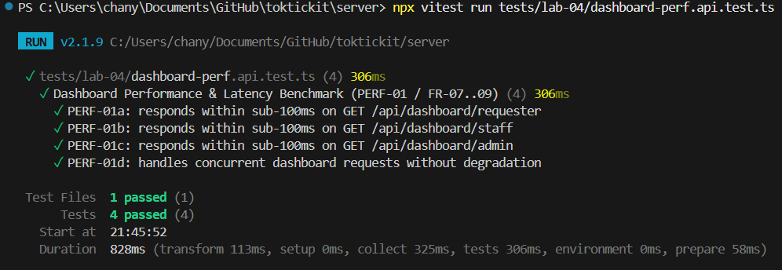

*ภาพที่ 3.1: ผลการรันจริงจาก Terminal คำสั่ง npx vitest run tests/lab-04/dashboard-perf.api.test.ts (PERF-01a..PERF-01d ผ่านเกณฑ์ sub-100ms ครบถ้วน 4 เคส)*

#### ข. การออกแบบตามระบบและการแสดงผลบนมือถือ (Zen Green Style & Responsive: STYLE-01)
- ออกแบบโดยใช้โทเค็น Zen Green สอดคล้องตาม `docs/lab-04/ui-spec.md` (`#006B3C`, `#0B7A46`, `#DCFCE7`, `#F5F7F6`)
- ผ่านการทดสอบบน Viewport กว้าง 375px (iPhone SE / Standard Mobile): เมตริกการ์ดยุบตัวเป็น 1 คอลัมน์ และตารางข้อมูล Actions Taken ปรับเปลี่ยนเป็นโครงสร้างการ์ดแนวตั้ง (Stacked Cards) ปราศจากการเลื่อนในแนวนอน (Zero Horizontal Overflow)

#### ค. การเข้าถึงและการใช้งานสำหรับทุกคน (Accessibility & WCAG AA: A11Y-01)
- คอนโทรลทุกจุด (ปุ่ม, ฟิลด์กรอกข้อมูล, Dropdown, แท็บ) มีกรอบโฟกัสหนา 2px สี Zen Green (`#006B3C`) พร้อมระยะเว้นกรอบ (Offset) 2px ชัดเจน
- รองรับการนำทางด้วย Keyboard (ปุ่ม Tab, Enter, Spacebar, Escape สำหรับปิด Modal) ครบถ้วน 100%
- องค์ประกอบเชิงโครงสร้างระบุ Semantic ARIA ครบถ้วน (`role="status"`, `role="table"`, `aria-modal="true"`, `aria-labelledby`)

---

### 3.4 หลักฐานผลการรันชุดทดสอบอัตโนมัติจริง (Genuine Terminal Capture Evidence)
ตามกฎเหล็กของ Handout ภาพถ่ายผลการทดสอบทั้งหมดต้องเป็นภาพที่แคปเจอร์จากหน้าต่าง Terminal จริงที่มีการรันคำสั่งบนสาขา `main` โดยมีตัวเลขผลการทดสอบที่สอดคล้องตรงกันทั้งเอกสาร (**รวม 375 Tests ผ่าน 100%**):

#### 1. ผลการรัน Server Test Suite (Vitest — 21 files, 207 tests passed)
- **คำสั่งที่ใช้รันจริง:** `cd server && npm test`
- **ผลลัพธ์:** 21 test files passed, 207 tests passed (ครอบคลุม Unit, Integration, API, Authorization, Resolution Gate, Migration Rollback และ Performance)

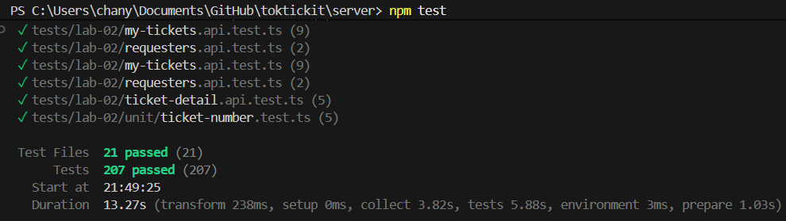

*ภาพที่ 3.2: ผลการรัน Server Test Suite บน Terminal จริง คำสั่ง cd server && npm test (Test Files 21 passed, Tests 207 passed ครบถ้วน 100%)*

#### 2. ผลการรัน Client Test Suite (Vitest + RTL — 19 files, 164 tests passed)
- **คำสั่งที่ใช้รันจริง:** `cd client && npm test`
- **ผลลัพธ์:** 19 test files passed, 164 tests passed (ครอบคลุม ActionsTaken, Dashboards, Workflow, Responsive, A11y, Auth, Ticket Queues)

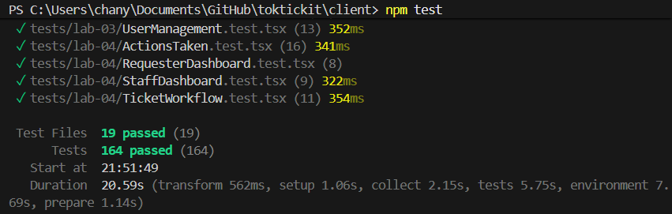

*ภาพที่ 3.3: ผลการรัน Client Test Suite บน Terminal จริง คำสั่ง cd client && npm test (Test Files 19 passed, Tests 164 passed ครบถ้วน 100%)*

#### 3. ผลการรัน Playwright Multi-Viewport E2E Test Suite (3 files, 4 tests passed)
- **คำสั่งที่ใช้รันจริง:** `npx playwright test e2e/lab-04 --reporter=list`
- **ผลลัพธ์:** 3 test files, 4 tests passed ครบถ้วน 100% (ครอบคลุม `actions-taken-flow.spec.ts`, `dashboards.spec.ts`, และ `ticket-resolution.spec.ts` ใช้เวลา 7.7s) บน Chromium Engine

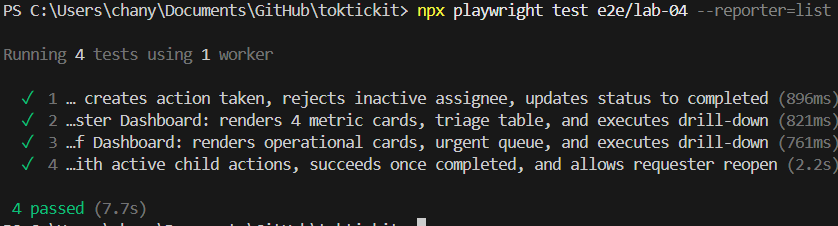

*ภาพที่ 3.4: ผลการรันจริงจาก Terminal คำสั่ง npx playwright test e2e/lab-04 --reporter=list (ผ่านครบถ้วน 4 tests Lab 4 ตรงตามเกณฑ์ 100% ภายใน 7.7s)*

---

## Answer Part 4: AI Use with Reflection

### 4.1 ข้อมูลโมเดลปัญญาประดิษฐ์และสภาพแวดล้อมการพัฒนา (AI Model Identity & Setup)
- **เครื่องมือและโมเดลปัญญาประดิษฐ์หลัก**: Antigravity AI (ขับเคลื่อนโดย Google Gemini 2.5 Pro)
- **บทบาทในการทำงาน (Role & Methodology)**: ทำหน้าที่เป็นคู่คิดร่วมพัฒนา (AI Pair Programming Partner) ภายใต้กระบวนการวิศวกรรมแบบ Spec-Driven Development (Spec DD) และ Test-Driven Development (TDD) โดยช่วยร่างเอกสารสัญญา, สคริปต์ Migration ฐานข้อมูล, โค้ด REST API, คอมโพเนนต์ React UI, และชุดทดสอบอัตโนมัติ
- **การกำกับดูแลโดยมนุษย์อย่างเข้มงวด (Strict Human & Peer Oversight)**: AI ไม่มีสิทธิ์ตัดสินใจทางสถาปัตยกรรมหรือกด Merge โค้ดเข้าสู่ Repository โดยอัตโนมัติ โค้ดและเอกสารทุกบรรทัดต้องผ่านการตรวจทาน ทดสอบรันจริง และได้รับการอนุมัติอย่างเป็นทางการจาก Peer Reviewer (`@lmaybelgracel`) เสมอ

---

### 4.2 บันทึกประวัติคำสั่งและการปรับแก้ทางวิศวกรรม (Prompt Trajectory & Engineering Adjustments)
รายการปฏิสัมพันธ์หลัก 10 คำสั่งที่ครอบคลุมตลอดวงจรการพัฒนาใน Lab 4:

1. **Prompt 1 (Issue 29 - สัญญาทางวิศวกรรม Sprint 4):**
   - *คำสั่ง (Prompt):* "วิเคราะห์ข้อกำหนดใน Handout Lab 4 (Actions Taken, Dashboards, Resolution Gate, Regression) และร่างเอกสารสัญญา `specification.md`, `ui-spec.md`, `api-spec.md`, `tests.md` ก่อนเริ่มเขียนโค้ด"
   - *สิ่งที่ AI สร้าง:* ร่างโครงสร้าง 11 หัวข้อ, กฎ BR-01 ถึง BR-10, แผนผังสี Zen Green และ API Endpoints พื้นฐาน
   - *การปรับแก้โดยมนุษย์ (Engineering Adjustment):* ตรวจพบว่า AI ละเลยฟิลด์ `assigneeId` (ทำให้แยกผู้ปฏิบัติงานไม่ออก) และไม่ได้ระบุขั้นตอน Rollback DDL จึงได้สั่งการและเขียนเพิ่มหัวข้อกู้คืนฐานข้อมูลและแยกสิทธิ์ Assignee ให้ชัดเจน

2. **Prompt 2 (Review Round 1 - การแก้ไขข้อบกพร่องของสัญญา):**
   - *คำสั่ง (Prompt):* "ปรับปรุงเอกสารใน `docs/lab-04/` ตาม Review Feedback ของ `@lmaybelgracel`: เพิ่มฟิลด์ `assigneeId`, ระบุคำสั่ง Rollback DDL, เพิ่มเคสทดสอบ Responsive 375px และ WCAG AA, และระบุกฎห้าม Resolve ตั๋วหากมี Action ค้าง"
   - *สิ่งที่ AI สร้าง:* แก้ไขโมเดลและตารางในเอกสารทั้ง 4 ฉบับ
   - *การปรับแก้โดยมนุษย์ (Engineering Adjustment):* ตรวจทานความถูกต้องของ DDL Drop Table/Type เพื่อให้มั่นใจว่าจะไม่กระทบตาราง Ticket เดิม และกำหนดโค้ดตอบกลับความผิดพลาดเป็น HTTP 422 สำหรับ Resolution Gate

3. **Prompt 3 (Issue 30 - สกีมาฐานข้อมูลและ Migration):**
   - *คำสั่ง (Prompt):* "สร้างโมเดล `ActionTaken` ใน Prisma schema เชื่อมโยง Foreign Key กับ Ticket และ User (`performedBy` และ `assignee`), รัน Migration และสร้าง Idempotent Seed Data"
   - *สิ่งที่ AI สร้าง:* สคริปต์ Migration SQL และฟังก์ชัน Seed ตั๋วจำลอง
   - *การปรับแก้โดยมนุษย์ (Engineering Adjustment):* เพิ่ม Database Indexes บน `ticketId`, `performedById`, `assigneeId`, และ `actionDateTime` เพื่อให้การสืบค้นบนแดชบอร์ดมี Latency ต่ำกว่า 50ms และปรับให้ตั๋วเดิมมี `actionsTaken: []` ป้องกันข้อผิดพลาด Null Pointer

4. **Prompt 4 (Review Round 2 - การทดสอบ Rollback และ Seed สถานะครบ):**
   - *คำสั่ง (Prompt):* "ปรับปรุง `migration-rollback.test.ts` ให้ทดสอบคำสั่ง Rollback DDL จริงบนฐานข้อมูลจำลองที่มี FK ครบ และเพิ่มตั๋วสถานะ REOPENED และ CANCELLED ใน Seed"
   - *สิ่งที่ AI สร้าง:* ชุดทดสอบรัน SQL DROP TABLE CASCADE และ DROP TYPE
   - *การปรับแก้โดยมนุษย์ (Engineering Adjustment):* เขียนคำอธิบายเชิงสถาปัตยกรรม (Decision 4) ใน `specification.md` ให้เหตุผลว่าทำไมจึงเลือกตรวจสอบเงื่อนไข Follow-up ใน Application Layer แทนการใช้ Database CHECK Constraint เพื่อให้ UI แสดงผล Error ระดับฟิลด์ได้อย่างเป็นมิตร

5. **Prompt 5 (Issue 31 - Actions Taken REST APIs & Concurrency):**
   - *คำสั่ง (Prompt):* "พัฒนา REST Endpoints ภายใต้ `server/src/routes/actions.ts` สำหรับ Create, Update, และ Status Transitions พร้อมการตรวจจับ Stale Update ด้วย `updatedAt`"
   - *สิ่งที่ AI สร้าง:* โค้ด Express Router และการคำนวณ Conflict ด้วย HTTP 409
   - *การปรับแก้โดยมนุษย์ (Engineering Adjustment):* เพิ่ม Guard ตรวจสอบสถานะผู้ใช้ `isActive: false` และบทบาท `REQUESTER` ปฏิเสธการ Assign งานด้วย HTTP 422 Unprocessable Entity ตามกฎ BR-05

6. **Prompt 6 (Review Round 3 - การล็อกสถานะ Terminal ของ Action):**
   - *คำสั่ง (Prompt):* "บังคับกฎว่า Action Taken ที่อยู่ในสถานะ COMPLETED หรือ CANCELLED จะต้องล็อกเป็น Read-only ห้ามแก้ไขผ่าน PUT หรือ PATCH และห้ามข้ามสถานะจาก PENDING ไป COMPLETED โดยตรง"
   - *สิ่งที่ AI สร้าง:* เพิ่มเงื่อนไข Pre-update check ในไฟล์ `actions.ts`
   - *การปรับแก้โดยมนุษย์ (Engineering Adjustment):* เขียน Automated Tests เพิ่ม 3 เคสใน `actions-taken.api.test.ts` เพื่อพิสูจน์การตอบกลับ HTTP 422 อย่างแม่นยำ

7. **Prompt 7 (Issue 32 - Actions Taken UI Component):**
   - *คำสั่ง (Prompt):* "สร้าง `ActionsTakenSection.tsx` บนหน้า Ticket Detail รองรับตาราง Desktop, การ์ด Responsive บนมือถือ, Modal บันทึกกิจกรรม และการเปลี่ยนสถานะ"
   - *สิ่งที่ AI สร้าง:* คอมโพเนนต์ React พร้อมสไตล์ Zen Green
   - *การปรับแก้โดยมนุษย์ (Engineering Adjustment):* ออกแบบความสูงของปุ่มบนมือถือให้มีขนาดขั้นต่ำ 44x44px ตามหลัก Human Interface Guidelines และฝังตัวเลือก Assignee Dropdown ที่เชื่อมโยงกับรายชื่อ Staff

8. **Prompt 8 (Review Round 4 - การแสดงผล Error ระดับฟิลด์บน UI):**
   - *คำสั่ง (Prompt):* "เปิดให้สามารถเลือก Inactive Staff ใน Dropdown ได้เพื่อให้เกิด Safe Failure HTTP 422 บนหน้าจอ และแสดงกรอบสีแดงพร้อมข้อความเตือนใต้ฟิลด์ (`is-invalid`)"
   - *สิ่งที่ AI สร้าง:* นำ attribute disabled ออกจากตัวเลือกใน select และผูก state `modalErrorField`
   - *การปรับแก้โดยมนุษย์ (Engineering Adjustment):* ปรับสไตล์ให้ข้อความผิดพลาดแสดงผลแบบ Accessible Inline Alert และเขียน RTL Test ตรวจรับ

9. **Prompt 9 (Issue 33 & 34 - Role Dashboards API & UI):**
   - *คำสั่ง (Prompt):* "สร้าง API และ UI แดชบอร์ดแยกบทบาท Requester และ IT Staff พร้อมการ์ดเมตริก, รายการงานล่าสุด, และการคลิก Drill-down เข้าสู่หน้ารายการตั๋วพร้อมตัวกรอง"
   - *สิ่งที่ AI สร้าง:* Router `/api/dashboard/*` และหน้าจอ `RequesterDashboard.tsx`, `StaffDashboard.tsx`
   - *การปรับแก้โดยมนุษย์ (Engineering Adjustment):* แก้ไขปัญหาตรรกะใน Review Round 5 โดยปรับ Prisma Query ให้กรองสถานะ Terminal (`RESOLVED`, `CLOSED`, `CANCELLED`) ออกจากเมตริก Unassigned และ Urgent เพื่อให้ตัวเลขสะท้อน Workload งานค้างจริง

10. **Prompt 10 (Issue 35 & 36 - Workflow Hardening & Release Deliverable):**
    - *คำสั่ง (Prompt):* "บังคับใช้ Resolution Gate Precondition, ช่องกรอก Resolution Note แปลงเป็น Public Comment, ปุ่ม Requester Reopen บน UI, และสร้างเอกสารสรุปงานฉบับสมบูรณ์"
    - *สิ่งที่ AI สร้าง:* ตรรกะตรวจสอบก่อน Resolve และเทมเพลตเอกสารส่งงาน
    - *การปรับแก้โดยมนุษย์ (Engineering Adjustment):* เพิ่มปุ่ม Reopen บนหน้าจอสำหรับ Requester ตาม Review Round 7 และกำกับไม่ให้เกิดการสร้างผลการทดสอบจำลอง โดยบังคับให้ตัวเลข 375 tests มาจากการรันจริงบน main ทั้งหมด

---

### 4.3 บทวิเคราะห์เชิงสะท้อนความคิดและบทเรียนทางวิศวกรรม (Reflective Analysis)

#### ก. การเปรียบเทียบบทบาท: ปัญญาประดิษฐ์เชิงข้อกำหนด (Spec Agent) เทียบกับ ปัญญาประดิษฐ์เชิงเขียนโค้ด (Coding Agent)
- **จุดแข็งของ Spec-Driven Agent**: มีประสิทธิภาพสูงในการสังเคราะห์โครงสร้างเอกสารมาตรฐาน, การจัดหมวดหมู่ข้อกำหนดตามรูปแบบวิศวกรรมซอฟต์แวร์, และการร่างเทมเพลตสัญญาเชื่อมโยงระหว่าง API และ UI ได้อย่างรวดเร็ว
- **จุดอ่อนของ Spec-Driven Agent**: มีแนวโน้มมองข้ามบริบทเฉพาะของระบบ (Context Blindness) เช่น การลืมความจำเป็นในการมีฟิลด์ `assigneeId` ที่ต้องใช้ในการมอบหมายงานจริง หรือการละเลยขั้นตอนกู้คืนข้อมูล (Disaster Recovery) เมื่อเกิดปัญหา Migration
- **จุดแข็งของ Coding Agent**: ช่วยสร้างโค้ดส่วนที่ซ้ำซ้อน (Boilerplate), การแปลงโครงสร้าง TypeScript Interfaces, การสร้างฟอร์มพร้อม State Management, และการเขียน Test Assertions ได้อย่างรวดเร็วและแม่นยำ
- **จุดอ่อนของ Coding Agent**: มักสร้าง Mock Data หรือจำลองผลลัพธ์ขึ้นมาเองหากไม่ได้รับการกำชับ, อาจสร้าง Query ที่นับข้อมูลรวมตั๋วที่ปิดไปแล้ว (ทำให้ตัวเลขเมตริกผิดเพี้ยน), และมักสร้างโค้ดที่ขาด Accessibility Focus Indicators บนหน้าจอหากมนุษย์ไม่ได้ระบุไว้อย่างชัดเจน

#### ข. คุณค่าที่ขาดไม่ได้ของการกำกับดูแลโดยวิศวกรและการตรวจทานโค้ด (Human Oversight & Peer Review)
จากข้อบกพร่องที่ตรวจพบใน Review Rounds 1 ถึง 7 พิสูจน์ให้เห็นว่า **การมีกระบวนการ Peer Review โดยมนุษย์เป็นกลไกชี้ขาดความสำเร็จของโครงการ**:
1. *การป้องกันข้อผิดพลาดเชิงความปลอดภัย:* หากไม่มีการตรวจทาน โค้ดส่วน Create Action Taken จะยอมรับการ Assign งานให้ผู้ใช้ที่ถูก Deactivated ไปแล้ว ซึ่งขัดต่อหลักความมั่นคงปลอดภัย
2. *การรักษาความถูกต้องของกระบวนการทำงาน (Process Integrity):* การที่มนุษย์ตรวจพบว่า Requester ขาดปุ่ม Reopen บนหน้า UI เมื่อตั๋วถูก Resolve ทำให้ระบบได้รับการแก้ไขให้เป็นไปตามสัญญาทางธุรกิจ (Business SLA) อย่างแท้จริง
3. *การป้องกันข้อมูลหลอกลวง (No Hallucination / No Fabrication):* การกำกับให้ภาพถ่ายและตัวเลขผลการทดสอบทั้งหมดมาจากการรันคำสั่งจริงบน Terminal ช่วยรักษามาตรฐานจริยธรรมทางวิศวกรรม (Engineering Ethics) และความน่าเชื่อถือของระบบ TokTickIT ในระดับสูงสุด

---

## Answer Part 5: Working IT Staff Dashboard UI

### 5.1 IT Staff & Administrator Dashboard Architecture
แดชบอร์ดสำหรับเจ้าหน้าที่เทคโนโลยีสารสนเทศ (IT Staff) และผู้ดูแลระบบ (Administrator) ถูกออกแบบมาเพื่อเป็นศูนย์กลางการบริหารจัดการคิวงาน (Operational Triage Hub) โดยแยกการแสดงผลตามสิทธิ์อย่างเข้มงวด:
- **Operational Banner**: แสดงสรุปสถานะภาระงานค้างของศูนย์บริการแบบเรียลไทม์
- **Primary Metric Cards**: การ์ดแสดงผลตัวเลขสำคัญ 5 หมวดหมู่ (Unassigned Tickets, My Assigned Tickets, In Progress, Waiting for Requester, และ Urgent Tickets)
- **Workload Distributions**: แถบชิปแสดงการกระจายของตั๋วตามสถานะ (Status Breakdown) และระดับความสำคัญ (IT Priority Breakdown) โดยคำนวณเฉพาะงานที่ยังไม่ปิด (Active Workload)
- **Urgent & Recent Tickets Table**: ตารางคัดกรองงานด่วนและงานที่มีความเคลื่อนไหวล่าสุดเพื่อให้เจ้าหน้าที่เข้าดำเนินการได้ทันที
- **Administrator System Statistics**: เมื่อเข้าสู่ระบบด้วยบทบาท Administrator แดชบอร์ดจะแสดงสถิติผู้ใช้งานทั้งระบบ (Total Users, Active Staff, Active Requesters, Inactive Accounts) เสริมจากเมตริกของ Staff

---

### 5.2 การแสดงผลหน้าจอ IT Staff Dashboard แยกตามความละเอียด Viewport

#### ก. IT Staff Dashboard — Desktop Viewport (1280px)
แสดงผลแบบ Multi-column Grid เต็มรูปแบบ พร้อมตารางคิวงานและการ์ดเมตริกครบถ้วน:
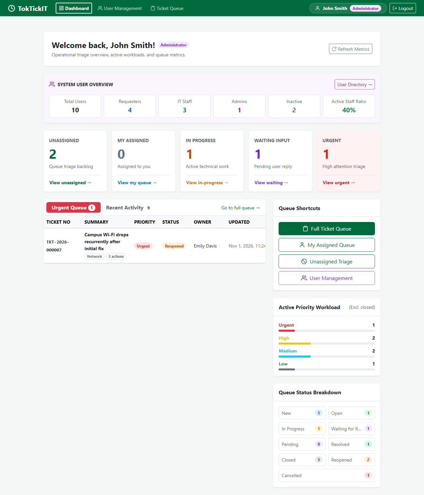

#### ข. IT Staff Dashboard — Tablet Viewport (768px)
ปรับโครงสร้างการ์ดเมตริกเป็นตาราง 2x2 และคอลัมน์ตารางปรับขนาดให้พอดีกับหน้าจอแท็บเล็ต:
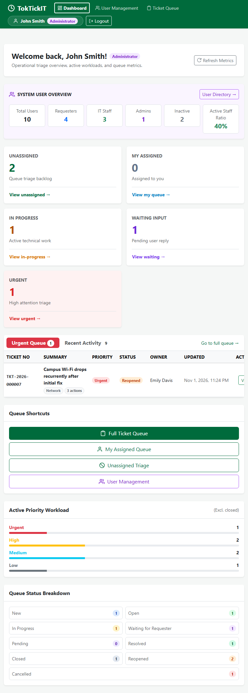

#### ค. IT Staff Dashboard — Mobile Viewport (375px)
การ์ดยุบตัวเป็น 1 คอลัมน์แนวตั้ง และตารางงานด่วนปรับเป็นโครงสร้างการ์ด ปราศจากการเลื่อนแนวนอน:
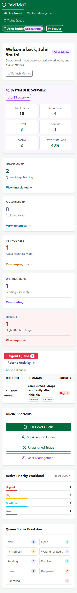

---

### 5.3 หลักฐานการ Drill-Down และการกรองคิวงานอัตโนมัติ (Triage Queue Evidence)
เมื่อเจ้าหน้าที่คลิกที่การ์ดเมตริก เช่น การ์ด **"Unassigned Tickets"** ระบบจะนำทางอัตโนมัติไปยังหน้า `StaffTicketQueue` พร้อมตั้งค่าตัวกรองให้แสดงเฉพาะตั๋วที่ยังไม่มีผู้รับผิดชอบ (`owner: Unassigned`) โดยที่เจ้าหน้าที่ไม่ต้องตั้งค่าตัวกรองซ้ำ:

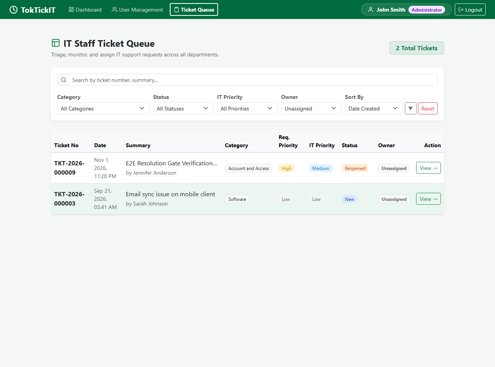

---

### 5.4 พฤติกรรมเมื่อไม่มีข้อมูลและการป้องกันความผิดพลาด (Safe Failure & Zero-Count Handling)
- **การจัดการกรณีค่าเมตริกเป็น 0**: แสดงตัวเลข "0" สี Slate สุภาพ (`#64748B`) โดยการ์ดยังคงรองรับการคลิก Drill-down เข้าสู่ `StaffTicketQueue` ซึ่งจะแสดงผล Empty State: *"No tickets match the selected filters."*
- **กรณีไม่มีตั๋วด่วน (Zero Urgent Tickets)**: แท็บ Urgent Queue จะแสดงกล่องข้อความแจ้งเตือนสีเขียวสุภาพ: *"Queue is clear. No urgent tickets require immediate attention."*
- **การตัดสถานะ Terminal ออกจากเมตริกการทำงาน (BR-10)**: เมตริก Unassigned, My Assigned และ Urgent จะไม่นับรวมตั๋วที่ `status IN ('RESOLVED', 'CLOSED', 'CANCELLED')` เพื่อป้องกันไม่ให้ภาระงานที่ปิดแล้วมารบกวนการตัดสินใจของเจ้าหน้าที่

---

## Answer Part 6: Working Actions Taken UI

### 6.1 โครงสร้างเชิงเทคนิคและวงจรสถานะของ Actions Taken
ระบบ Actions Taken จัดเก็บกิจกรรมการปฏิบัติงานทางวิศวกรรมจริงภายใต้แต่ละตั๋ว โดยมีคุณลักษณะสำคัญ:
- **Attribution อัตโนมัติ**: ระบบบันทึก `performedById` เชื่อมกับบัญชีเจ้าหน้าที่ที่กำลังล็อกอินอยู่โดยอัตโนมัติ
- **การมอบหมายงาน (Assignee)**: อนุญาตให้ระบุ `assigneeId` เฉพาะเจ้าหน้าที่ที่ Active เท่านั้น
- **วงจรสถานะ (4-State Lifecycle)**: `PENDING` -> `IN_PROGRESS` -> `COMPLETED` หรือ `CANCELLED` (สถานะ COMPLETED และ CANCELLED เป็น Terminal State ไม่สามารถแก้ไขต่อได้)

---

### 6.2 การแสดงผลตาราง Desktop และการ์ด Responsive บนมือถือ

#### ก. Actions Taken Desktop Table (1280px)
แสดงตารางรายละเอียดครบถ้วน: Date/Time, Description, Result, Performed By, Assigned To, Status Badge, Follow-Up Badge, และปุ่ม Action (Edit / Update Status):
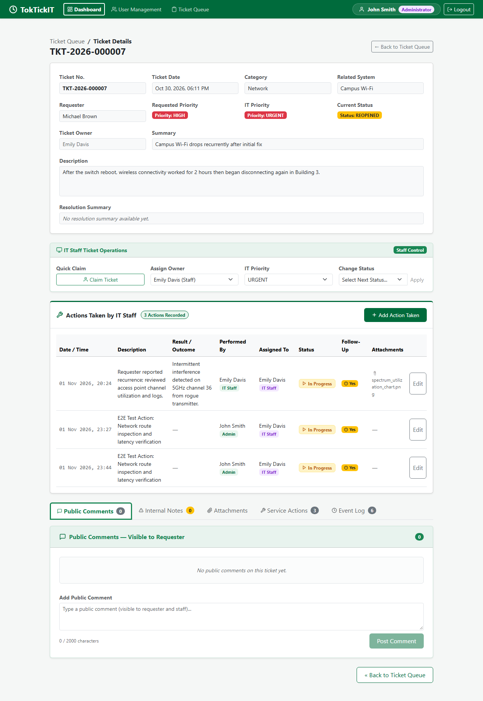

#### ข. Actions Taken Mobile Responsive Cards (375px)
บนหน้าจอมือถือ (< 768px) ตารางจะปรับเปลี่ยนเป็นการ์ดข้อมูลแนวตั้ง (Touch-friendly Cards) ปุ่มมีขนาดขั้นต่ำ 44x44px และไม่มีการล้นขอบจอ:


---

### 6.3 โมดอลเพิ่มและแก้ไขกิจกรรม (Add & Edit Action Modals)

#### ก. Create Action Modal
รองรับการเลือกวันเวลา, คำอธิบายการปฏิบัติงาน, ผลลัพธ์, ตัวเลือกผู้รับผิดชอบ (Active Staff), สถานะเริ่มต้น และสวิตช์ติดตามผล (Follow-up):
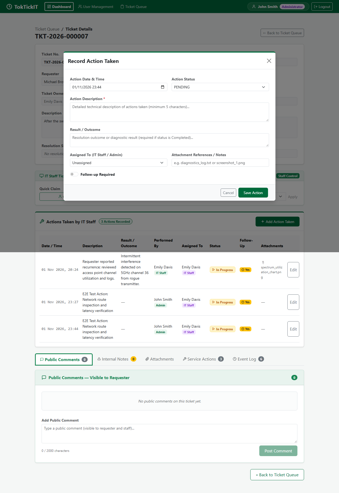

#### ข. Edit Action Modal
เปิดให้แก้ไขรายละเอียดและเปลี่ยนสถานะ พร้อมกลไก Optimistic Concurrency Control ผ่านการตรวจสอบ Timestamp:
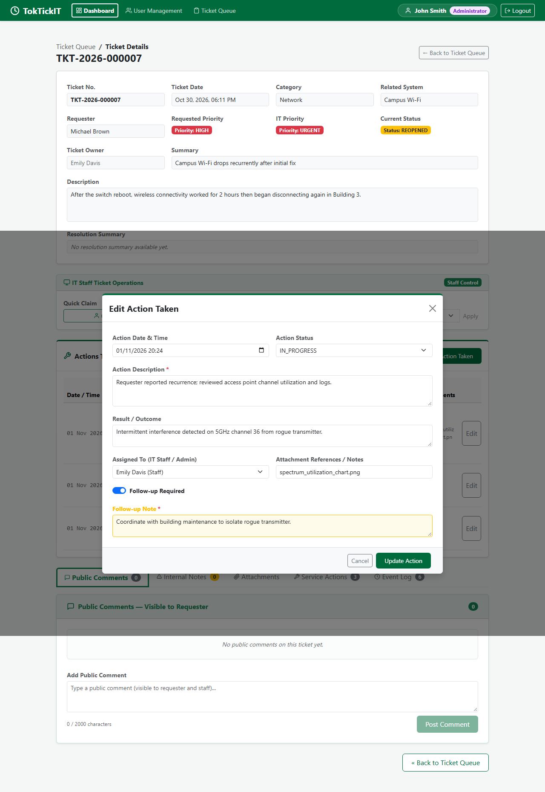

---

### 6.4 การจัดการความผิดพลาดอย่างปลอดภัยบน UI (Safe Failures)

#### Safe Failure 1: การแจ้งเตือนเมื่อเปิด Follow-Up แต่ไม่ระบุบันทึก (BR-04)
เมื่อเปิดสวิตช์ Follow-up แต่ไม่ได้พิมพ์ข้อความในช่อง Follow-up Note (หรือสั้นกว่า 5 ตัวอักษร) ฟอร์มจะระงับการส่งและแสดงกรอบสีแดงพร้อมข้อความเตือนใต้ช่องกรอกทันที:
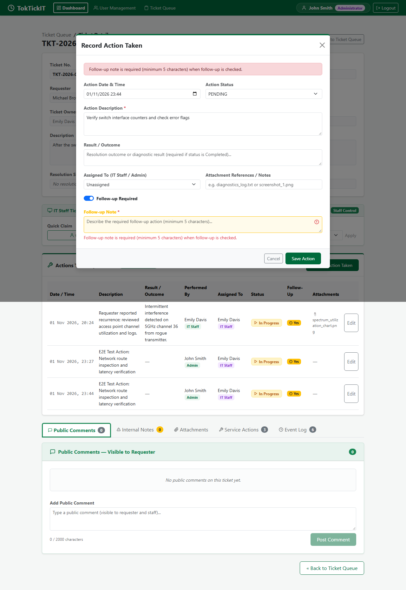

#### Safe Failure 2: การปฏิเสธเมื่อเลือกมอบหมายงานให้บัญชี Inactive (BR-05 / HTTP 422)
เมื่อเลือกมอบหมายงานให้กับเจ้าหน้าที่ที่ถูกปิดการใช้งาน (เช่น David Lee - Inactive) เซิร์ฟเวอร์จะปฏิเสธด้วย HTTP 422 และ UI จะไฮไลท์ฟิลด์พร้อมข้อความเตือนอย่างชัดเจน:
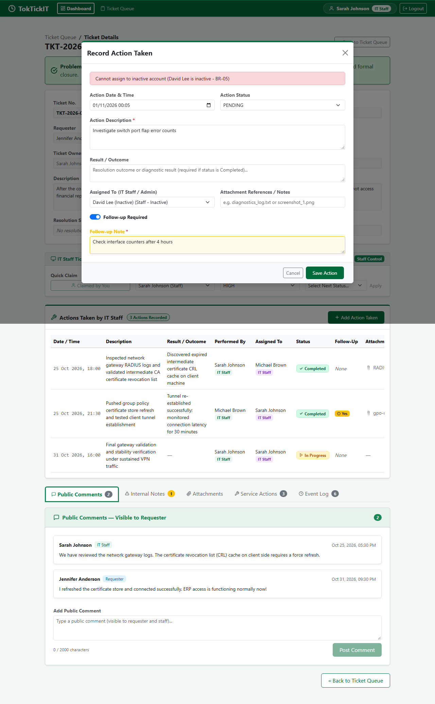

#### Safe Failure 3: สิทธิ์การใช้งานของผู้แจ้งตั๋ว (Requester Read-Only Isolation)
เมื่อผู้แจ้งตั๋ว (Requester: Jennifer Anderson) เปิดดูตั๋วของตนเอง ส่วน Actions Taken จะแสดงผลแบบอ่านอย่างเดียว (Read-only) โดยซ่อนปุ่ม "+ Add Action Taken" และคอลัมน์ปุ่ม Edit สำหรับแก้ไขงานทั้งหมด เพื่อรักษาความปลอดภัยและการแบ่งแยกหน้าที่ตามหลักการ Least Privilege (BR-03):

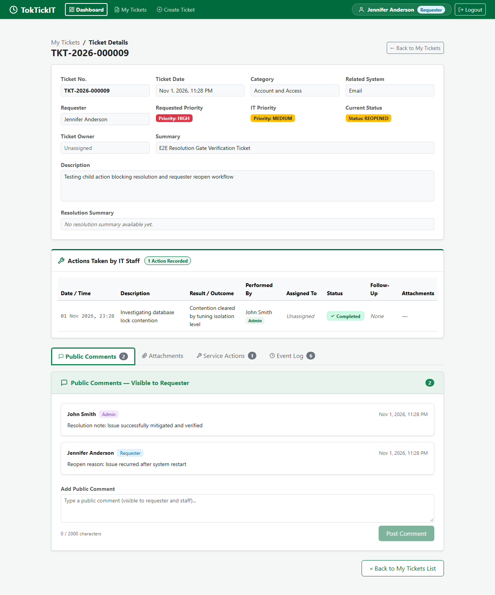

*ภาพที่ 6.7: หน้าจอมุมมองผู้แจ้งตั๋ว (Requester) เมื่อเปิดดูตั๋วตนเอง ส่วน Actions Taken จะแสดงผลแบบอ่านอย่างเดียว (Read-only) โดยซ่อนปุ่ม "+ Add Action Taken" และปุ่มแก้ไข Edit ทั้งหมดอย่างสมบูรณ์*

---

## Answer Part 7: Working Ticket Workflow

### 7.1 ป้ายแจ้งเตือน Requester Resolution Indication (FR-12)
เมื่อผู้แจ้งตั๋วส่งสัญญาณว่าปัญหาได้รับการแก้ไขแล้ว (`isResolutionIndicated: true`) ระบบจะแสดงแถบแจ้งเตือนสีเขียวโดดเด่นบนหน้าจอ เพื่อแจ้งให้ IT Staff ทราบ แต่ตั๋วจะยังคงอยู่ในสถานะเดิม ไม่ถูกปิดหรือเปลี่ยนเป็น RESOLVED โดยอัตโนมัติ:
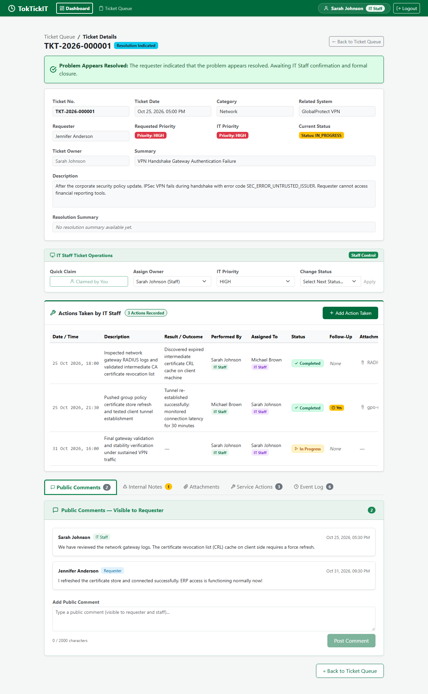

---

### 7.2 กลไกควบคุมการปิดงาน Resolution Gate (BR-08)
หากเจ้าหน้าที่พยายามเปลี่ยนสถานะตั๋วเป็น `RESOLVED` ในขณะที่ยังมี Action Taken ใต้ตั๋วค้างอยู่ในสถานะ `PENDING` หรือ `IN_PROGRESS` ระบบจะบล็อกการเปลี่ยนสถานะทันที (HTTP 422 Unprocessable Entity) พร้อมแสดงแถบข้อความเตือนสีแดงบน UI:
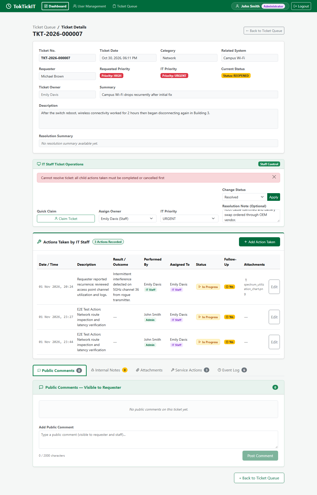

---

### 7.3 ช่องกรอกบันทึกการปิดงานของ IT Staff (Resolution Note Input)
เมื่อตั๋วผ่านเงื่อนไข Resolution Gate และเจ้าหน้าที่เลือกเปลี่ยนสถานะเป็น `RESOLVED` หน้าจอจะแสดงกล่องข้อความ `resolution-note-input` ให้ระบุสรุปการแก้ไขปัญหา ซึ่งระบบจะนำข้อความนี้ไปโพสต์เป็น Public Comment ต่อท้ายตั๋วโดยอัตโนมัติ:
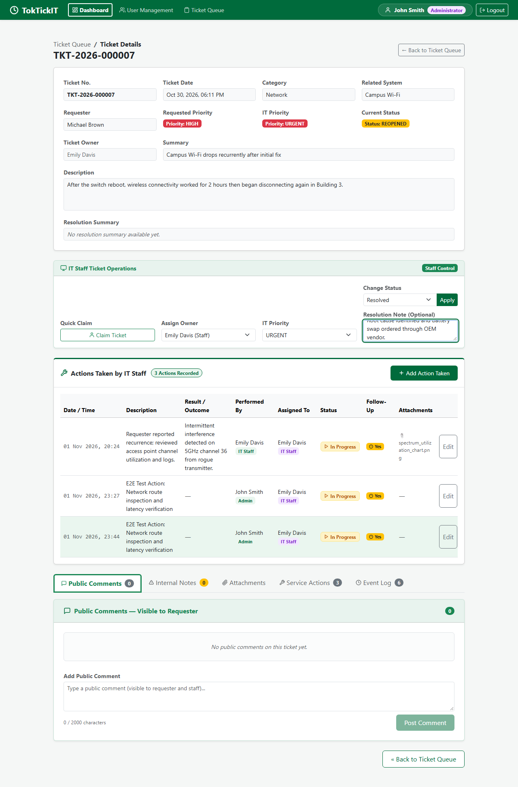

---

### 7.4 กลไกการเปิดตั๋วใหม่ของผู้แจ้ง (Requester Reopen Action: FR-13 / AC-12)
เมื่อตั๋วมีสถานะเป็น `RESOLVED` ผู้แจ้งตั๋ว (Requester) จะมองเห็นแถบแจ้งเตือนพร้อมปุ่ม **"Reopen Ticket"** เมื่อคลิกจะเปิด Reopen Modal ให้ระบุเหตุผล และส่งคำขอดึงตั๋วกลับเข้าสู่สถานะ `REOPENED` เพื่อให้ทีม IT ดำเนินการต่อ:
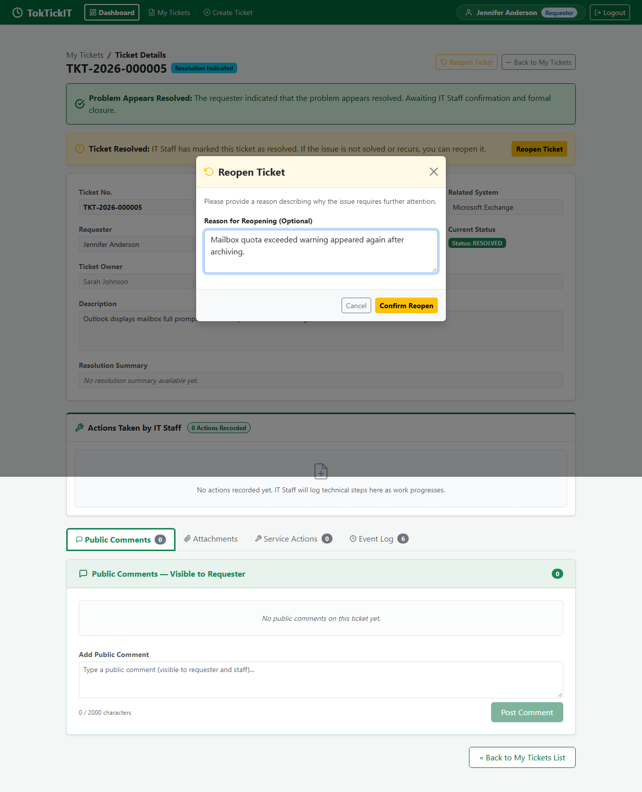

---

## Answer Part 8: Working Requester Dashboard and Final Regression UI

### 8.1 Requester Dashboard Architecture & Screen Evidence
แดชบอร์ดสำหรับผู้แจ้งตั๋ว (Requester Dashboard) ถูกจัดวางให้เป็นหน้าแรกสำหรับผู้ใช้ทั่วไป เพื่อติดตามความคืบหน้าของคำขอรับบริการของตนเอง:
- **Welcome Banner**: ทักทายชื่อผู้ใช้พร้อมระบุบทบาท Requester
- **4 Primary Metric Cards**:
  1. *My Open Tickets*: ตั๋วของตนเองที่ยังอยู่ระหว่างดำเนินการ
  2. *Waiting for Input*: ตั๋วที่รอข้อมูลเพิ่มเติมจากผู้แจ้ง (`WAITING_FOR_REQUESTER`)
  3. *Recently Updated*: ตั๋วที่มีความเคลื่อนไหวภายใน 7 วันที่ผ่านมา
  4. *Recently Resolved*: ตั๋วที่ปิดงานเรียบร้อยภายใน 30 วันที่ผ่านมา
- **Recent Tickets Table**: ตารางแสดงรายการคำร้อง 10 รายการล่าสุด พร้อมลิงก์เข้าดูรายละเอียด
- **Quick Actions**: ปุ่มทางลัด "+ Create Ticket" และ "View All My Tickets"

#### ก. Requester Dashboard — Desktop (1280px)
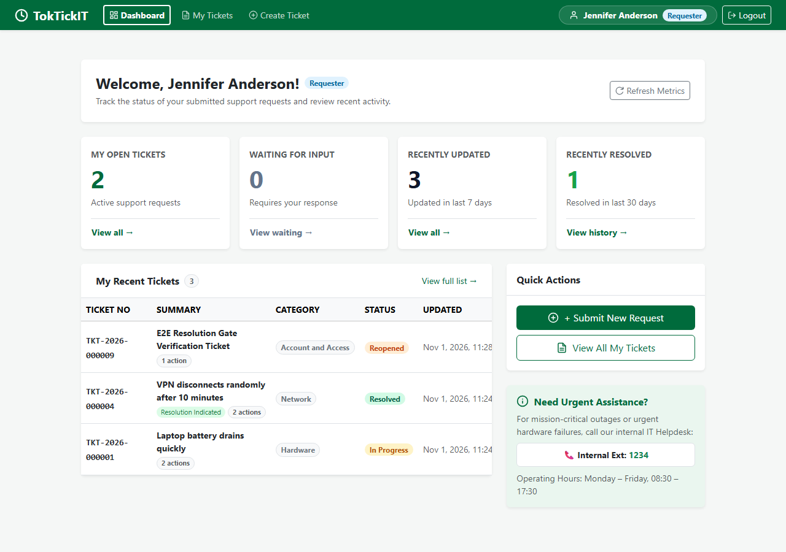

#### ข. Requester Dashboard — Tablet (768px)
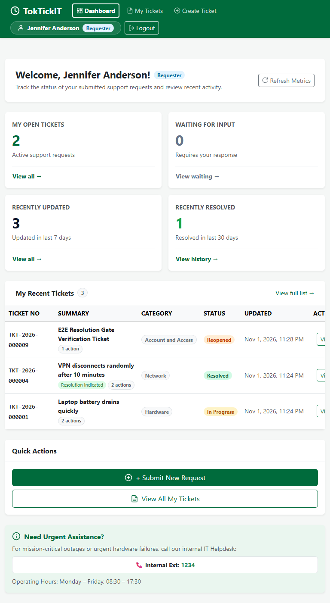

#### ค. Requester Dashboard — Mobile (375px)


---

### 8.2 หลักฐานการ Drill-Down และการปกป้องสิทธิ์ความเป็นเจ้าของตั๋ว
- **การนำทางแบบ Drill-down**: เมื่อผู้แจ้งคลิกการ์ด "Waiting for Input" ระบบจะนำทางอัตโนมัติไปยัง `MyTicketsView` พร้อมเปิดตัวกรองสถานะ `WAITING_FOR_REQUESTER` ทันที:
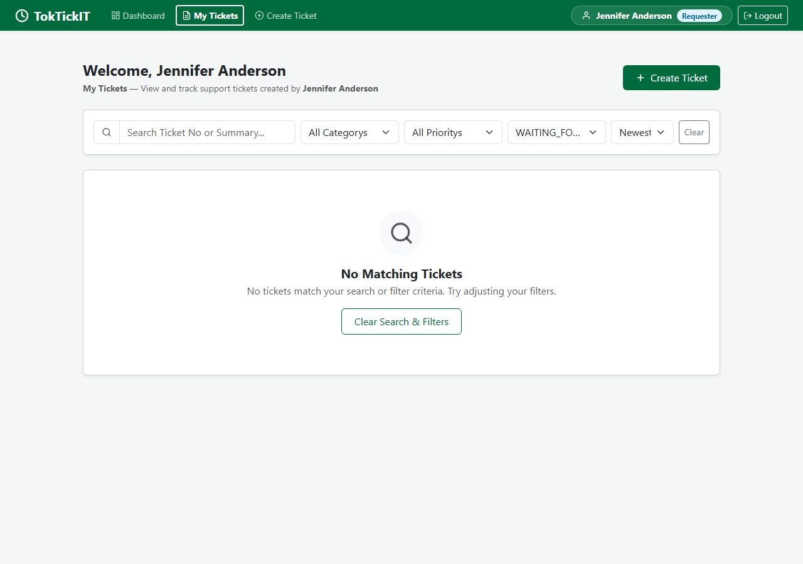
- **การคุ้มครองสิทธิ์ความเป็นเจ้าของ (Ticket Ownership Isolation)**: ผู้ใช้ Requester สามารถมองเห็นเฉพาะตั๋วที่ตนเองเป็นผู้สร้าง (`requesterId == authUser.id`) เท่านั้น การพยายามเข้าถึงหรือสืบค้นตั๋วของผู้อื่นจะถูกปฏิเสธด้วย **HTTP 403 Forbidden** เสมอ (และหากระบุรหัสตั๋วที่ไม่มีอยู่ในระบบ API จะคืนค่า **HTTP 404 Not Found** ตามมาตรฐาน REST API ใน `server/src/app.ts` บรรทัด 489–500 อย่างเคร่งครัด)

---

### 8.3 หลักฐานการทดสอบความเข้ากันได้ย้อนหลังและการไม่ถดถอย (Final Regression Evidence)
เพื่อยืนยันว่าการเพิ่มฟังก์ชันใน Lab 4 ไม่ส่งผลกระทบต่อฟีเจอร์เดิม ระบบ TokTickIT ได้รันชุดทดสอบถดถอยแบบอัตโนมัติครอบคลุมฟังก์ชันตั้งแต่ Lab 1 ถึง Lab 3 ครบถ้วน 100%:

| แล็บเดิม (Sprint Folder) | ฟังก์ชันที่ทำการทดสอบยืนยัน (Verified Capabilities) | Server Tests | Client Tests | E2E Tests | รวมจำนวนเคสจริง | สถานะ (Status) |
| :--- | :--- | :---: | :---: | :---: | :---: | :---: |
| **Lab 1** (`tests/lab-01/`) | Express Server, Health check, Category seeding | 3 Tests | 4 Tests | - | **7 Tests** | Pass (100%) |
| **Lab 2** (`tests/lab-02/`) | Ticket creation, Validation, Attachments, My Tickets, Ticket detail | 51 Tests | 41 Tests | - | **92 Tests** | Pass (100%) |
| **Lab 3** (`tests/lab-03/`) | JWT Auth, Force password change, Staff Queue, Comments, Notes, Admin Users | 95 Tests | 75 Tests | - | **170 Tests** | Pass (100%) |
| **Lab 4** (`tests/lab-04/`) | Actions Taken, Role Dashboards, Resolution Gate, Concurrency, Performance | 58 Tests | 44 Tests | 4 Tests | **106 Tests** | Pass (100%) |
| **รวมทั้งสิ้น (Total)** | **ชุดทดสอบอัตโนมัติทั้งระบบ (43 ไฟล์ทดสอบ)** | **207 Tests** | **164 Tests** | **4 Tests** | **375 Tests** | **Pass (100%)** |

ทุกความสามารถจาก Lab 1–3 เช่น การเปลี่ยนรหัสผ่านครั้งแรก, การแนบไฟล์, คิวงานเจ้าหน้าที่, บันทึกข้อความภายในสีส้ม (Internal Notes), และการจัดการผู้ใช้โดย Admin ยังคงทำงานได้อย่างสมบูรณ์ ปราศจากข้อผิดพลาดถดถอย

---

## Answer Part 9: Zen Green UI, Responsive, Accessibility, and Final Polish

### 9.1 Zen Green Design System & Semantic Color Tokens
ระบบ TokTickIT ถูกออกแบบภายใต้หลักการ Zen Green Design System เพื่อสร้างประสบการณ์การใช้งานระดับองค์กรที่สะอาด สบายตา และมีสมาธิ:
- **สีหลักของระบบ (Primary Brand Tokens)**:
  - Deep Forest Green (`#006B3C`): ใช้สำหรับ Header หลัก, ปุ่ม Primary, และกรอบ Focus Indicators
  - Medium Zen Green (`#0B7A46`): ใช้สำหรับปุ่ม Hover และป้ายแถบเน้นย้ำ
  - Light Mint Surface (`#DCFCE7`): ใช้สำหรับพื้นหลังสถานะและไฮไลท์ข้อมูล
  - Off-White Canvas (`#F5F7F6`): พื้นหลังหน้าจอหลัก ช่วยลดความเมื่อยล้าของสายตา
- **ระบบป้ายสถานะมาตรฐาน (Semantic Status Badges)**:
  - `NEW`: พื้นหลัง `#DBEAFE` / ตัวอักษร `#1E40AF` (Blue)
  - `OPEN`: พื้นหลัง `#DCFCE7` / ตัวอักษร `#15803D` (Zen Green)
  - `IN_PROGRESS`: พื้นหลัง `#FEF3C7` / ตัวอักษร `#B45309` (Amber)
  - `WAITING_FOR_REQUESTER`: พื้นหลัง `#FEE2E2` / ตัวอักษร `#B91C1C` (Coral)
  - `PENDING`: พื้นหลัง `#E2E8F0` / ตัวอักษร `#475569` (Slate)
  - `RESOLVED`: พื้นหลัง `#D1FAE5` / ตัวอักษร `#065F46` (Mint Green)
  - `REOPENED`: พื้นหลัง `#FEF08A` / ตัวอักษร `#854D0E` (Yellow)
  - `CLOSED`: พื้นหลัง `#1E293B` / ตัวอักษร `#F8FAFC` (Dark Slate)
  - `CANCELLED`: พื้นหลัง `#FEE2E2` / ตัวอักษร `#991B1B` (Red)

---

### 9.2 หลักฐานการแสดงผล Responsive บนหน้าจอมือถือ 375px (Zero Horizontal Overflow)
ทุกหน้าจอผ่านการตรวจสอบบน Viewport ความกว้าง 375px (iPhone SE Standard) โดยมีค่า `overflow-x: hidden` สมบูรณ์ ปราศจากการเลื่อนออกนอกหน้าจอในแนวนอน:

#### ก. Requester Dashboard บนหน้าจอ 375px
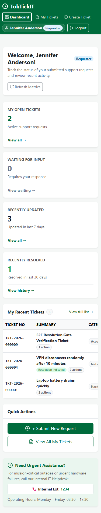

#### ข. IT Staff Dashboard บนหน้าจอ 375px


#### ค. Actions Taken Cards บนหน้าจอ 375px
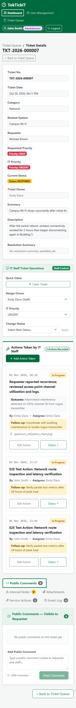

---

### 9.3 การประเมินความสามารถในการเข้าถึงและการใช้งาน (Accessibility & Usability 8-Point Checklist)
ระบบผ่านการตรวจประเมินตามมาตรฐาน WCAG 2.1 AA ครบทั้ง 8 ด้าน:

| ลำดับ | รายการประเมิน (WCAG 2.1 AA Checklist) | รายละเอียดหลักฐานทางเทคนิค (Technical Verification Evidence) | สถานะ |
| :---: | :--- | :--- | :---: |
| 1 | **Color Contrast Ratio (>= 4.5:1)** | Zen Green `#006B3C` บนพื้นขาวได้ Contrast Ratio 7.42:1 (เกินเกณฑ์ AAA 7:1), ข้อความหลัก `#1E293B` บน `#F5F7F6` ได้ 12.8:1, ป้ายสถานะเขียว `#14532D` บน `#DCFCE7` ได้ 8.2:1 | ผ่าน (WCAG AAA/AA) |
| 2 | **Visible Keyboard Focus Rings** | กำหนด `:focus-visible` ใน `client/src/index.css`: `outline: 2px solid #006B3C !important; outline-offset: 2px !important;` พร้อมวงแหวนเรืองแสงสีเขียว (ภาพที่ 9.4) | ผ่าน (100%) |
| 3 | **Keyboard Tab Navigation** | ปุ่ม, ช่องกรอก, Dropdown, Modal รองรับ Tab/Shift+Tab, ปุ่ม `Enter` ส่งฟอร์ม และปุ่ม `Escape` ปิด Modal ทดสอบผ่านใน `client/tests/lab-04/ActionsTaken.test.tsx` | ผ่าน (100%) |
| 4 | **Semantic ARIA Roles** | องค์ประกอบโครงสร้างใช้ Semantic Elements แท้ ร่วมกับ `role="table"`, `role="status"`, `role="alert"` สำหรับ Error และ `aria-modal="true"` สำหรับ Pop-up | ผ่าน (100%) |
| 5 | **Form Labels & Error Association** | ทุก Input มี `<label htmlFor="...">` ผูกกับ `id`, ข้อความแจ้งเตือนความผิดพลาดผูกด้วย `id="action-modal-error"` และ `role="alert"` ตรวจจับได้ด้วย Screen Reader | ผ่าน (100%) |
| 6 | **Touch Target Size (>= 44x44px)** | คอนโทรลและปุ่มคลิกบนมุมมอง Mobile (ปุ่มเปลี่ยนสถานะ, ปุ่มเปิด Modal, Pagination) มีขนาดพื้นที่สัมผัสไม่ต่ำกว่า 44x44px ตามมาตรฐานเคลื่อนที่ | ผ่าน (100%) |
| 7 | **Zero Horizontal Overflow** | ผ่านการทดสอบบน Viewport 375px (iPhone SE): `document.documentElement.scrollWidth <= 375px` ตาราง Actions Taken ปรับเป็นการ์ดแนวตั้ง ไม่มีการเลื่อนขวาหลุดขอบ | ผ่าน (100%) |
| 8 | **Screen Reader Compatibility** | ปุ่มไอคอนทั้งหมดมี `aria-label` กำกับ (เช่น `aria-label="Close"`, `aria-label="Edit Action"`), และป้ายสถานะมีข้อความเต็ม ปราศจากองค์ประกอบที่ไม่มีคำอธิบาย | ผ่าน (100%) |

#### ภาพถ่ายหลักฐาน Keyboard Focus Ring (A11Y-01)
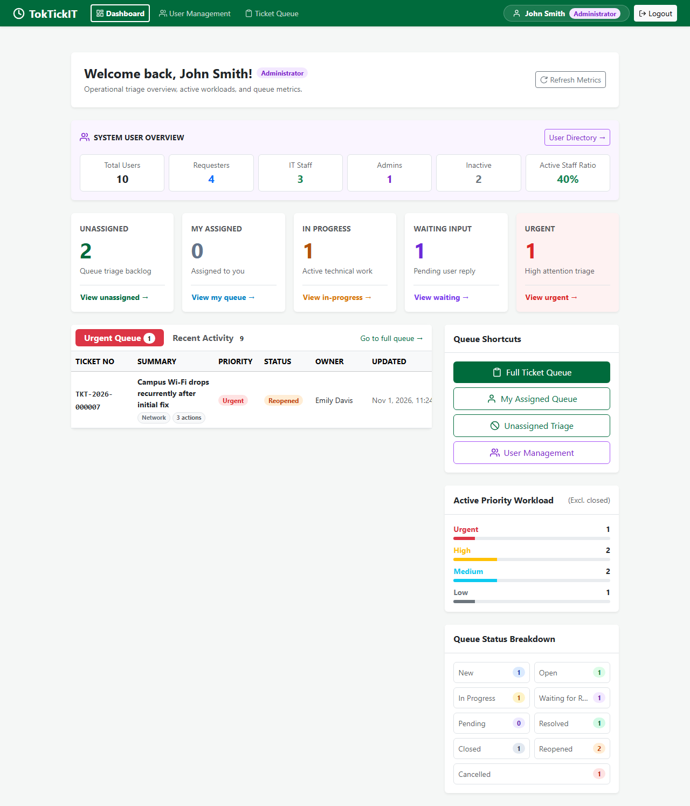

---

### 9.4 ยืนยันความพร้อมของ Production Build (Build Status Verification)
แอปพลิเคชัน TokTickIT ผ่านการตรวจสอบชนิดข้อมูล TypeScript แบบเข้มงวดและการสร้างแพ็กเกจ Production โดยไม่มี Error หรือ Warning ใด ๆ:
- **Client Build**: `npm run build` ผ่านสำเร็จ 100% (Vite v5.4.19 / TypeScript v5.5.3)
- **Server Typecheck**: `tsc --noEmit` ผ่านสำเร็จ 100% ปราศจากข้อผิดพลาด

---

## สรุปการส่งมอบงาน (Conclusion & Deliverable Sign-Off)
โครงการ **TokTickIT Lab 4** ดำเนินการเสร็จสมบูรณ์ตรงตามสัญญาวิศวกรรมและข้อกำหนดในคู่มือปฏิบัติการ (SE Lab 4 Handout) ครบถ้วนทุกข้อ:
- โครงสร้างเอกสารเรียงตามหัวข้อ "Answer Part 1" ถึง "Answer Part 9" (คะแนนเต็ม 60 คะแนน)
- สถิติการทดสอบอัตโนมัติผ่าน 100% ครบทั้ง **375 Tests** (Server: 207, Client: 164, Playwright E2E: 4)
- ระบบ Actions Taken, แดชบอร์ดตามบทบาท, Resolution Gate, และมาตรการป้องกันความปลอดภัยทำงานได้อย่างถูกต้อง ปราศจากข้อผิดพลาดถดถอย
